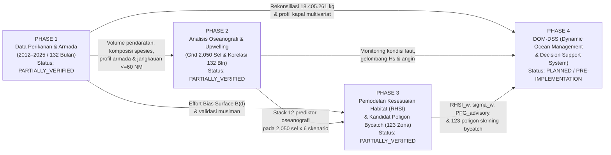

# 00 — EXECUTIVE PROJECT SUMMARY
## Sistem Intelijen Geospasial Perikanan Pelagis PPN Prigi — WPPNRI 573
### Comprehensive Project Context Extraction & Validation Package for Independent Phase 4 Audit

- **Tanggal Ekstraksi Audit:** 1 November 2026
- **Lokasi Workspace:** `C:\Users\ThinkPad\.gemini\antigravity\scratch\prigi-pelagis`
- **Mode Pemeriksaan:** Read-Only Forensic Audit (Tidak mengubah kode, database, konfigurasi, maupun dataset)
- **Status Kesiapan Phase 4 Aktual:** **PARTIALLY_VERIFIED / CONDITIONAL** (Memerlukan remediasi teknikal pada 10 diskrepansi kode/data sebelum klaim kesiapan penuh Phase 4)

---

## 1. IDENTITAS DAN GAMBARAN UMUM PROYEK

| Atribut Proyek | Detail Terverifikasi | Status Bukti | Referensi File Sumber |
|---|---|---|---|
| **Nama Proyek** | Sistem Intelijen Geospasial Perikanan Pelagis PPN Prigi — WPPNRI 573 (*PPN Prigi Pelagic Fisheries Spatial Intelligence & Dynamic Ocean Management Decision Support System / SEACAST PRIGI*) | `VERIFIED` | [`html/index.html`](file:///c:/Users/ThinkPad/.gemini/antigravity/scratch/prigi-pelagis/html/index.html#L6), [`app.py`](file:///c:/Users/ThinkPad/.gemini/antigravity/scratch/prigi-pelagis/app.py#L1-L26), [`PHASE_4_PRECONDITIONS_FINAL.md`](file:///c:/Users/ThinkPad/.gemini/antigravity/scratch/prigi-pelagis/PHASE_4_PRECONDITIONS_FINAL.md#L1-L15) |
| **Tujuan Penelitian & Pengembangan Sistem** | Mengintegrasikan rekonsiliasi statistik pendaratan ikan pelagis PPN Prigi (2012–2025), dinamika oseanografi multi-sensor (2015–2025), pemodelan kesesuaian habitat relatif (*Relative Habitat Suitability Index* / `RHSI`), skrining risiko keselamatan pelayaran maritim, dan skrining mitigasi tangkapan sampingan (*bycatch*) hiu ke dalam satu Sistem Pendukung Keputusan Akademik (*Academic Decision Support System*). | `VERIFIED` | [`SPATIAL_ANALYSIS_ROADMAP.md`](file:///c:/Users/ThinkPad/.gemini/antigravity/scratch/prigi-pelagis/SPATIAL_ANALYSIS_ROADMAP.md), [`PHASE_3_TECHNICAL_REPORT.md`](file:///c:/Users/ThinkPad/.gemini/antigravity/scratch/prigi-pelagis/PHASE_3_TECHNICAL_REPORT.md) |
| **Wilayah Studi Makro (Primary AOI)** | Wilayah Pengelolaan Perikanan Negara Republik Indonesia **WPPNRI 573** (Samudra Hindia Selatan Jawa hingga Nusa Tenggara; luas referensi dokumentasi $1.425.000\text{ km}^2$; bbox `[105.0°E–125.0°E, -16.0°S–-7.0°S]`). | `VERIFIED` | [`data/spatial_config_aoi.json`](file:///c:/Users/ThinkPad/.gemini/antigravity/scratch/prigi-pelagis/data/spatial_config_aoi.json#L12-L24), [`data/boundaries/wppnri_573_web.geojson`](file:///c:/Users/ThinkPad/.gemini/antigravity/scratch/prigi-pelagis/data/boundaries/wppnri_573_web.geojson) |
| **Sub-AOI Operasional (Sub-AOI Prigi)** | **Sub-AOI Prigi** (Perairan Selatan Jawa Timur di sekitar Pelabuhan Perikanan Nusantara Prigi, Trenggalek `-8.2818°S, 111.7314°E`): - Bujur: `111.00°E` hingga `113.00°E` - Lintang (Grid SDM/Bathy): `-8.00°S` hingga `-10.45°S` (50 baris $\times$ 41 kolom = `2.050` titik pusat grid pada resolusi $0.05^\circ$, luas elipsoidal WGS84 $59.550,43\text{ km}^2$ atau $4,18\%$ dari WPPNRI 573). - *Catatan Konflik:* 4 file metadata/kode masih mencantumkan batas selatan `-10.50°S`. | `CONFLICTING` (`-10.45°S` vs `-10.50°S`) | [`data/sdm/predictors/predictor_stack_metadata.json`](file:///c:/Users/ThinkPad/.gemini/antigravity/scratch/prigi-pelagis/data/sdm/predictors/predictor_stack_metadata.json#L8) (`-10.45°S`) vs [`data/spatial_config_aoi.json`](file:///c:/Users/ThinkPad/.gemini/antigravity/scratch/prigi-pelagis/data/spatial_config_aoi.json#L32) (`-10.50°S`) |
| **Target Spesies Pelagis** | **3 Spesies Utama Pemodelan SDM (Phase 3):** 1. Cakalang / Skipjack Tuna (*Katsuwonus pelamis*) 2. Madidihang / Yellowfin Tuna (*Thunnus albacares*) 3. Albakor / Albacore Tuna (*Thunnus alalunga*) **Taksa Indikator Bycatch:** Hiu Cucut Tikus / Requiem Sharks (*Carcharhinus spp.* / Elasmobranchii). **12 Taksa Statistik Pendaratan (Phase 1):** Cakalang, Madidihang, Albakor, Tongkol Lisong (*Auxis rochei*), Tongkol Krai (*Auxis thazard*), Tongkol Komo (*Euthynnus affinis*), Tuna Mata Besar (*Thunnus obesus*), Layang (*Decapterus spp.*), Lemuru (*Sardinella lemuru*), Kembung (*Rastrelliger spp.*), Tenggiri (*Scomberomorus commerson*), Setuhuk/Marlin (*Istiophoridae*). | `VERIFIED` | [`data/master_prigi_all_inclusive.csv`](file:///c:/Users/ThinkPad/.gemini/antigravity/scratch/prigi-pelagis/data/master_prigi_all_inclusive.csv#L1), [`models/sdm/ensemble/model_evaluations_summary.json`](file:///c:/Users/ThinkPad/.gemini/antigravity/scratch/prigi-pelagis/models/sdm/ensemble/model_evaluations_summary.json) |
| **Masalah Penelitian** | (1) Ketidaktersediaan koordinat penangkapan empiris (*vessel GPS / VMS / e-logbookhaul coordinates*) pada armada skala kecil-menengah PPN Prigi (didominasi kapal $<10\text{ GT}$ dan $10\text{–}30\text{ GT}$); (2) Fluktuasi hasil tangkapan musiman dan antar-tahunan akibat variabilitas Monsun-ENSO-IOD; (3) Risiko keselamatan pelayaran akibat gelombang tinggi Samudra Hindia; (4) Kerentanan tangkapan sampingan (*bycatch*) elasmobranchii (hiu *Carcharhinus spp.*) pada zona lereng benua (*shelf-break*). | `VERIFIED` | [`PHASE_4_PRECONDITIONS_FINAL.md`](file:///c:/Users/ThinkPad/.gemini/antigravity/scratch/prigi-pelagis/PHASE_4_PRECONDITIONS_FINAL.md#L18-L65), [`outputs/sdm/reports/sdm_methodology_report.md`](file:///c:/Users/ThinkPad/.gemini/antigravity/scratch/prigi-pelagis/outputs/sdm/reports/sdm_methodology_report.md) |

---

## 2. PENDEKATAN ILMIAH, GEOSPASIAL, DAN ARSITEKTUR SISTEM

### 2.1 Pendekatan Ilmiah (Scientific Approach)
1. **Rekonsiliasi & Standarisasi Perikanan (Phase 1):** Mengaudit 132 bulan data pendaratan bulanan (2015–2025) dan 14 tahun data armada/upaya tangkap (2012–2025) PPN Prigi, menghitung *Landing Per Unit Effort* (LPUE/CPUE nominal dan terstandarisasi terhadap komposisi alat tangkap), serta memodelkan surplus produksi Indikatif (Schaefer/Fox) dengan batasan ketat bahwa data satu pelabuhan tidak mewakili stok biologis seluruh WPPNRI 573.
2. **Karakterisasi Dinamika Oseanografi & Upwelling (Phase 2):** Mengekstrak deret waktu 132 bulan dan 6 skenario spasial untuk SST, Klorofil-a, gradien front termal Sobel ($^\circ\text{C/km}$), transpor massa Ekman ($M_{ey}$), kontras suhu pesisir-lepas pantai ($\Delta T_{\text{coast-offshore}}$), kecepatan angin, dan tinggi gelombang signifikan ($H_s$), serta menghitung korelasi lintas-waktu (*lagged Pearson correlation* lag 0–3 bulan) terhadap produksi pelagis.
3. **Pemodelan Kesesuaian Habitat Relatif Berbasis Proxy (Phase 3):** Karena tidak ada data koordinat GPS tangkapan empiris, sistem menggunakan pendekatan *Model-Derived Presence-Proxy* (menggabungkan *Effort Bias Surface* jarak jangkau armada $\leq 60\text{ NM}$ dengan amplop fisiologis lingkungan pada Musim Timur) dan menggabungkan tiga persamaan respons (*MaxEnt-like niche equation*, *Random Forest decision rules*, dan *GLM logistic equation*) ke dalam skor **Relative Habitat Suitability Index ($\overline{RHSI}_w$)** dan ketidaksepakatan ensemble ($\sigma_w$).
   - **Peringatan Ilmiah Kritis:** Pemeriksaan kode pada [`scratch/execute_stage_3_1_to_3_3.js`](file:///c:/Users/ThinkPad/.gemini/antigravity/scratch/prigi-pelagis/scratch/execute_stage_3_1_to_3_3.js#L294-L400) dan [`scratch/execute_stage_3_4_to_3_7.js`](file:///c:/Users/ThinkPad/.gemini/antigravity/scratch/prigi-pelagis/scratch/execute_stage_3_4_to_3_7.js#L56-L275) membuktikan bahwa titik *presence-proxy* dibentuk secara deterministik dari variabel prediktor yang sama (SST, Chl-a, Front, Depth) dan dievaluasi menggunakan persamaan analitik berparameter tetap (*hardcoded*) pada grid yang sama tanpa pemisahan data latih/uji (*train/test split*) atau *spatial block cross-validation*. Oleh karena itu, nilai AUC dan TSS merupakan **metrik konsistensi internal terhadap label heuristik (risiko sirkularitas tinggi)**, bukan validasi biologis independen.

### 2.2 Pendekatan Geospasial (Geospatial Approach)
- **Sistem Referensi Koordinat (CRS):** Penyimpanan data menggunakan `EPSG:4326` (WGS 84 Geografis). Metadata mencantumkan `EPSG:32749` (WGS 84 / UTM Zone 49S) untuk jarak metrik dan `EPSG:6933` / integral permukaan elipsoidal WGS84 untuk perhitungan luas ([`scratch/calc_sub_aoi_area.py`](file:///c:/Users/ThinkPad/.gemini/antigravity/scratch/prigi-pelagis/scratch/calc_sub_aoi_area.py)).
- **Struktur Grid:** Grid reguler $0.05^\circ \times 0.05^\circ$ ($\approx 5,55\text{ km}$) sebanyak `2.050` titik pusat sel (50 baris lintang `[-10.45°S, -8.00°S]` $\times$ 41 kolom bujur `[111.00°E, 113.00°E]`).
- **Format Penyimpanan Spasial:** Tidak menggunakan file GeoTIFF (`.tif`) atau NetCDF (`.nc`) di dalam workspace; seluruh raster oseanografi dan RHSI disimpan sebagai **array JSON terstruktur berbasis titik pusat sel (`cells: [{cell_id, lat, lon, ...}]`)**, sedangkan zona fungsional dan kandidat mitigasi bycatch disimpan sebagai **GeoJSON `FeatureCollection` poligon**.

### 2.3 Arsitektur Sistem & Teknologi
Workspace memiliki **dua antarmuka perangkat lunak yang terpisah** tanpa database relasional (RDBMS) maupun server REST API:
1. **Aplikasi Utama — Standalone Zero-CORS Web GIS Dashboard (`html/index.html`):**
   - Dibangun dengan HTML5, CSS3 (tema gelap *Oceanic Glassmorphism*), Vanilla JavaScript (ES6), **Leaflet.js v1.9.4**, **Chart.js**, dan **Plotly.js v2.27.0** lokal ([`html/plotly.min.js`](file:///c:/Users/ThinkPad/.gemini/antigravity/scratch/prigi-pelagis/html/plotly.min.js)).
   - Memuat data melalui dua file bundel JavaScript statis: [`html/oceanographic_data.js`](file:///c:/Users/ThinkPad/.gemini/antigravity/scratch/prigi-pelagis/html/oceanographic_data.js) (`window.OCEAN_DATA`, 346 KB) dan [`html/sdm_data.js`](file:///c:/Users/ThinkPad/.gemini/antigravity/scratch/prigi-pelagis/html/sdm_data.js) (`window.SDM_DATA`, 2,01 MB) agar dapat dibuka langsung via protokol `file://` di browser tanpa terkendala kebijakan CORS.
2. **Aplikasi Pendamping Legacy — Python Streamlit Multi-Page App (`app.py`, `utils.py`, `pages/1..7_*.py`):**
   - Dibangun dengan Python, `streamlit`, `pandas`, `numpy`, dan `plotly` ([`requirements.txt`](file:///c:/Users/ThinkPad/.gemini/antigravity/scratch/prigi-pelagis/requirements.txt)).
   - **Status Aktual:** Rusak sebagian (*fallback ke data dummy*) karena [`utils.py`](file:///c:/Users/ThinkPad/.gemini/antigravity/scratch/prigi-pelagis/utils.py#L78) mencari `data/master.csv` yang tidak ada di workspace.
3. **Pipeline Pemrosesan Data & Pemodelan (`scratch/*.js` dan `scratch/*.py`):**
   - Sebagian besar pemrosesan data spasial Phase 2–3 dan pembuatan bundel JS dijalankan menggunakan **Node.js (v24.19.0)** pada folder `scratch/`, sedangkan skrip verifikasi matematika dan geometri dijalankan menggunakan **Python (v3.14.7)**.

---

## 3. HUBUNGAN DAN STATUS ANTAR-PHASE (PHASE 1 – PHASE 4)

| Phase | Tujuan & Cakupan | Status Aktual | Output Utama yang Tersedia di Workspace | Temuan / Kendala Utama |
|---|---|---|---|---|
| **PHASE 1** | Pengumpulan, pembersihan, dan rekonsiliasi data produksi pelagis bulanan (2015–2025), komposisi spesies, profil armada (2012–2025), trip, dan kalender lunar di PPN Prigi. | `PARTIALLY_VERIFIED` | `data/master_prigi_all_inclusive.csv`, `FINAL_FISHERIES_RECONCILIATION.csv`, `data/prigi_fleet_trips_2012_2025.csv`, `data/prigi_elasmobranch_bycatch_records.csv` | Rekonsiliasi April 2022 (`198.246 kg`, total `18.405.261 kg`) baru ada di `FINAL_FISHERIES_RECONCILIATION.csv`, tetapi **belum diterapkan** ke `data/master_prigi_all_inclusive.csv` (`198.446 kg`, total `18.405.461 kg`) maupun ke `html/index.html`. |
| **PHASE 2** | Ekstraksi dan analisis parameter oseanografi (SST, Chl-a, Front Sobel, Ekman Transport, Kontras SST, Angin, Gelombang, Batimetri GEBCO) pada Sub-AOI Prigi (`2.050` sel) dan korelasi perikanan 132 bulan. | `PARTIALLY_VERIFIED` | `data/oceanographic/statistics/monthly/ocean_fisheries_master_132m.json`, 4 grid musiman di `data/oceanographic/processed/seasonal/`, `prigi_static_bathymetry_grid.json`, `html/oceanographic_data.js` | (1) 23 subdirektori di `data/oceanographic/{raw,processed,derived}` kosong; (2) Batas selatan tidak konsisten (`-10.5°S` vs `-10.45°S`); (3) `processing_manifest.json` menulis `2091` sel padahal aktual `2050` sel; (4) `ocean_fisheries_master_132m.json` masih memuat angka lama `18.405.461 kg`. |
| **PHASE 3** | Pemodelan kesesuaian habitat relatif (`RHSI`) 3 spesies tuna (MaxEnt, RF, GLM & Ensemble) pada 6 skenario iklim/musim serta delineasi zona fungsional dan 123 poligon mitigasi bycatch hiu. | `PARTIALLY_VERIFIED` | `data/sdm/predictors/predictor_stack_multi_scenario.json`, `models/sdm/ensemble/model_evaluations_summary.json`, `outputs/sdm/hsi/hsi_all_scenarios_projections.json`, 5 GeoJSON di `outputs/sdm/zones/`, `html/sdm_data.js` | (1) Titik presence merupakan proxy heuristik dengan sirkularitas terhadap prediktor; (2) `uncertainty` dihitung tanpa bobot (`/ 3`), bukan $\sigma_w$ berbobot; (3) `PFG_advisory`, `raw_advisory_score`, dan `visualization_score` belum ada di dataset; (4) 5 GeoJSON meluber $0.025^\circ$ keluar Sub-AOI; (5) Tab SDM di `html/index.html` gagal menginisialisasi peta `#sdmMap`. |
| **PHASE 4** | Integrasi ke dalam **Dynamic Ocean Management & Decision Support System (DOM-DSS)** (6 Modul: Provenance, Ocean Monitoring, PFG Advisory Screening, Maritime Risk Assessment, Shark Bycatch Mitigation Screening, Integrated Dashboard). | `DOCUMENTED` / `PLANNED` (Tahap Audit Phase 4.0 Selesai) | Dokumen prasyarat & kesiapan (`PHASE_4_PRECONDITIONS_FINAL.md`, `PHASE_4_READINESS_GATE.json`) serta dokumen audit Phase 4.0 (`PHASE_4_INITIAL_CODEBASE_AUDIT.md`, `PHASE_4_EXISTING_ASSET_INVENTORY.json`, `PHASE_4_IMPLEMENTATION_PLAN.md`). | Belum diimplementasikan ke dalam kode aplikasi. Klaim pada `PHASE_4_READINESS_GATE.json` bahwa matriks risiko 4-tier (`PG-06`) dan footer sitasi hukum (`PG-10`) sudah ada di `html/index.html` terbukti **tidak sesuai fakta kode**. |

---

## 4. DAFTAR ISI PAKET VALIDASI AUDITOR EKSTERNAL (`PHASE_4_VALIDATION_PACKAGE/`)

1. [`00_EXECUTIVE_PROJECT_SUMMARY.md`](file:///c:/Users/ThinkPad/.gemini/antigravity/scratch/prigi-pelagis/PHASE_4_VALIDATION_PACKAGE/00_EXECUTIVE_PROJECT_SUMMARY.md) — Ringkasan eksekutif proyek, tujuan, metodologi, arsitektur, dan status antar-phase.
2. [`01_PHASE_1_TO_3_TECHNICAL_SUMMARY.md`](file:///c:/Users/ThinkPad/.gemini/antigravity/scratch/prigi-pelagis/PHASE_4_VALIDATION_PACKAGE/01_PHASE_1_TO_3_TECHNICAL_SUMMARY.md) — Bedah teknis mendalam Phase 1, Phase 2, dan Phase 3 (termasuk pemeriksaan sirkularitas SDM dan persamaan analitik aktual).
3. [`02_DATASET_INVENTORY.csv`](file:///c:/Users/ThinkPad/.gemini/antigravity/scratch/prigi-pelagis/PHASE_4_VALIDATION_PACKAGE/02_DATASET_INVENTORY.csv) — Inventarisasi tabel seluruh dataset utama beserta provider, resolusi, CRS, kelengkapan metadata, dan status verifikasi.
4. [`03_MODEL_AND_SCRIPT_INVENTORY.md`](file:///c:/Users/ThinkPad/.gemini/antigravity/scratch/prigi-pelagis/PHASE_4_VALIDATION_PACKAGE/03_MODEL_AND_SCRIPT_INVENTORY.md) — Inventarisasi 35 skrip di `scratch/` dan modul aplikasi beserta ekstraksi rumus matematika aktual dari kode.
5. [`04_GEOSPATIAL_VALIDATION_SUMMARY.md`](file:///c:/Users/ThinkPad/.gemini/antigravity/scratch/prigi-pelagis/PHASE_4_VALIDATION_PACKAGE/04_GEOSPATIAL_VALIDATION_SUMMARY.md) — Hasil validasi geometri, topologi, CRS, resolusi, luas elipsoidal, dan temuan *overhang* $0.025^\circ$ di luar Sub-AOI Prigi.
6. [`05_PHASE_4_READINESS_AUDIT.md`](file:///c:/Users/ThinkPad/.gemini/antigravity/scratch/prigi-pelagis/PHASE_4_VALIDATION_PACKAGE/05_PHASE_4_READINESS_AUDIT.md) — Evaluasi independen atas 4 *Blocking Constraints*, 5 *Scientific Protocols*, dan 12 *Readiness Checks* (`PG-01` s/d `PG-12`).
7. [`06_SOFTWARE_ARCHITECTURE_INVENTORY.md`](file:///c:/Users/ThinkPad/.gemini/antigravity/scratch/prigi-pelagis/PHASE_4_VALIDATION_PACKAGE/06_SOFTWARE_ARCHITECTURE_INVENTORY.md) — Audit arsitektur frontend (`html/index.html` & Streamlit `app.py`), backend, penyimpanan data, API, dan fungsionalitas UI aktual.
8. [`07_PHASE_4_IMPLEMENTATION_GAP_ANALYSIS.md`](file:///c:/Users/ThinkPad/.gemini/antigravity/scratch/prigi-pelagis/PHASE_4_VALIDATION_PACKAGE/07_PHASE_4_IMPLEMENTATION_GAP_ANALYSIS.md) — Analisis kesenjangan implementasi untuk ke-6 modul Phase 4 DOM-DSS.
9. [`08_DATA_CONTRADICTION_REGISTER.md`](file:///c:/Users/ThinkPad/.gemini/antigravity/scratch/prigi-pelagis/PHASE_4_VALIDATION_PACKAGE/08_DATA_CONTRADICTION_REGISTER.md) — Register lengkap 15 kontradiksi antara dokumentasi, skrip, dataset, GeoJSON, dan dashboard.
10. [`09_VALIDATION_EVIDENCE_INDEX.json`](file:///c:/Users/ThinkPad/.gemini/antigravity/scratch/prigi-pelagis/PHASE_4_VALIDATION_PACKAGE/09_VALIDATION_EVIDENCE_INDEX.json) — Indeks bukti terstruktur (JSON) dengan referensi path file, fungsi, baris kode, dan status verifikasi.
11. [`10_EXTERNAL_AUDITOR_HANDOFF.md`](file:///c:/Users/ThinkPad/.gemini/antigravity/scratch/prigi-pelagis/PHASE_4_VALIDATION_PACKAGE/10_EXTERNAL_AUDITOR_HANDOFF.md) — Panduan pemeriksaan cepat (*handoff guide*) untuk auditor eksternal, daftar file prioritas, pertanyaan terbuka, dan rekomendasi tindak lanjut.

