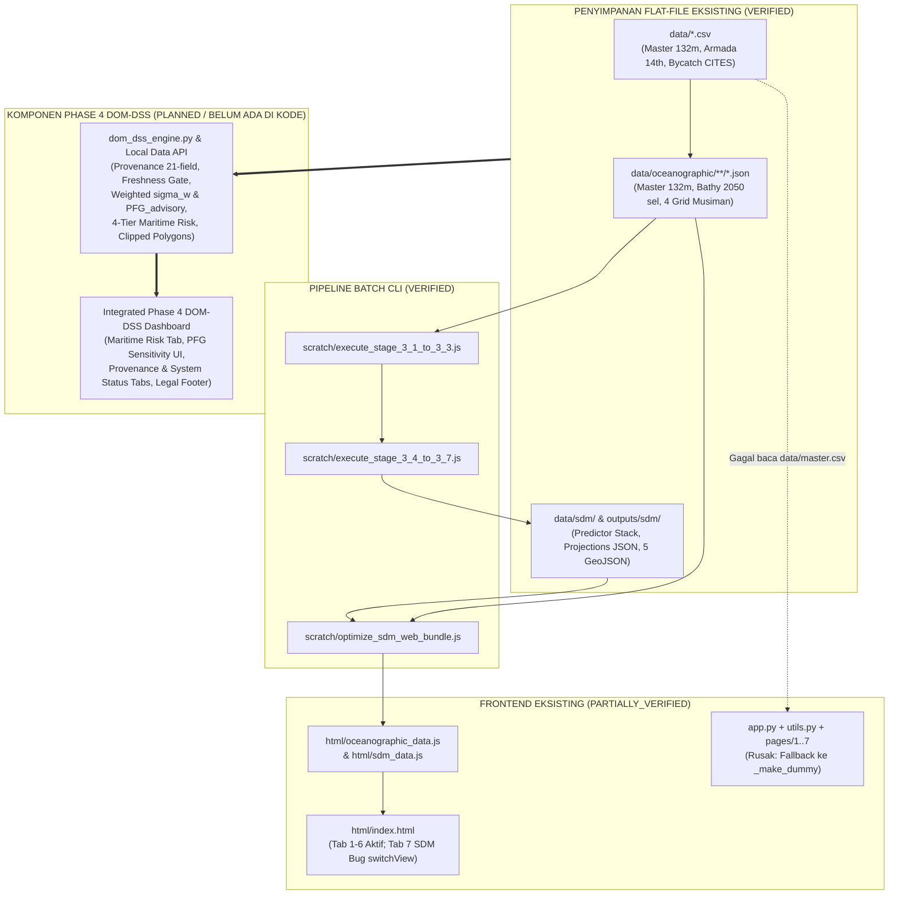

# 06 — SOFTWARE ARCHITECTURE & DASHBOARD FUNCTIONALITY INVENTORY
## Sistem Intelijen Geospasial Perikanan Pelagis PPN Prigi — WPPNRI 573

Dokumen ini menyajikan audit arsitektur perangkat lunak aktual di dalam workspace (`html/`, `app.py`, `utils.py`, `pages/`, `scratch/`) serta menginventarisasi endpoint API dan status fungsionalitas setiap komponen dashboard.

---

## 1. INVENTARISASI ARSITEKTUR PERANGKAT LUNAK (EXISTING VS PLANNED)

### 1.1 Frontend Architecture
Workspace memiliki **dua antarmuka frontend** yang dibangun pada tahap berbeda:

#### A. Frontend Utama (Phase 1–3): Standalone Web GIS Dashboard (`html/index.html`)
- **Framework:** Vanilla HTML5 + CSS3 (*Custom Oceanic Dark Glassmorphism Design System*) + Vanilla JavaScript (ES6). Tidak menggunakan React/Vue/Angular atau bundler Webpack/Vite.
- **Entry Point:** [`html/index.html`](file:///c:/Users/ThinkPad/.gemini/antigravity/scratch/prigi-pelagis/html/index.html) (327.030 byte, 2.109 baris kode).
- **Halaman / Tab Navigasi (`switchView(viewId)` di baris 1236–1254):**
  1. `view-overview` — *Ringkasan Eksekutif & Produksi 12 Spesies* (Aktif)
  2. `view-fleet` — *Profil Armada & Alat Tangkap (2012–2025)* (Aktif)
  3. `view-ocean` — *Spasial Oseanografi & Upwelling WPP 573* (Aktif, memanggil `initOceanMap()`)
  4. `view-cpue` — *Standarisasi Effort & Tren LPUE/CPUE* (Aktif)
  5. `view-calendar` — *Kalender Musim Penangkapan & Siklus Lunar* (Aktif)
  6. `view-stock` — *Indikator Eksploitasi Lokal & Konservasi Hiu* (Aktif)
  7. `view-sdm` — *Pemodelan Spasial Kesesuaian Habitat (Phase 3 SDM)* (**RUSAK SAAT DIKLIK:** Markup HTML `#view-sdm` ada di baris 985–1128 dan fungsi `initSdmMap()` / `renderSdmCharts()` ada di baris 1781 & 2008, tetapi **tidak pernah dipanggil** di dalam `switchView(viewId)`).
- **Map Library:** **Leaflet.js v1.9.4** (dimuat via CDN `unpkg.com/leaflet@1.9.4` di baris 10–11) dengan tile basemap *CartoDB Dark Matter* dan *Esri World Imagery*.
- **Chart Library:** **Chart.js** (CDN `cdn.jsdelivr.net/npm/chart.js` di baris 9) untuk grafik di Tab 1–6, dan **Plotly.js v2.27.0** lokal ([`html/plotly.min.js`](file:///c:/Users/ThinkPad/.gemini/antigravity/scratch/prigi-pelagis/html/plotly.min.js), 4,56 MB, dimuat di baris 12) untuk grafik kurva respons dan kepentingan variabel SDM.
- **Data Loading Pattern (Zero-CORS):** Memuat dua skrip lokal `` (`window.OCEAN_DATA`, 346 KB) dan `` (`window.SDM_DATA`, 2,01 MB) sehingga berjalan tanpa HTTP server.

#### B. Frontend Kedua (Prototipe Legacy): Python Streamlit Multi-Page App (`app.py` & `pages/`)
- **Framework:** **Streamlit** (`streamlit`, `pandas`, `numpy`, `plotly`).
- **Entry Point:** [`app.py`](file:///c:/Users/ThinkPad/.gemini/antigravity/scratch/prigi-pelagis/app.py) (64 baris) dengan modul utilitas [`utils.py`](file:///c:/Users/ThinkPad/.gemini/antigravity/scratch/prigi-pelagis/utils.py) (226 baris).
- **Dashboard Pages (`pages/`):**
  1. [`pages/1_Hasil_Tangkapan.py`](file:///c:/Users/ThinkPad/.gemini/antigravity/scratch/prigi-pelagis/pages/1_Hasil_Tangkapan.py)
  2. [`pages/2_Iklim_dan_Laut.py`](file:///c:/Users/ThinkPad/.gemini/antigravity/scratch/prigi-pelagis/pages/2_Iklim_dan_Laut.py)
  3. [`pages/3_Model_dan_Prediksi.py`](file:///c:/Users/ThinkPad/.gemini/antigravity/scratch/prigi-pelagis/pages/3_Model_dan_Prediksi.py)
  4. [`pages/4_Kalender_Musim.py`](file:///c:/Users/ThinkPad/.gemini/antigravity/scratch/prigi-pelagis/pages/4_Kalender_Musim.py)
  5. [`pages/5_Spesies_dan_Pengelolaan.py`](file:///c:/Users/ThinkPad/.gemini/antigravity/scratch/prigi-pelagis/pages/5_Spesies_dan_Pengelolaan.py)
  6. [`pages/6_Data_dan_Keterbatasan.py`](file:///c:/Users/ThinkPad/.gemini/antigravity/scratch/prigi-pelagis/pages/6_Data_dan_Keterbatasan.py)
  7. [`pages/7_Kontribusi_dan_Progres.py`](file:///c:/Users/ThinkPad/.gemini/antigravity/scratch/prigi-pelagis/pages/7_Kontribusi_dan_Progres.py)
- **Kondisi Aktual:** `load_master()` di [`utils.py`](file:///c:/Users/ThinkPad/.gemini/antigravity/scratch/prigi-pelagis/utils.py#L78-L85) mencari `data/master.csv` (tidak ada) dan `pages/5_Spesies_dan_Pengelolaan.py` mencari `species_traits.csv` (tidak ada), sehingga seluruh aplikasi Streamlit berjalan menggunakan generator angka acak sintetis `_make_dummy()` (`dummy = True`).

---

### 1.2 Backend Architecture
- **Bahasa Pemrograman:** Node.js (JavaScript CommonJS di `scratch/*.js`) dan Python (`app.py`, `utils.py`, `scratch/*.py`).
- **Framework Server / REST API:** **`NOT_FOUND`** — Tidak ada server backend (seperti FastAPI, Flask, Django, atau Express.js) yang berjalan di workspace. Seluruh pemrosesan dilakukan melalui skrip *batch CLI* di `scratch/`.
- **Modul Pemrosesan Batch:**
  - `scratch/execute_stage_3_1_to_3_3.js` (Standardisasi prediktor, Effort Bias Surface, Presence-Proxy, Background TGB)
  - `scratch/execute_stage_3_4_to_3_7.js` (Evaluasi model analitik MaxEnt/RF/GLM, Ensemble, Proyeksi 6 skenario, Zona fungsional)
  - `scratch/optimize_sdm_web_bundle.js` (Kompilator bundel `html/sdm_data.js`)
- **Autentikasi:** **`NOT_FOUND`** — Tidak ada mekanisme login, token JWT, sesi pengguna, atau kontrol akses berbasis peran (RBAC).

---

### 1.3 Database Architecture
- **DBMS:** **`NOT_FOUND`** — Tidak menggunakan PostgreSQL/PostGIS, MySQL, SQLite, atau MongoDB.
- **Penyimpanan Data Aktual:** Berbasis *Flat-File Repository* di sistem berkas lokal:
  - `data/*.csv` (Data statistik perikanan, armada, trip, kalender lunar, dan catatan CITES bycatch)
  - `data/oceanographic/**/*.json` & `.csv` (Statistik deret waktu 132 bulan, klimatologi, dan grid spasial `2.050` sel)
  - `data/sdm/**/*.json` & `.geojson` (Stack prediktor, bias surface, titik presence-proxy, titik background)
  - `models/sdm/ensemble/model_evaluations_summary.json` (Bobot dan evaluasi model)
  - `outputs/sdm/hsi/hsi_all_scenarios_projections.json` & `outputs/sdm/zones/*.geojson` (Output proyeksi dan poligon zona)
  - `html/oceanographic_data.js` & `html/sdm_data.js` (Bundel JSON-in-JS untuk frontend)

---

### 1.4 Infrastructure & Environment
- **Deployment Architecture:** Aplikasi lokal berbasis berkas statis (`html/index.html` dibuka langsung di browser) dan prototipe Streamlit lokal (`streamlit run app.py`).
- **Environment Configuration:**
  - Python 3.14.7 (`C:\Users\ThinkPad\AppData\Local\Python\bin\python.exe`)
  - Node.js v24.19.0 (`C:\Program Files\nodejs\node.exe`)
  - [`requirements.txt`](file:///c:/Users/ThinkPad/.gemini/antigravity/scratch/prigi-pelagis/requirements.txt): `streamlit`, `pandas`, `numpy`, `plotly` (43 byte).
- **External Services (Runtime):** Menggunakan CDN publik (`unpkg.com` untuk Leaflet, `cdn.jsdelivr.net` untuk Chart.js, `fonts.googleapis.com` untuk font Inter & JetBrains Mono, serta tile server CartoDB/Esri) saat `html/index.html` dibuka. Tidak ada koneksi API waktu-nyata ke server BMKG, NASA, atau Copernicus saat aplikasi berjalan.
- **Logging:** Tidak ada sistem logging terstruktur; hanya `console.log()` pada skrip CLI dan browser.

---

### 1.5 Diagram Arsitektur Sistem (Aktual vs Direncanakan untuk Phase 4)

---

## 2. INVENTARISASI ENDPOINT API DAN FUNGSIONALITAS DASHBOARD (SECTION 10)

### 2.1 Inventarisasi Endpoint API
Pemeriksaan kode di seluruh workspace mengonfirmasi bahwa **belum ada endpoint HTTP/REST API yang diimplementasikan**:

| Endpoint | Method | Function | Input | Output | Authentication | Test Evidence |
|---|---|---|---|---|---|---|
| `NONE (No HTTP/REST API exists in workspace)` | `N/A` | Aplikasi Web GIS memuat objek global `window.OCEAN_DATA` dan `window.SDM_DATA` dari file `.js` lokal; aplikasi Streamlit memanggil fungsi Python lokal `utils.load_master()`. | `N/A` | `N/A` | `None` | `VERIFIED` (`NOT_FOUND` untuk REST API; seluruh komunikasi data menggunakan pemuatan file statis lokal). |

---

### 2.2 Audit Fungsionalitas Dashboard (`html/index.html` & `app.py`)

Berikut adalah status verifikasi aktual untuk setiap fitur dashboard yang diminta pada Bagian 10 Master Prompt:

| Fitur Dashboard | Lokasi di Kode Aktual | Status Implementasi | Bukti Teknis & Catatan Audit |
|---|---|---|---|
| **1. Oceanographic Map** | [`html/index.html`](file:///c:/Users/ThinkPad/.gemini/antigravity/scratch/prigi-pelagis/html/index.html#L1502-L1650) (`initOceanMap()`, `renderOceanGrid()`) | **`Implemented and tested`** | Peta Leaflet `#oceanMap` di Tab 3 (`view-ocean`) merender `2.050` sel grid $0.05^\circ$ untuk 4 skenario (`musim_timur`, `musim_barat`, `extreme_2019_iod`, `extreme_2016_la_nina`) dan 4 variabel (`sst_celsius`, `chlor_a_mg_m3`, `thermal_front_sobel_c_km`, `depth_m`), dilengkapi kontur 200 m dan penanda PPN Prigi. *(Catatan: kotak Sub-AOI di baris 1582 masih memakai `-10.5` dan jarak 200 m di baris 1537 memakai rumus kasar).* |
| **2. Species Selector** | [`html/index.html`](file:///c:/Users/ThinkPad/.gemini/antigravity/scratch/prigi-pelagis/html/index.html#L472-L490) (Tab 1) & baris 1002 (`#sdmSpeciesSelect` di Tab 7) | **`Implemented and tested` (Tab 1) / `Implemented but not tested` (Tab 7 SDM)** | Pemilih spesies di Tab 1 berfungsi penuh untuk memfilter grafik 12 spesies. Pemilih `#sdmSpeciesSelect` (`cakalang`, `madidihang`, `albakor`) di Tab 7 memiliki fungsi `updateSdmDashboard()` (baris 1825), tetapi peta `#sdmMap` tidak terinisialisasi saat tab dibuka karena bug `switchView()`. |
| **3. Time / Scenario Selector** | [`html/index.html`](file:///c:/Users/ThinkPad/.gemini/antigravity/scratch/prigi-pelagis/html/index.html#L596-L612) (`#oceanScenarioSelect`) & baris 1011 (`#sdmScenarioSelect`) | **`Implemented and tested` (Skenario Musiman) / `Not available` (Slider Bulan Spesifik di Peta)** | Peta memiliki pemilih skenario musiman/iklim (4 skenario di Tab 3; 6 skenario di Tab 7), namun belum memiliki pemilih bulan spesifik (dari 132 bulan) untuk merender peta atau memeriksa validitas waktu. |
| **4. RHSI Visualization** | [`html/index.html`](file:///c:/Users/ThinkPad/.gemini/antigravity/scratch/prigi-pelagis/html/index.html#L1781-L1995) (`initSdmMap()`, `renderSdmGrid()`) | **`Implemented but not tested` (Terhalang Bug `switchView`)** | Kode rendering grid RHSI dan ketidakpastian (`uncertainty` tak-berbobot) sudah ditulis di `<script id="sdm-script">`, tetapi **tidak pernah terpanggil** ketika pengguna mengklik tab `view-sdm` karena `switchView('view-sdm')` tidak memanggil `initSdmMap()`. Selain itu, belum ada visualisasi $PFG_{\text{advisory}} = \overline{RHSI}_w - \lambda \sigma_w$ maupun pemisahan `raw_advisory_score` vs `visualization_score`. |
| **5. Risk Monitoring (Maritime Risk Assessment)** | `NOT_FOUND` di [`html/index.html`](file:///c:/Users/ThinkPad/.gemini/antigravity/scratch/prigi-pelagis/html/index.html) maupun [`app.py`](file:///c:/Users/ThinkPad/.gemini/antigravity/scratch/prigi-pelagis/app.py) | **`Planned` / `Not available`** | Walaupun [`PHASE_4_READINESS_GATE.json`](file:///c:/Users/ThinkPad/.gemini/antigravity/scratch/prigi-pelagis/PHASE_4_READINESS_GATE.json) (`PG-06`) mengklaim matriks risiko 4-tier sudah ada di `html/index.html` baris 1450–1550, pemeriksaan aktual membuktikan **fitur ini sama sekali belum ada di kode**. Hanya grafik deret waktu gelombang $H_s$ bulanan yang ada di Tab 3. |
| **6. Bycatch Polygon Visualization** | [`html/index.html`](file:///c:/Users/ThinkPad/.gemini/antigravity/scratch/prigi-pelagis/html/index.html#L1955-L1977) (`sdmBycatchLayer` di dalam `renderSdmGrid()`) | **`Implemented but not tested` (Dirender sebagai Titik, Bukan Poligon, & Terhalang Bug `switchView`)** | Di baris 1961, 123 zona bycatch dirender sebagai titik lingkaran `L.circleMarker([b.lat, b.lon])`, **bukan poligon**, tidak terinisialisasi saat tab diklik, dan popup-nya belum menampilkan ke-8 atribut taksonomi CITES (`2026-03-05`, `NEEDS_VERIFICATION`). |
| **7. Data Provenance Display** | [`html/index.html`](file:///c:/Users/ThinkPad/.gemini/antigravity/scratch/prigi-pelagis/html/index.html#L720-L760) (Tabel sumber dasar di Tab 3) & [`pages/6_Data_dan_Keterbatasan.py`](file:///c:/Users/ThinkPad/.gemini/antigravity/scratch/prigi-pelagis/pages/6_Data_dan_Keterbatasan.py) | **`UI only` (Parsial)** | Hanya menampilkan kartu statis nama satelit/reanalisis (MODIS, OISST, ERA5, GEBCO). Belum memiliki tabel provenance 21/16 field (waktu publikasi, waktu ingest, jendela validitas, status kesegaran/latensi, flag interpolasi). |
| **8. Metadata Display** | [`html/index.html`](file:///c:/Users/ThinkPad/.gemini/antigravity/scratch/prigi-pelagis/html/index.html#L1060-L1125) | **`UI only` (Parsial)** | Menampilkan ringkasan metrik AUC/TSS/bobot dan catatan metodologi, tetapi belum terhubung ke metadata provenance per layer dan masih memuat beberapa istilah lama (`CUI`, `EMPIRICAL PROOF`). |
| **9. Error Handling** | [`utils.py`](file:///c:/Users/ThinkPad/.gemini/antigravity/scratch/prigi-pelagis/utils.py#L78-L85) & [`html/index.html`](file:///c:/Users/ThinkPad/.gemini/antigravity/scratch/prigi-pelagis/html/index.html#L1826) | **`Implemented but not tested` (Berbahaya secara Ilmiah di `utils.py`)** | Di `html/index.html`, hanya ada `if (!window.SDM_DATA) return;`. Di `utils.py`, penanganan error saat `data/master.csv` gagal dibaca justru diam-diam membangkitkan data acak sintetis (`_make_dummy()`), yang berisiko menyesatkan pengguna jika tidak memperhatikan flag `dummy`. |
| **10. Loading State** | `NOT_FOUND` di [`html/index.html`](file:///c:/Users/ThinkPad/.gemini/antigravity/scratch/prigi-pelagis/html/index.html) | **`Not available`** | Tidak ada indikator pemuatan (*spinner/skeleton*) atau pemeriksaan kesiapan bundel data di `html/index.html`. |
| **11. Empty / Stale Data State** | `NOT_FOUND` di [`html/index.html`](file:///c:/Users/ThinkPad/.gemini/antigravity/scratch/prigi-pelagis/html/index.html) | **`Not available`** | Belum ada tampilan khusus ketika data kosong atau kedaluwarsa (`DATA KEDALUWARSA` / `STALE DATA` / `DATA UNAVAILABLE`). Sebaliknya, header `html/index.html` (baris 378–385) selalu menampilkan badge hijau berdenyut `"SEMUA DATA TERINTEGRASI (100%)"` dengan jam UTC hidup seolah-olah sistem terhubung ke umpan waktu-nyata. |

