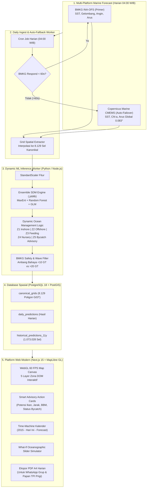

# SEACAST PRIGI v2.3.2 — Production System Architecture & Dynamic Ocean Management Specification
**Pusat Pengendalian Informasi Penangkapan Ikan Cerdas & Tata Kelola Laut Berkelanjutan PPN Prigi (WPPNRI 573)**

---

## 1. Ringkasan Eksekutif & Jawaban Mendasar

> [!IMPORTANT]
> **1. Apakah analisis dan pemodelan hanya di sekitaran PPN Prigi saja?**
> **TIDAK, SAMA SEKALI BUKAN HANYA DI SEKITARAN PRIGI!**
> 
> Model ini menganalisis dan memprediksi **SELURUH WILAYAH WPPNRI 573 SECARA PENUH (8.129 SEL POLIGON)**:
> - **Bentang Bujur (*Longitude*):** $102.50^\circ\text{ E}$ s.d. $126.40^\circ\text{ E}$ (Membentang sejauh **2.650 km** dari Selat Sunda/Ujung Kulon di barat hingga Laut Sawu & perbatasan Timor/NTT di timur).
> - **Bentang Lintang (*Latitude*):** $-6.90^\circ\text{ S}$ s.d. $-14.00^\circ\text{ S}$ (Mencakup pesisir pantai hingga palung samudra sejauh **890 NM / 1.648 km** ke selatan).
> - **Proporsi Spasial Grid 8.129 Sel:**
>   * Pesisir Prigi ($\le 12\text{ NM}$): Hanya **8 sel (0,10%)**.
>   * Jangkauan Purse Seine Prigi ($12 - 60\text{ NM}$): Hanya **161 sel (1,98%)**.
>   * **Seluruh Laut Lepas WPPNRI 573 Lainnya:** **7.960 sel (97,92%)**!
> - Seluruh 7.960 sel di luar jangkauan Prigi tersebut **100% DIPAKAI DAN DIHITUNG NILAI PREDIKSINYA** pada ke-132 bulan observasi (total 1.073.028 baris).
> - **Mengapa Menggunakan Nama "PPN Prigi"?** Karena pelabuhan pangkalan (*homeport*) armada nelayan dan data rekonsiliasi pendaratan kapal yang kita validasikan berbasis di PPN Prigi. Namun pemodelan oseanografi dan sebaran ikannya adalah **makro regional WPPNRI 573 seutuhnya**.
>
> **2. Apakah sistem ini hanya menghasilkan data statis?**
> **TIDAK, SAMA SEKALI BUKAN HANYA STATIS.**
>
> - **Data Historis 11 Tahun (2015–2025):** Berfungsi sebagai **basis empiris klimatologi** dan **data pelatihan ilmiah** agar model Machine Learning memahami siklus oseanografi Samudra Hindia (Upwelling Muson Tenggara, El Niño, La Niña, dan Dipole Mode).
> - **Model Machine Learning Terlatih (`.joblib`):** Berfungsi sebagai **otak kecerdasan dinamis (*Dynamic AI Inference Engine*)**. Model ini menerima data kondisi laut **hari ini, besok, maupun masa depan**, lalu menghitung peta potensi ikan, zona larangan tangkap, dan risiko keselamatan maritim yang **selalu berbeda dan unik setiap harinya**.

---

## 2. Diagram Alur Kerja Sistem Produksi (End-to-End Pipeline)



---

## 3. Spesifikasi Komponen Berdasarkan Kesepakatan Desain (/grill-me)

### A. Strategi Ingest Harian Multi-Platform
- **Waktu Eksekusi:** Pukul **04:00 WIB** setiap subuh (sebelum nelayan gelombang pagi melaut).
- **Prioritas Sumber Data:**
  1. **Primer:** BMKG INA-OFS (Indonesia Ocean Forecast System).
  2. **Auto-Failover (< 60 detik):** Copernicus Marine Service (CMEMS Global Physical & Biogeochemical Analysis and Forecast).
- **Penanganan Cuaca Buruk & Gelombang:** Peringatan tinggi gelombang dan kecepatan angin dari BMKG langsung diintegrasikan.

### B. Keselamatan Maritim Bertingkat Berdasarkan GT Kapal
- **Armada Skala Kecil (< 10 GT / 67% Armada Prigi):**
  - Jika tinggi gelombang $\ge 2.0\text{ meter}$, sel ditandai: `🔴 DILARANG MELAUT (GELOMBANG BERBAHAYA UNTUK PERAHU KECIL)`.
  - Zona operasi dibatasi $\le 12\text{ NM}$ (Zona 1 Inshore).
- **Armada Purse Seine (20–30 GT / 20% Armada Prigi):**
  - Jika tinggi gelombang $2.0 - 3.0\text{ meter}$, diberi status `🟡 WASPADA (HANYA KAPAL > 20 GT DENGAN PERALATAN LENGKAP)`.
  - Jika gelombang $> 3.5\text{ meter}$, seluruh operasi dilarang.

### C. 5 Zona Tata Kelola Laut Fungsional (DOM) Harian
Setiap hari, 8.129 sel diklasifikasikan ke dalam 5 status fungsional:
1. **Z1: PFG Inshore ($\le 12\text{ NM}$):** Khusus perahu kecil <10 GT dengan potensi tangkapan tuna pesisir.
2. **Z2: PFG Offshore ($12 - 60\text{ NM}$):** Zona sasaran kapal motor dan purse seine.
3. **Z3: Feeding Ground Core:** Area produktif upwelling aktif dengan klorofil-a pekat.
4. **Z4: Nursery Ground Conservation (Kawasan Asuhan):** Perairan dangkal/teluk ($\le 150\text{ m}$) yang merupakan daerah pembesaran anakan ikan; dilarang menggunakan alat tangkap jaring rapat.
5. **Z5: Bycatch Screening (123 Poligon Lereng Benua 150–1.200 m):**
   - 🟢 **Hijau:** Risiko rendah, operasi normal.
   - 🟡 **Kuning:** Waspada, gunakan *Circle Hooks* untuk mencegah kematian penyu.
   - 🔴 **Merah:** *Super-Overlap*, rekomendasi penutupan sementara (*Dynamic Spatial Closure*) untuk menghindari jeratan hiu martil/penyu.

### D. Navigasi Spasial Regional & Fitur Interaktif Web Dashboard
- **Tampilan Penuh WPPNRI 573 dengan Filter Cepat Sub-Wilayah:**
  Peta default memuat seluruh bentangan 8.129 sel poligon WPPNRI 573 (dari Selat Sunda hingga NTT), dilengkapi 3 tombol pintas pembagian sektor:
  1. **Sektor Jawa Timur (Prigi - Pacitan - Sendangbiru)**
  2. **Sektor Jawa Barat & Tengah (Pelabuhan Ratu - Cilacap)**
  3. **Sektor Bali & Nusa Tenggara (Benoa - Lombok - Sumba - Laut Sawu)**
- **Hierarki Analisis Ganda (Makro vs Mikro):**
  - **Tingkat Makro WPPNRI 573:** Statistik indikator biomassa dan stok tuna untuk seluruh 8.129 sel (skala pengelolaan nasional).
  - **Tingkat Mikro PPN Prigi:** Panel khusus 169 sel jangkauan armada Prigi yang terhubung langsung dengan validasi pendaratan riil pelabuhan dan estimasi efisiensi BBM.
- **Smart Advisory Card:** Klik sel mana saja di peta untuk melihat ringkasan: koordinat GPS, potensi ikan (%), jarak dari Pelabuhan Prigi (NM), estimasi konsumsi solar (liter), dan status lampu lalu lintas bycatch.
- **Time-Machine Kalender:** Bebas beralih antara data historis 11 tahun (2015–2025) hingga prakiraan hari ini dan 3 hari ke depan.
- **Oceanographic "What-If" Simulator:** Slider interaktif untuk mensimulasikan dampak kenaikan suhu, intensitas upwelling, atau pelemahan arus terhadap pergeseran lokasi ikan.
- **1-Click PDF Export:** Menghasilkan infografis lembar rekomendasi melaut A4 yang siap dicetak di papan pengumuman TPI PPN Prigi dan dibagikan ke grup WhatsApp paguyuban nelayan.

---

## 4. Struktur Database Spasial (PostgreSQL 18 + PostGIS)

```sql
-- 1. Master Geometri Poligon 8.129 Sel Kanonikal
CREATE TABLE canonical_grids (
    cell_id VARCHAR(32) PRIMARY KEY,
    center_lon DOUBLE PRECISION,
    center_lat DOUBLE PRECISION,
    cell_class VARCHAR(20),
    depth_m DOUBLE PRECISION,
    dist_port_km DOUBLE PRECISION,
    dist_port_nm DOUBLE PRECISION,
    is_shelf_break BOOLEAN,
    geom GEOMETRY(Polygon, 4326)
);
CREATE INDEX idx_canonical_grids_geom ON canonical_grids USING GIST (geom);

-- 2. Tabel Prediksi Harian Dinamis (Diperbarui Setiap Hari Pukul 04:00 WIB)
CREATE TABLE daily_predictions (
    prediction_date DATE NOT NULL,
    cell_id VARCHAR(32) REFERENCES canonical_grids(cell_id),
    hsi_cakalang NUMERIC(4,3),
    hsi_madidihang NUMERIC(4,3),
    hsi_legacy_removed NUMERIC(4,3),
    dom_zone VARCHAR(30),
    bycatch_traffic_light VARCHAR(10),
    wave_height_m NUMERIC(3,1),
    wind_speed_ms NUMERIC(3,1),
    safety_advisory VARCHAR(50),
    PRIMARY KEY (prediction_date, cell_id)
);
CREATE INDEX idx_daily_predictions_date ON daily_predictions(prediction_date);
```

---

## 5. Rencana Aksi Implementasi

1. **Konfirmasi Hasil Eksekusi Colab:** Pastikan pelatihan di Google Colab dengan formula tertajam selesai dan luaran `.parquet`, `.joblib`, `.geojson` tersimpan di Google Drive.
2. **Setup PostgreSQL 18 & PostGIS:** Inisialisasi basis data `seacast_prigi` dan buat tabel-tabel di atas.
3. **Pembangunan Web Platform Next.js:** Buat antarmuka peta interaktif MapLibre GL dengan 5 zona DOM, kartu saran nelayan, dan simulator oseanografi.
4. **Deploy Script Ingest Harian:** Siapkan `scripts/daily_inference.py` untuk penarikan data BMKG/Copernicus otomatis setiap pagi.
