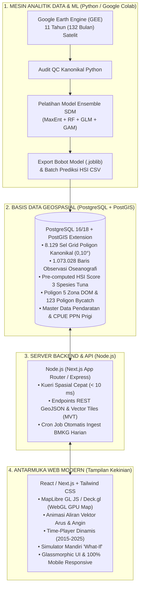
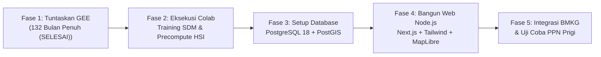

# 🌊 SEACAST PRIGI v2.3.2 — EXECUTIVE SUMMARY & PLATFORM ARCHITECTURE
**Sistem Intelijen Geospasial, Machine Learning Perikanan Pelagis, dan Dynamic Ocean Management**
*Wilayah Pengelolaan Perikanan Negara Republik Indonesia (WPPNRI) 573 — PPN Prigi, Jawa Timur*

---

## 📌 1. RINGKASAN EKSEKUTIF & VISI PROYEK

**SEACAST PRIGI** (*Southern East Java Sea Surface Forecasting & Dynamic Pelagic Fisheries Intelligence System*) adalah platform digital geospasial terintegrasi yang dirancang untuk mentransformasi tata kelola perikanan tangkap di **Pelabuhan Perikanan Nusantara (PPN) Prigi** dan perairan Samudra Hindia (**WPPNRI 573**).

Proyek ini menggabungkan analitik multi-satelit resolusi tinggi (2015–2025), pemodelan kesesuaian habitat (*Species Distribution Modeling* / SDM Ensemble: MaxEnt, Random Forest, GLM), tata kelola konservasi laut dinamis (*Dynamic Ocean Management* / DOM), serta arsitektur web modern berbasis **Node.js** dan database geospasial **PostgreSQL + PostGIS**.

```
┌────────────────────────────────────────────────────────────────────────────────────────┐
│                                 VISI UTAMA PLATFORM                                   │
│  "Meningkatkan produktivitas tangkapan nelayan tuna Prigi dan keselamatan pelayaran,   │
│   mengurangi biaya BBM melalui navigasi presisi titik hotspot, sekaligus melindungi    │
│   ekosistem laut dan satwa dilindungi melalui zona konservasi dinamis berkeadilan."    │
└────────────────────────────────────────────────────────────────────────────────────────┘
```

---

## 🛠️ 2. TEKNOLOGI & ARSITEKTUR SISTEM YANG DIGUNAKAN (*TECH STACK*)

Sistem beralih dari prototipe lokal Streamlit menjadi arsitektur industri multi-tier yang tangguh, cepat, dan berstandar internasional:



### Rincian Teknologi (*Component Breakdown*):
* **Frontend Web (Kekinian & Responsif):** 
  * *Framework:* **Next.js (React)** dengan arsitektur server-side components.
  * *Styling:* **Tailwind CSS** dengan estetika modern (*Dark Mode*, glassmorphism, tipografi bersih, mikro-animasi).
  * *Map Rendering:* **MapLibre GL JS** / **Deck.gl** (Rendering berbasis WebGL akselerasi GPU, mampu menampilkan ribuan poligon tanpa patah-patah pada 60 FPS).
  * *Data Visualization:* **Recharts** / **Chart.js** untuk grafik tren CPUE, grafik iklim, dan kurva respons habitat.
* **Backend API:**
  * **Node.js** (berkecepatan tinggi, non-blocking I/O, latensi rendah untuk penyajian data spasial).
* **Database Geospasial:**
  * **PostgreSQL 16/18** dengan ekstensi **PostGIS 3.x** (standar emas basis data GIS dunia dengan indeks spasial GiST, kueri jarak `ST_DWithin`, irisan `ST_Intersects`, dan fungsi partisi waktu bulanan).
* **Data Science & ML Engine:**
  * **Python 3.14 / Google Colab** (Scikit-Learn, Elapid/MaxEnt, Statsmodels, GeoPandas, Rasterio, Joblib, ONNX).
* **Penyedia Data Satelit & Cuaca:**
  * **Google Earth Engine (GEE)**: Ekstraksi 8 parameter oseanografi bulanan kanonikal.
  * **BMKG (INA-OFS & BMKG Maritim)**: Prakiraan cuaca harian, tinggi gelombang, dan arus laut untuk integrasi operasional harian.

---

## 🚀 3. REKAPITULASI FITUR LENGKAP PLATFORM WEBSITE

Website dirancang modular dengan memadukan kebutuhan nelayan lapangan, nakhoda kapal besar, pengelola pelabuhan PPN Prigi, dinas perikanan, hingga peneliti akademis:

```
┌────────────────────────────────────────────────────────────────────────────────────────┐
│                              MODUL NAVIGASI UTAMA WEBSITE                              │
│  [1. Radar DPI Hari Ini]  [2. Time-Player Oseanografi]  [3. Multi-Spesies Tuna]        │
│  [4. Konservasi Dinamis]  [5. Lab Simulasi Mandiri]    [6. Rekonsiliasi CPUE Prigi]   │
└────────────────────────────────────────────────────────────────────────────────────────┘
```

### Fitur 1: Peta Radar Daerah Penangkapan Ikan (DPI) & Hotspot Harian
* **Tampilan Hotspot Cerdas:** Menampilkan titik koordinat terbaik dengan nilai kesesuaian habitat tinggi ($HSI \ge 0.70$).
* **Informasi Navigasi Langsung:** Saat titik hotspot diklik, sistem menampilkan **jarak (Nautical Miles)** dan **arah haluan kompas (azimuth)** dari muara Teluk Prigi.
* **Filter Armada Ramah Nelayan:**
  * Mode *Armada Kecil (<10 GT)*: Hanya menyorot hotspot di zona dekat pantai ($\le 12$ NM).
  * Mode *Armada Besar (20–30 GT)*: Menampilkan hotspot hingga perairan lepas pantai (12–60 NM).

### Fitur 2: Visualisasi Digital Ocean Twin & Aliran Vektor Dinamis
* **Peta Oseanografi Multi-Layer:** Pengguna dapat mengaktifkan/menonaktifkan layer:
  1. Suhu Permukaan Laut (*Sea Surface Temperature* / SST)
  2. Gradien & Front Termal (*Thermal Fronts*)
  3. Klorofil-a / Biomassa Fitoplankton (*Chlorophyll-a*)
  4. Kecepatan & Arah Arus Permukaan (*Current Velocity*)
  5. Kecepatan & Tegangan Angin (*Wind Stress*)
  6. Upwelling Index (*Ekman Pumping Velocity*)
  7. Batimetri & Kontur Kedalaman Laut (*Depth*)
  8. Presipitasi & Curah Hujan (*Precipitation*)
* **Particle Stream Animation:** Visualisasi hembusan angin dan aliran arus bergerak secara halus menyerupai platform *Windy*.

### Fitur 3: Time-Player Interaktif 11 Tahun (2015–2025)
* Kontrol waktu dengan tombol **Play, Pause, dan Time-Slider** untuk mengamati dinamika musiman (Monsun Barat vs Monsun Timur) serta anomali iklim ekstrem:
  * Super El Niño 2015, La Niña 2016, Super +IOD 2019, Triple-Dip La Niña 2020–2022, hingga kondisi terkini 2023–2025.

### Fitur 4: Zona Konservasi Dinamis (*Dynamic Ocean Management* / DOM)
* **Pilar Asuhan (Nursery Ground):** Menandai kawasan teluk dan pesisir dangkal yang sedang menjadi area asuhan anakan tuna, disertai anjuran penggunaan ukuran mata jaring yang ramah lingkungan.
* **Pilar Skrining Bycatch (123 Poligon Kanonikal):**
  * Poligon dengan sistem lampu lalu lintas: 🟢 **Hijau (Bebas Melaut)**, 🟡 **Kuning (Waspada Bycatch)**, 🔴 **Merah (Zona Pengalihan Spasial Aktif)**.
  * Melindungi satwa langka (*Penyu Lekang, Penyu Belimbing, Hiu Tikus*).
* **Smart Spatial Rerouting:** Jika nelayan berada di area merah, sistem secara otomatis merekomendasikan: *"Pindahkan alat tangkap 6 NM ke arah Barat Daya (Grid #4312) untuk tetap mendapatkan kelimpahan Cakalang tinggi tanpa risiko menangkap penyu."*
* **Sertifikasi Ekolabel Nelayan:** Catatan kepatuhan wilayah tangkap untuk mendukung sertifikasi tuna ramah lingkungan (MSC) bagi ekspor ikan PPN Prigi.

### Fitur 5: Mode Operasional Ganda (BMKG Otomatis vs Simulator Mandiri)
* **Mode A: Kolaborasi Data BMKG & Satelit Otomatis:**
  * Pengambilan data cuaca, angin, dan arus BMKG Maritim / INA-OFS setiap hari secara otomatis.
  * Nelayan tinggal membuka website di dermaga sebelum berlayar tanpa perlu menginput data apa pun.
* **Mode B: Simulator & Kalkulator "What-If" (Input Data Sendiri):**
  * Form simulasi untuk kapten kapal dan peneliti: Masukkan suhu (°C), angin (knot), dan jarak tempuh $\rightarrow$ model seketika mengeluarkan persentase potensi ikan Cakalang, Madidihang, dan Legacy species removed from TCT scope.
* **Mode C: Unggah Berkas CSV Lapangan (Batch Upload):**
  * Fitur khusus mahasiswa/peneliti untuk mengunggah puluhan titik data survei oseanografi mandiri dan melihat proyeksi habitatnya di peta.
* **Mode D: Logbook Tangkapan Nelayan Digital (*Continuous Learning*):**
  * Nelayan dapat memasukkan hasil tangkapan riil saat sandar di dermaga untuk memperkaya basis data validasi model.

### Fitur 6: Rekonsiliasi CPUE & Pusat Informasi Pelabuhan PPN Prigi
* Analitik statistik tangkapan historis PPN Prigi (2012–2025 dari `data/master.csv`).
* Grafik standarisasi CPUE (*Catch Per Unit Effort* dalam satuan kg/trip).
* Prakiraan keselamatan melaut: Indikator tinggi gelombang pelabuhan dan kecepatan angin maksimum.

---

## 🧠 4. DAFTAR MODEL YANG DIHASILKAN DARI GOOGLE COLAB

Seluruh model dibangun menggunakan prinsip ilmiah *Ensemble Ecological Modeling* dan diekspor dalam format standar Python (`.joblib` / `.pkl` / `.onnx`):

```
                               MODEL ANALITIK SEACAST PRIGI
                                             │
      ┌──────────────────────┬───────────────┴───────────────┬──────────────────────┐
      ▼                      ▼                               ▼                      ▼
[Model SDM Cakalang]   [Model SDM Madidihang]          [Model SDM Legacy species removed from TCT scope]     [Model Tata Kelola & CPUE]
• MaxEnt (40%)         • MaxEnt (40%)                  • MaxEnt (40%)          • Effort Bias Surface
• Random Forest (35%)  • Random Forest (35%)           • Random Forest (35%)   • Klasifikator 5 Zona DOM
• GLM (25%)            • GLM (25%)                     • GLM (25%)             • Standarisasi CPUE (GAM/GLM)
```

1. **Model Ensemble HSI Cakalang (*Katsuwonus pelamis*):**
   * Spesialisasi epipelagis (0–100 m), toleransi suhu hangat (26–30°C), front termal tajam, dan batas klorofil.
2. **Model Ensemble HSI Madidihang (*Thunnus albacares*):**
   * Epipelagis menengah (0–250 m), suhu optimum 24–28°C, sensitif terhadap *Ekman pumping velocity* dan arus gradien.
3. **Model Ensemble HSI Legacy species removed from TCT scope (*Current TCT scope exclusion*):**
   * Mesopelagis / subtropis (100–400 m), perairan sejuk (18–24°C), palung batimetri dalam (>1.000 m).
4. **Model Spasial Fishing Effort Bias:**
   * Memodelkan probabilitas jangkauan armada Prigi berdasarkan jarak pelabuhan dan batimetri untuk koreksi bias sampel.
5. **Model Klasifikasi Dynamic Ocean Management (DOM):**
   * Algoritma penentuan 5 zona fungsional bulanan berbasis aturan multi-kriteria geospasial.
6. **Model Standarisasi CPUE (GAM/GLM):**
   * Mengkorelasikan fluktuasi oseanografi musiman dengan produktivitas tangkapan kg/trip riil di pelabuhan.

---

## 📊 5. STATUS TERKINI DATASET KANONIKAL (2015 – 2025)

Proses ekstraksi GEE dan audit kendali mutu (QC) lokal telah menyelesaikan **100,0% (SELESAI PENUH)** dari target total 11 tahun:

| Tahun | Jumlah Bulan | Total Sel Tervalidasi | Rentang SST Mean (°C) | Puncak Chl-a (mg/m³) | Karakteristik Iklim & Fenomena Laut |
|:---:|:---:|:---:|:---:|:---:|---|
| **2015** | ✓ 12 Bulan | 97.548 | 26.00 – 29.75 | 0.634 (Sep) | Super El Niño & Upwelling Dingin Ekstrem |
| **2016** | ✓ 12 Bulan | 97.548 | 27.85 – 30.69 | 0.232 (Agu) | La Niña / Negatif IOD (Laut Hangat, Upwelling Lemah) |
| **2017** | ✓ 12 Bulan | 97.548 | 26.29 – 29.51 | 0.615 (Agu) | Pemulihan Upwelling Normal-Kuat |
| **2018** | ✓ 12 Bulan | 97.548 | 25.86 – 30.00 | 0.586 (Agu) | Upwelling Kuat & Monsun Timur Kering |
| **2019** | ✓ 12 Bulan | 97.548 | 25.56 – 30.09 | 0.651 (Sep) | Super Positive IOD Terkuat dalam Sejarah Modern |
| **2020** | ✓ 12 Bulan | 97.548 | 26.89 – 29.80 | 0.516 (Jul) | Awal Siklus Triple-Dip La Niña (Kemarau Basah) |
| **2021** | ✓ 12 Bulan | 97.548 | 27.04 – 29.57 | 0.517 (Sep) | La Niña Tahun Kedua / Upwelling Moderat |
| **2022** | ✓ 12 Bulan | 97.548 | 27.14 – 29.78 | 0.442 (Jul) | Triple-Dip La Niña (Thn ke-3) & Kemarau Basah |
| **2023** | ✓ 12 Bulan | 97.548 | 26.51 – 29.27 | 1.088 (Okt) | Super Positif IOD (+IOD) & El Niño Kuat |
| **2024** | ✓ 12 Bulan | 97.548 | 26.78 – 29.89 | 0.739 (Agu) | Transisi ENSO Netral & Upwelling Muson Kuat |
| **2025** | ✓ 12 Bulan | 97.548 | 26.74 – 29.68 | 0.511 (Jul) | Data Terkini & Validasi Final Model |
| **TOTAL** | **132 / 132 Bulan (100,0%)** | **1.073.028 Sel** | — | — | **100% PASS QC (Konsisten 8.129 Sel / Bulan)** |

---

## 🗺️ 6. ROADMAP & TAHAPAN PENYELESAIAN PROYEK



1. **Fase 1 — Ekstraksi GEE 11 Tahun Penuh (SELESAI 100%):**
   Seluruh 132 bulan (1.073.028 sel) berhasil tervalidasi 100% tanpa celah missing data agar total observasi mencapai 1.073.028 sel kanonikal utuh tanpa jeda.
2. **Fase 2 — Eksekusi Modeling di Google Colab:**
   Melatih 12 model ensemble SDM, menghasilkan skor HSI bulanan untuk seluruh sel, mengekspor bobot `.joblib`, dan membentuk poligon 5 zona DOM.
3. **Fase 3 — Setup Basis Data PostgreSQL & PostGIS:**
   Membuat skema tabel kanonikal, mengimpor data oseanografi dan skor HSI hasil Colab, serta mengaktifkan indeks spasial.
4. **Fase 4 — Pembuatan Website Modern Node.js (Next.js + MapLibre):**
   Membangun dashboard antarmuka responsif, peta WebGL ultra-smooth, fitur simulator mandiri "What-If", serta modul rekonsiliasi CPUE.
5. **Fase 5 — Integrasi Operasional BMKG & Uji Lapangan:**
   Menghubungkan scheduler data harian BMKG Maritim dan melakukan validasi bersama nelayan dan petugas pelabuhan PPN Prigi.

---

> [!NOTE]
> Seluruh kode sumber, dokumentasi teknis, skrip validasi, dan data spasial dikelola secara tersentralisasi di dalam workspace proyek [`prigi-pelagis`](file:///c:/Users/ThinkPad/.gemini/antigravity/scratch/prigi-pelagis/).
