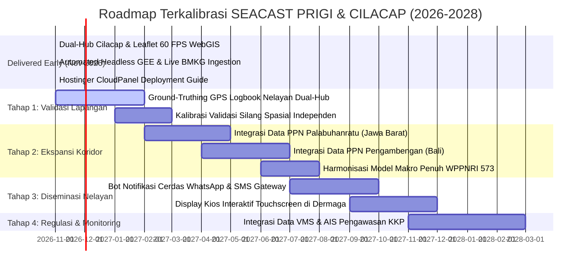

# SEACAST PRIGI & CILACAP V3 — DEVELOPMENT ROADMAP
## PETA JALAN PENGEMBANGAN BERKELANJUTAN & PENELITIAN TAHAP LANJUT (2026–2028)

**Dokumen ID:** SEACAST-DOC-ROADMAP-V3  
**Status Evaluasi:** Terkalibrasi Ulang Berdasarkan Pencapaian Nyata per 13 November 2026  
**Fokus Roadmap:** Ground-Truthing Lapangan, Ekspansi PPN Palabuhanratu & Pengambengan, Diseminasi Nelayan WhatsApp & Anjungan TPI  
**Target Rilis:** v3.2 (Dual-Hub Production) s.d. v4.0 (Autonomous Maritime Dissemination)  
**Tanggal Penyusunan:** 13 November 2026 (Diperbarui dari Baseline 4 November 2026)  
**Penyusun:** Principal Technical Architect, Marine Fisheries Oceanographer & Lead Spatial Engineer  

---

## 1. PRINSIP STRATEGIS PENGEMBANGAN

Pengembangan berkelanjutan platform **SEACAST** berpegang teguh pada empat pilar integritas:
1. **Evidence-Based Ground-Truthing:** Setiap pemutakhiran model machine learning wajib didasarkan pada data tangkapan aktual di laut (*in-situ field verification*), bukan sekadar penyesuaian parameter simulasi.
2. **Kedaulatan & Keamanan Data:** Pengelolaan data perikanan sensitif (posisi kapal dan koordinat penangkapan nelayan) dilindungi dengan enkripsi dan kontrol akses berjenjang.
3. **Kesederhanaan Pengguna Akhir (*User-Centric & Inclusive Design*):** Rekomendasi teknologi tinggi harus dapat diakses dan dipahami dengan mudah oleh nelayan tradisional melalui media harian mereka (WhatsApp bot, display layar sentuh TPI, lembar cetak A4).
4. **Keberlanjutan Ekologis (Sustainability First):** Peluang penangkapan ikan ekonomis tidak boleh mengorbankan zona asuhan benih (*Z4 Nursery Ground*) atau keselamatan megafauna laut dilindungi (*Z5 Bycatch Mitigation*).

---

## 2. REKAPITULASI PENCAPAIAN DINI (DELIVERED EARLY — NOVEMBER 2026)

Dua tonggak pencapaian besar yang semula dijadwalkan untuk tahun 2027 telah **berhasil diselesaikan lebih awal pada November 2026**:

| Milestone Target Awal | Jadwal Semula | Tanggal Selesai Aktual | Hasil Rekayasa yang Telah Operasional |
|---|---|---|---|
| **Ekspansi Multi-Pelabuhan (Simpul Cilacap)** | Q1–Q3 2027 | **10 November 2026** | **Koridor Dual-Hub PPN Prigi & PPS Cilacap**: Seeder 132 bulan pendaratan Cilacap, kalkulasi Haversine dinamis, cincin jangkauan (12/30/60 NM), camera flyTo. |
| **Integrasi Live Data BMKG Maritim** | Q3–Q4 2027 | **11 November 2026** | **Live Ingestion Open Endpoints**: Penarikan langsung cuaca maritim real-time dari `XO026`, `XM001`, `M.12`, `M.10` via `BmkgMaritimService.php`. |
| **Otomatisasi Ekstraksi Headless GEE** | Q3–Q4 2027 | **12 November 2026** | **Automated Headless Extractor**: Skrip `scripts/gee_daily_extractor.py` mengekstrak 8.129 sel dalam 11,3s via partisi bujur $114.5^\circ\text{ E}$, latensi dinamis $T-2$/$T-3$, komposit median 8-hari Chl-a. |
| **Orkestrasi Harian Terpadu** | Q3–Q4 2027 | **12 November 2026** | **Artisan Command `seacast:sync-live`**: Eksekusi otomatis BMKG + GEE + scikit-learn + PostGIS + Cache invalidation pada pukul 04:00 WIB via scheduler Laravel. |
| **Engine WebGIS 60 FPS & Scrubber** | Q4 2026 | **10 November 2026** | **Leaflet Ocean Streamlines**: Canvas transparan di `currentsPane` (`z-index: 450`), clipping pantai `getSouthCoastLat()`, scrubber 13 bulan sub-50ms. |
| **Kesiapan CloudPanel Deploy** | Q1 2027 | **10 November 2026** | **Runbook Hostinger VPS**: Ubuntu 24.04 LTS, CloudPanel PHP 8.3-FPM, PostgreSQL 17, PostGIS 3.6 (`docs/deployment/HOSTINGER_CLOUDPANEL_DEPLOYMENT_GUIDE.md`). |

---

## 3. TIMELINE PETA JALAN EMPAT TAHAP TERBARU (2026–2028)

---

## 4. RINCIAN TAHAPAN ROADMAP LANJUTAN

### TAHAP 1: VALIDASI EMPIRIS & GROUND-TRUTHING LAPANGAN (Q4 2026 – Q1 2027)
**Target Versi:** v3.3  
**Fokus Utama:** Menyelesaikan hutang teknis *TD-01 (Proxy Niche Validation)* dengan memasukkan titik observasi tangkapan nyata dari nelayan di laut lepas.

1. **Program Percontohan GPS Logger Dual-Hub:**
   - Pemasangan perangkat GPS logger mandiri pada 16 kapal percontohan:
     - 8 armada di PPN Prigi (4 perahu pancing ulur $<10\text{ GT}$ dan 4 kapal purse seine $20–30\text{ GT}$).
     - 8 armada di PPS Cilacap (4 kapal pancing tonda $<10\text{ GT}$ dan 4 kapal rawai tuna $>30\text{ GT}$).
   - Perekaman koordinat lintang-bujur titik penangkapan (*fishing ground set*), waktu tebar jaring, dan estimasi berat hasil tangkapan per jenis spesies.
2. **Uji Validasi Silang Spasial Independen (*Spatial Block Cross-Validation*):**
   - Melatih ulang model Ensemble SDM menggunakan titik koordinat tangkapan GPS empiris sebagai data keberadaan (*presence data*).
   - Menghitung nilai ROC-AUC dan *True Skill Statistic* (TSS) independen yang bebas dari bias sirkular proxy lingkungan.
3. **Penyempurnaan Formula HSI Albakor:**
   - Memasukkan parameter kedalaman lapisan termoklin (*thermocline depth*) dari reanalisis oseanografi untuk memperkuat pemodelan Albakor di perairan laut dalam.

---

### TAHAP 2: PENYELESAIAN INTEGRASI EMPAT PELABUHAN WPPNRI 573 (Q1 2027 – Q3 2027)
**Target Versi:** v3.4  
**Fokus Utama:** Memperluas Koridor Dual-Hub menjadi Koridor Kuadran Penuh (Jawa Barat, Jawa Tengah, Jawa Timur, Bali).

1. **Akuisisi Data PPN Palabuhanratu (Jawa Barat):**
   - Pengambilan deret waktu pendaratan ikan pelagis besar dan profil armada PPN Palabuhanratu periode 2015–2026.
   - Penambahan titik sentral dan cincin jangkauan pelabuhan barat pada antarmuka WebGIS.
2. **Akuisisi Data PPN Pengambengan (Bali):**
   - Pengambilan data pendaratan Lemuru, Tongkol, dan Tuna di PPN Pengambengan untuk mencakup dinamika oseanografi Selat Bali dan Nusa Tenggara Barat.
3. **Harmonisasi Model Makro Regional WPPNRI 573:**
   - Menghubungkan keempat pelabuhan pangkalan ke dalam sistem terpadu yang memungkinkan perbandingan tren pendaratan dan efisiensi penangkapan lintas wilayah secara komparatif.

---

### TAHAP 3: DISEMINASI INKLUSIF & ANJUNGAN DERMAGA TPI (Q3 2027 – Q4 2027)
**Target Versi:** v4.0  
**Fokus Utama:** Menyalurkan intelijen penangkapan ikan ke tangan nelayan tradisional secara inklusif dan bebas hambatan teknologi.

1. **Layanan Notifikasi Cerdas WhatsApp & SMS Nelayan:**
   - Membangun bot WhatsApp resmi SEACAST yang mengirimkan:
     - Koordinat hotspot penangkapan terdekat sesuai pangkalan kapal.
     - Peringatan dini gelombang BMKG dan status izin melaut berdasarkan ukuran GT kapal.
     - Jadwal broadcast otomatis setiap pagi pukul 04:30 WIB sebelum nelayan berangkat melaut.
2. **Anjungan Mandiri (Display Layar Sentuh Interaktif) di Dermaga TPI:**
   - Pemasangan unit display layar sentuh luar ruangan tahan cuaca laut (*weatherproof IP66*) di Tempat Pelelangan Ikan (TPI) PPN Prigi dan PPS Cilacap.
   - Menyajikan peta WebGIS interaktif serta tombol cetak satu-klik Lembar Informasi Rekomendasi Melaut A4 untuk dibagikan kepada nahkoda perahu tradisional.

---

### TAHAP 4: INTEGRASI MONITORING KEPATUHAN & REGULASI KKP (Q4 2027 – Q1 2028)
**Target Versi:** v4.1  
**Fokus Utama:** Mendukung pengawasan perikanan berkelanjutan bersama Kementerian Kelautan dan Perikanan (KKP).

1. **Integrasi Data VMS & AIS Kapal Perikanan:**
   - Menjajaki integrasi data transmisi *Vessel Monitoring System* (VMS) dan AIS untuk memantau kepatuhan armada penangkapan terhadap batas kawasan konservasi *Z4 Nursery Ground* dan *Marine Protected Areas* (MPA).
2. **Sertifikasi Ramah Lingkungan & Pelaporan Tangkapan Sampingan (Bycatch):**
   - Integrasi modul pelaporan interaksi penyu/hiu digital di aplikasi untuk mendukung sertifikasi ekolabel internasional (*Marine Stewardship Council / MSC*).

---

## 5. DISTRIBUSI SUMBER DAYA & JAMINAN KUALITAS

Untuk mempertahankan integritas sistem selama realisasi roadmap:
- **Zero-Dummy Policy:** Tetap menjadi aturan baku: setiap metrik yang disajikan ke publik harus berakar pada data empiris satelit, BMKG, atau pencatatan pelabuhan resmi.
- **Rangkaian Uji Regresi Otomatis:** Setiap penambahan fitur baru wajib disertai test case otomatis pada rangkaian uji PHPUnit dan Pest untuk mencegah regresi logika.
- **Arsitektur Mandiri Ringan:** Mempertahankan keunggulan arsitektur tanpa dependensi runtime pihak ketiga yang berat, menjamin platform dapat beroperasi stabil di atas VPS dengan efisiensi biaya komputasi yang tinggi.
