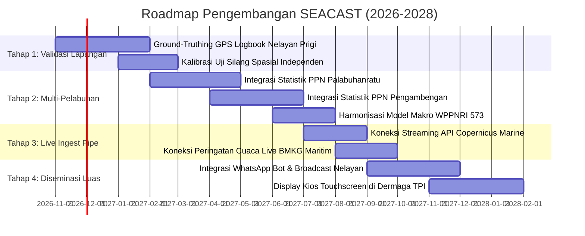

# SEACAST PRIGI V3 — DEVELOPMENT ROADMAP
## PETA JALAN PENGEMBANGAN BERKELANJUTAN & PENELITIAN TAHAP LANJUT (2026–2028)

**Dokumen ID:** SEACAST-DOC-ROADMAP-V3  
**Fokus Roadmap:** Ground-Truthing Lapangan, Akuisisi Multi-Pelabuhan, Otomatisasi Live Telemetry & Diseminasi Nelayan  
**Target Rilis:** v3.1 s.d. v4.0  
**Tanggal Penyusunan:** 4 November 2026  
**Penyusun:** Principal Technical Architect & Lead Marine Fisheries Scientist  

---

## 1. PRINSIP STRATEGIS PENGEMBANGAN

Pengembangan lanjutan platform **SEACAST PRIGI** berpegang pada empat pilar integritas:
1. **Evidence-Based Ground-Truthing:** Setiap pemutakhiran model machine learning wajib didasarkan pada data tangkapan aktual (*in-situ field verification*), bukan sekadar penyesuaian parameter simulasi.
2. **Kedaulatan & Keamanan Data:** Pengelolaan data perikanan sensitif (lokasi kapal dan armada) dilindungi dengan enkripsi dan kontrol akses berjenjang.
3. **Kesederhanaan Pengguna Akhir (*User-Centric Design*):** Rekomendasi teknologi tinggi harus dapat diterima dengan mudah oleh nelayan tradisional berpendidikan dasar melalui media yang mereka gunakan setiap hari (WhatsApp, papan TPI, kertas cetak).
4. **Keberlanjutan Ekologis (Sustainability First):** Peluang penangkapan ikan ekonomis tidak boleh mengorbankan zona asuhan benih ikan (*Z4 Nursery Ground*) atau keselamatan megafauna laut dilindungi (*Z5 Bycatch Mitigation*).

---

## 2. TIMELINE PETA JALAN EMPAT TAHAP (2026–2028)

---

## 3. RINCIAN TAHAPAN ROADMAP

### TAHAP 1: VALIDASI EMPIRIS & GROUND-TRUTHING LAPANGAN (Q4 2026 – Q1 2027)
**Target Versi:** v3.1  
**Fokus Utama:** Menyelesaikan hutang teknis *TD-01 (Proxy Niche Validation)* dengan memasukkan titik observasi tangkapan nyata dari nelayan.

1. **Program Percontohan Logbook GPS PPN Prigi:**
   - Melakukan pemasangan GPS logger portabel pada 10 kapal percontohan (5 kapal $<10\text{ GT}$ pancing ulur dan 5 kapal $20–30\text{ GT}$ purse seine).
   - Merekam koordinat lintang-bujur titik tebar jaring (*setting*), waktu operasi, dan volume hasil tangkapan per trip.
2. **Uji Validasi Silang Spasial Independen (*Spatial Block Cross-Validation*):**
   - Melatih ulang model Ensemble SDM menggunakan titik koordinat tangkapan GPS empiris sebagai data keberadaan (*presence data*).
   - Menghitung nilai ROC-AUC dan *True Skill Statistic* (TSS) independen yang bebas dari bias sirkular proxy lingkungan.
3. **Penyempurnaan Formula HSI Albakor:**
   - Memasukkan parameter kedalaman termoklin (*thermocline depth*) untuk memperbaiki performa model Albakor yang sebelumnya memiliki nilai MaxEnt rendah (0,507).

---

### TAHAP 2: EKSPANSI SIMPUL MULTI-PELABUHAN WPPNRI 573 (Q1 2027 – Q3 2027)
**Target Versi:** v3.2  
**Fokus Utama:** Menyelesaikan hutang teknis *TD-03 (Kesenjangan Multi-Pelabuhan)* dengan memperluas cakupan statistik pendaratan ke simpul barat dan timur.

1. **Akuisisi Data PPN Palabuhanratu (Jawa Barat):**
   - Mengambil data deret waktu pendaratan ikan pelagis besar dan profil armada PPN Palabuhanratu periode 2015–2026.
   - Mengkalibrasi jarak tempuh pangkalan ke perairan Samudra Hindia sub-sektor Jabar-Jateng.
2. **Akuisisi Data PPN Pengambengan (Bali):**
   - Mengambil data deret waktu pendaratan Lemuru, Tongkol, dan Tuna di PPN Pengambengan (Selat Bali dan perairan selatan Bali).
   - Menyelaraskan analisis musiman upwelling sub-sektor Bali-Nusa Tenggara.
3. **Harmonisasi Model Makro Regional WPPNRI 573:**
   - Menghubungkan ketiga pelabuhan ke dalam satu antarmuka terpadu, memungkinkan pengguna membandingkan produktivitas pendaratan lintas pelabuhan secara simultan pada peta DPI Radar.

---

### TAHAP 3: OTOMATISASI PIPELINE DATA LIVE STREAMING (Q3 2027 – Q4 2027)
**Target Versi:** v3.3  
**Fokus Utama:** Menyelesaikan hutang teknis *TD-02 (Live Ingestion Pipe)* dengan mengotomatiskan penarikan data satelit mentah harian tanpa fungsi simulasi musiman.

1. **Integrasi Copernicus Marine Toolbox API (GLORYS12V1 / Forecast):**
   - Menghubungkan skrip pengunduh otomatis harian berbasis Python SDK `copernicusmarine` untuk mengambil feed harian arus permukaan ($u, v$), suhu, dan salinitas pada pukul 02:00 WIB.
2. **Integrasi Kredensial Resmi BMKG Maritim / Ina-WAVES:**
   - Mengkonfigurasi token API BMKG resmi untuk penarikan data gelombang laut harian ($H_s$, periode gelombang, swell) dan peringatan cuaca buruk ekstrem.
3. **Penyempurnaan Manajemen Tutupan Awan (*Cloud Masking Protocol*):**
   - Menerapkan algoritma interpolasi spasio-temporal (*DINEOF / Data Interpolating Empirical Orthogonal Functions*) untuk mengisi kekosongan data optik klorofil-a pada puncak musim hujan (Desember–Februari).

---

### TAHAP 4: DISEMINASI LAPANGAN & IMPLEMENTASI TEKNOLOGI INKLUSIF (Q4 2027 – Q1 2028)
**Target Versi:** v4.0  
**Fokus Utama:** Menyalurkan informasi hasil pemodelan ke tangan nelayan tradisional dan pemangku kepentingan di dermaga pelelangan ikan.

1. **Layanan Notifikasi Cerdas WhatsApp & SMS Nelayan:**
   - Membangun bot WhatsApp resmi SEACAST yang mengirimkan koordinat hotspot harian, kondisi gelombang BMKG, dan izin melaut sesuai ukuran GT kapal secara otomatis setiap pagi pukul 04:30 WIB.
2. **Anjungan Mandiri (Kios Display Interaktif) di TPI Prigi:**
   - Memasang layar sentuh kios informasi luar ruangan di Tempat Pelelangan Ikan (TPI) PPN Prigi yang menampilkan peta WebGL MapLibre interaktif dan tombol satu-klik cetak lembar rekomendasi melaut A4.
3. **Integrasi VMS / AIS Kapal Perikanan:**
   - Menjajaki integrasi data Vessel Monitoring System (VMS) Kementerian Kelautan dan Perikanan (KKP) untuk memantau kepatuhan armada penangkapan terhadap batas wilayah konservasi Z4 Nursery Ground dan Kawasan Konservasi Perairan (KKP/MPA).

---

## 4. INDIKATOR KINERJA UTAMA (KPI) KEBERHASILAN ROADMAP

| Indikator Target | Nilai Baseline Saat Ini (v3.0) | Target Jangka Menengah (v3.2) | Target Jangka Panjang (v4.0) |
| :--- | :---: | :---: | :---: |
| **Sumber Validasi Presensi Ikan** | Deterministic Ecological Proxy | 100 Titik GPS Logger Logbook | >500 Titik GPS Tangkapan Valid |
| **Pelabuhan Terintegrasi** | 1 Pelabuhan (PPN Prigi) | 3 Pelabuhan (Prigi, Palabuhanratu, Pengambengan) | 5 Pelabuhan (Termasuk Cilacap & Banyuwangi) |
| **Sumber Feed Gelombang Harian**| Parameterisasi Analitik Musiman | Live Stream API BMKG Ina-WAVES | Hybrid Multi-Sensor BMKG + WaveWatch III |
| **Waktu Rilis Prediksi Harian** | 04:00 WIB (Simulasi) | 03:30 WIB (Live Auto-Ingest) | 03:00 WIB (Multi-Source Pipeline) |
| **Kanal Diseminasi Informasi** | Web Browser & Lembar A4 TPI | Web Browser, Lembar A4, & Bot WhatsApp | Web, WA Bot, SMS Gateway, & Kios TPI |
| **Penghematan Bahan Bakar Solar**| Hipotesis / Simulasi Keekonomian| 10–15% Terukur pada Kapal Pilot | 20–30% Efisiensi Rata-Rata Armada |

