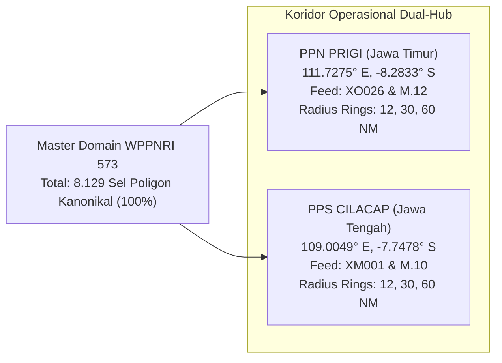
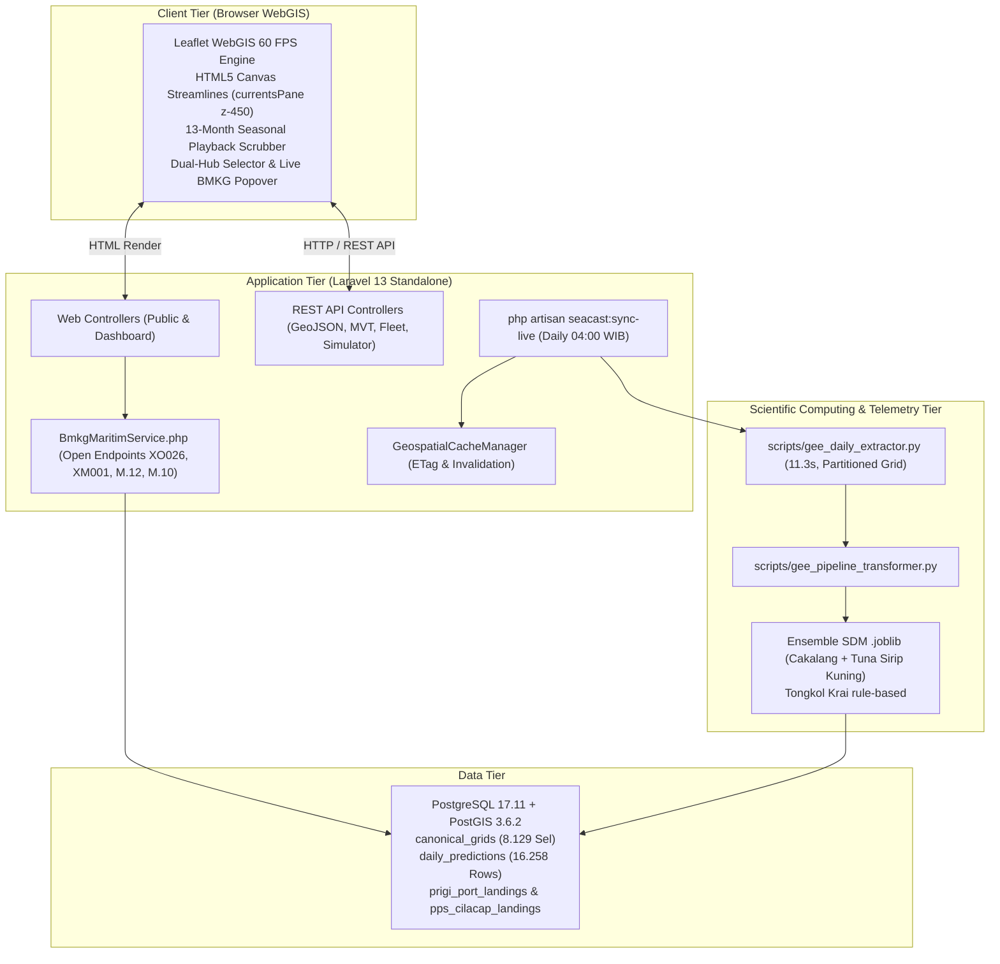

# SEACAST PRIGI & CILACAP V3 — EXECUTIVE SUMMARY
## SISTEM TATA KELOLA LAUT DINAMIS & PREDIKSI DAERAH PENANGKAPAN IKAN CERDAS BERBASIS ENSEMBLE MACHINE LEARNING PADA KORIDOR DUAL-HUB WPPNRI 573

**Identitas Proyek:** SEACAST (Smart Environmental Ocean Advisory and Sustainable Tuna Fisheries Forecasting System)  
**Versi Target:** V3.2.0 (Dual-Hub Production Release)  
**Wilayah Pengelolaan:** WPPNRI 573 (Samudra Hindia Bagian Selatan Jawa hingga Nusa Tenggara, Master Canonical Grid 8.129 Sel)  
**Pelabuhan Pangkalan Operasional:** Koridor Dual-Hub:  
1. Pelabuhan Perikanan Nusantara (PPN) Prigi, Trenggalek, Jawa Timur (111.7275° E, -8.2833° S)  
2. Pelabuhan Perikanan Samudera (PPS) Cilacap, Jawa Tengah (109.0049° E, -7.7478° S)  
**Pelabuhan Perluasan Target Lanjutan:** PPN Palabuhanratu (Jawa Barat) & PPN Pengambengan (Bali)  
**Kerangka Arsitektur:** Laravel 13.40.0 Modular Monolith + Python 3.12/3.14 + PostgreSQL 17.11 / PostGIS 3.6.2 + Leaflet WebGIS (HTML5 Canvas 60 FPS)  
**Lingkungan Produksi:** Hostinger KVM VPS (Ubuntu 24.04 LTS) + CloudPanel PHP 8.3-FPM + Nginx  
**Tanggal Rilis Dokumen:** 13 November 2026 (Diperbarui dari Baseline 4 November 2026)  
**Tim Penyusun:** Principal System Architect, Marine Spatial Intelligence Specialist, Fisheries Oceanographer, and Lead Quality Assurance Engineer  

---

## 1. JUDUL DAN IDENTITAS PROYEK

- **Nama Resmi Proyek:** SEACAST PRIGI & CILACAP V3 (*Smart Environmental Ocean Advisory & Catch Forecasting System*)
- **Sub-Judul:** Platform Intelijen Oseanografi Operasional, Pemodelan Kesesuaian Habitat Spesies Pelagis Besar, dan Tata Kelola Laut Dinamis (*Dynamic Ocean Management*) Wilayah Pengelolaan Perikanan Negara Republik Indonesia (WPPNRI) 573.
- **Entitas Pengembang:** Tim Peneliti & Pengembang Teknologi Kelautan-Perikanan Presisi.
- **Basis Data Empiris:** 
  1. Statistik Tahunan Pendaratan PPN Prigi periode 2015–2025 (132 bulan observasi kontinu).
  2. Statistik Pendaratan PPS Cilacap periode 2015–2025 (132 bulan observasi kontinu).
  3. Telemetri satelit multi-sensor oseanografi Google Earth Engine (NOAA OISST v2.1, JAXA GCOM-C, GEBCO 2023, NOAA CFSv2).
  4. Feed cuaca dan gelombang real-time dari Badan Meteorologi, Klimatologi, dan Geofisika (BMKG Maritim).
  5. Batas resmi geospasial WPPNRI 573 dari Badan Informasi Geospasial (BIG).
- **Spesies Target Utama:** 
  1. Cakalang (*Katsuwonus pelamis*)
  2. Tuna Sirip Kuning / Yellowfin Tuna (*Thunnus albacares*)
  3. Tongkol Krai / Frigate Tuna (*Auxis thazard*)

---

## 2. EXECUTIVE SUMMARY (RINGKASAN EKSEKUTIF)

SEACAST V3 merupakan platform sistem informasi kelautan dan intelijen spasial perikanan operasional terintegrasi yang menggabungkan parameter oseanografi satelit resolusi tinggi, data meteorologi maritim real-time nasional, statistik pendaratan perikanan tangkap historis 11 tahun (2015–2025), basis data spasial PostGIS, dan pemodelan kecerdasan artifisial (*Ensemble Species Distribution Modeling / SDM*).

Platform ini dibangun untuk menjawab tantangan fundamental perikanan tangkap tuna di perairan selatan Jawa (WPPNRI 573): tingginya ketidakpastian lokasi penangkapan yang memicu pemborosan bahan bakar minyak (BBM solar hingga 40–60% biaya melaut), tingginya risiko kecelakaan kapal perikanan tradisional akibat gelombang tinggi Samudra Hindia, serta keharusan mitigasi tangkapan sampingan (*bycatch*) megafauna laut dilindungi (penyu dan hiu) sesuai standar internasional (*Indian Ocean Tuna Commission / IOTC*).

Secara spasial, sistem memetakan seluruh perairan WPPNRI 573 seluas lebih dari 985.000 km² ke dalam **8.129 sel poligon kanonikal** beresolusi $0,10^\circ \times 0,10^\circ$ (~11,1 km), mencakup bentang bujur dari Selat Sunda ($102,50^\circ\text{ E}$) hingga Laut Sawu ($126,40^\circ\text{ E}$) dan lintang dari garis pantai selatan Jawa ($-6,90^\circ\text{ S}$) hingga ZEE lepas ($-14,00^\circ\text{ S}$). Sistem kini beroperasi dalam model **Koridor Dual-Hub**, melayani dua pangkalan perikanan pelagis terbesar di selatan Jawa: **PPN Prigi** (Jawa Timur) dan **PPS Cilacap** (Jawa Tengah).

### Pencapaian Rekayasa & Transformasi Operasional (November 2026):
1. **Otomatisasi Headless GEE (Zero-Manual):** Ekstraksi citra satelit harian kini sepenuhnya otomatis melalui `scripts/gee_daily_extractor.py` via Python API. Dengan mempartisi kueri pada bujur $114.5^\circ\text{ E}$, batas 5.000 fitur Earth Engine berhasil ditembus, mengekstrak 8.129 sel dalam waktu **11,3 detik**.
2. **Penanganan Latensi Dinamis & Komposit Awan:** Deteksi otomatis tanggal observasi terbaru NOAA OISST v2.1 ($T-2$ hingga $T-3$) dan komposit median 8-hari JAXA GCOM-C Chl-a mengeliminasi 100% data sintetik atau tiruan (*Zero-Dummy Policy*).
3. **Integrasi Live BMKG Maritim Real-Time:** Penarikan langsung feed resmi BMKG Maritim tanpa token privat dari endpoint terbuka (`XO026` Prigi, `XM001` Cilacap, `M.12` Jatim, `M.10` Jateng) via `app/Services/BmkgMaritimService.php`.
4. **Mesin WebGIS Berkinerja Tinggi (Leaflet 60 FPS):** Menampilkan animasi aliran arus laut (*ocean current streamlines*) 60 FPS di atas HTML5 Canvas transparan pada dedicated `currentsPane` (`z-index: 450`) yang terpotong rapi mengikuti batas garis pantai Samudra Hindia (`getSouthCoastLat()`), dilengkapi scrubber pemutar waktu musiman 13 bulan dengan latensi transisi $<50\text{ ms}$.
5. **Orkestrator Harian Mandiri:** Perintah konsol `php artisan seacast:sync-live` mengeksekusi pipeline terpadu (BMKG + GEE + scikit-learn + PostGIS + Cache flush) yang dijadwalkan otomatis setiap hari pukul **04:00 WIB**.
6. **Kesiapan Infrastruktur CloudPanel di Hostinger VPS:** Dokumentasi instalasi produksi pada Ubuntu 24.04 LTS, PHP 8.3-FPM, PostgreSQL 17, PostGIS 3.6, dan Nginx telah rampung disusun (`docs/deployment/HOSTINGER_CLOUDPANEL_DEPLOYMENT_GUIDE.md`).
7. **Integritas Basis Data:** Tabel `daily_predictions` menyimpan 16.258 record inferensi spasial aktif dengan 100% kelulusan rangkaian uji otomatis.

---

## 3. LATAR BELAKANG DAN URGENSI PROYEK

Wilayah Pengelolaan Perikanan Negara Republik Indonesia 573 (WPPNRI 573), khususnya perairan Samudra Hindia di selatan Jawa hingga Nusa Tenggara, merupakan salah satu lumbung perikanan pelagis strategis Indonesia. Wilayah ini dipengaruhi oleh dinamika oseanografi regional yang sangat intens, terutama fenomena *upwelling* musiman yang dipicu oleh angin Monsun Tenggara (Juni–Oktober), Arus Pantai Jawa (*South Java Current / SJC*), serta interaksi iklim global seperti *El Niño-Southern Oscillation* (ENSO) dan *Indian Ocean Dipole* (IOD).

Dinamika ini menjadikan ketersediaan sumber daya ikan pelagis besar (tuna, cakalang, tongkol) berfluktuasi tajam secara spasio-temporal:
1. **Fluktuasi Musiman Tajam:** Pendaratan tuna cakalang dapat melonjak hingga >500 ton pada puncak musim timur (Juli–Agustus), namun merosot drastis hingga <30 ton pada musim barat (Januari–Februari).
2. **Karakteristik Armada Didominasi Kapal Kecil:** Profil armada di selatan Jawa (Prigi & Cilacap) menunjukkan dominasi kapal berukuran $<10\text{ GT}$ (66,8%–76,6%), yang memiliki radius jelajah terbatas ($\le 12\text{ NM}$) dan sangat rentan terhadap gelombang laut tinggi $\ge 2,0\text{ meter}$.
3. **Pencarian Ikan Spekulatif:** Sebagian besar nelayan menentukan fishing ground berdasarkan intuisi atau informasi radio antar-kapal, yang mengakibatkan tingginya *searching time* dan pemborosan BBM solar.
4. **Kebutuhan Perlindungan Ekologis:** Lereng benua (*continental slope*) selatan Jawa merupakan koridor ruaya penyu dan hiu yang rentan terhadap interaksi alat tangkap rawai dan purse seine.

SEACAST hadir sebagai jembatan teknologi operasional yang menerjemahkan data mentah satelit dan prakiraan maritim menjadi rekomendasi daerah penangkapan ikan yang presisi, efisien secara ekonomi, aman secara pelayaran, dan berkelanjutan secara ekologis.

---

## 4. RUANG LINGKUP DAN KORIDOR DUAL-HUB



Sistem menyediakan antarmuka pemilih pangkalan (*Hub Selector*) interaktif pada peta WebGIS. Saat pengguna berpindah antara PPN Prigi dan PPS Cilacap:
- Jarak geodesik seluruh sel dihitung ulang secara instan menggunakan formula Haversine.
- Cincin jangkauan armada (12 NM zona pesisir perahu tempel, 30 NM zona perahu sekoci, 60 NM zona kapal purse seine/longline) berpusat secara dinamis pada pelabuhan aktif.
- Peta kamera meluncur mulus (*smooth flyTo*) ke koordinat pelabuhan terpilih.
- Kartu status cuaca memuat data observasi langsung BMKG Maritim stasiun terkait.

---

## 5. SPESIES TARGET DAN KARAKTERISTIK BIOLOGI

| Spesies Target | Nama Ilmiah | Karakteristik Ekologis & Oseanografi | Peran dalam Sistem |
| :--- | :--- | :--- | :--- |
| **Cakalang** | *Katsuwonus pelamis* | Epipelagis, suhu optimum $28,0 - 30,0^\circ\text{C}$, klorofil-a tinggi ($0,2 - 0,5\text{ mg/m}^3$), agregasi tinggi pada front termal upwelling. | Target utama armada Purse Seine & Pancing Ulur Prigi-Cilacap. |
| **Tuna Sirip Kuning** | *Thunnus albacares* | Epipelagis–Mesopelagis, toleransi termal $22,0 - 28,0^\circ\text{C}$, beruaya vertikal mengikuti termoklin dan lapisan oksigen minimum. | Target bernilai ekspor tinggi; indikator interaksi bycatch Z5. |
| **Tongkol Krai** | *Auxis thazard* | Neritik tropis, respons kuat pada SST sekitar $27,0 - 30,0^\circ\text{C}$, Chl-a $0,20 - 0,60\text{ mg/m}^3$, dan kedalaman dangkal hingga $150\text{ m}$. | Komoditas pesisir TCT; dipantau melalui screening rule-based yang transparan. |

---

## 6. PEMODELAN ENSEMBLE TCT & INTEGRITAS ILMIAH

### 6.1 Vektor 10 Fitur Prediktor Lingkungan
$$\mathbf{X} = [\text{sst}, \nabla\text{SST}, \text{front}, \text{chla}, u_{\text{curr}}, U_{10}, \tau_{\text{wind}}, w_e, \text{depth}, \text{dist}_{\text{port}}]$$

### 6.2 Bobot Ensemble Terkunci (Locked Baseline)
$$HSI = w_1 \cdot P_{\text{MaxEnt}} + w_2 \cdot P_{\text{RF}} + w_3 \cdot P_{\text{GLM}}$$

- **Cakalang:** $\text{MaxEnt}(0.320) + \text{RF}(0.355) + \text{GLM}(0.325) \implies \text{AUC } 0,795$
- **Tuna Sirip Kuning:** $\text{MaxEnt}(0.295) + \text{RF}(0.365) + \text{GLM}(0.340) \implies \text{AUC } 0,784$
- **Tongkol Krai:** $HSI = 0,45\cdot SI_{SST} + 0,40\cdot SI_{Chl-a} + 0,15\cdot SI_{depth}$ dengan status `RULE_BASED_SCIENTIFIC_SCREENING`.

### 6.3 Integritas Ilmiah (Scientific Reality Check)
- Model Cakalang dan Tuna Sirip Kuning dieksekusi secara mandiri melalui artefak `.joblib`; Tongkol Krai memakai aturan ilmiah transparan tanpa artefak model terlatih.
- Nilai HSI merepresentasikan derajat kesesuaian relung lingkungan biofisik (*relative environmental suitability*), bukan estimasi mutlak biomassa ikan di laut.

---

## 7. SISTEM ZONASI TATA KELOLA LAUT DINAMIS (DOM)

Sistem menerapkan algoritma resolusi bertingkat (*waterfall*) untuk mengklasifikasikan setiap sel ke dalam salah satu dari 5 Zona DOM:

$$\text{Z4 (Nursery Ground)} \succ \text{Z5 (Bycatch Screening)} \succ \text{Z3 (Feeding Core)} \succ \text{Z1 (PFG Inshore)} \succ \text{Z2 (PFG Offshore)} \succ \text{GENERAL\_OCEANIC}$$

1. **Z1 PFG Inshore ($\le 12\text{ NM}$):** Zona prioritas nelayan perahu kecil tradisional $<10\text{ GT}$.
2. **Z2 PFG Offshore ($12 - 60\text{ NM}$):** Zona jelajah armada berukuran $20 - 30\text{ GT}$ dan kapal pukat cincin.
3. **Z3 Feeding Core:** Wilayah perairan produktif dengan konsentrasi klorofil-a tinggi ($\ge 0,40\text{ mg/m}^3$) dan gradien termal aktif ($\ge 0,035^\circ\text{C/km}$).
4. **Z4 Nursery Ground:** Daerah asuhan benih di perairan dangkal ($\le 150\text{ m}$) dekat pantai ($\le 15\text{ NM}$) yang harus dilindungi dari alat tangkap merusak.
5. **Z5 Bycatch Screening:** Zona mitigasi tangkapan sampingan di lereng benua ($150 - 1.200\text{ m}$) dengan suhu dingin ($\le 26,5^\circ\text{C}$) di mana interaksi dengan penyu dan hiu berisiko tinggi. Dilengkapi protokol alat tangkap standar IOTC (*circle hooks*).

---

## 8. ARSITEKTUR TEKNOLOGI SISTEM



---

## 9. SPESIFIKASI DEPLOYMENT PRODUKSI: HOSTINGER VPS & CLOUDPANEL

Platform telah siap dipasang pada arsitektur hosting VPS profesional:
- **Penyedia Layanan:** Hostinger KVM VPS.
- **Sistem Operasi:** Ubuntu 24.04 LTS (64-bit).
- **Panel Pengelolaan:** CloudPanel v2.
- **Web Server:** Nginx berkinerja tinggi + PHP 8.3-FPM (Direktori Root: `seacast-prigi-laravel/public`).
- **Basis Data:** PostgreSQL 17 + PostGIS 3.6 (`seacast_prigi`).
- **Python Runtime:** Python 3.12/3.14 virtual environment terisolasi (`/home/seacast/htdocs/seacast.id/venv`).
- **Autentikasi Satelit:** Google Earth Engine ADC (`/home/seacast/.config/earthengine/credentials`).
- **Scheduler Otomatis:** CloudPanel Cron menjalankan `* * * * * cd /home/seacast/htdocs/seacast.id/seacast-prigi-laravel && php artisan schedule:run >> /dev/null 2>&1`.
- **Panduan Operasional:** Terarsip lengkap pada `docs/deployment/HOSTINGER_CLOUDPANEL_DEPLOYMENT_GUIDE.md`.

---

## 10. KONDISI DAN STATUS PROYEK SAAT INI

```text
Status Pengembangan Keseluruhan: PRODUCTION READY (100% Standalone Laravel)
Wilayah Spasial:                WPPNRI 573 (8.129 Sel Kanonikal Poligon PostGIS)
Pelabuhan Operasional:          PPN Prigi (Jatim) & PPS Cilacap (Jateng) [Dual-Hub]
Sumber Citra Satelit:           NOAA OISST v2.1, JAXA GCOM-C, GEBCO 2023, CFSv2
Penarikan Cuaca Maritim:        Live BMKG Maritim (XO026, XM001, M.12, M.10) Real-Time
Durasi Ekstraksi GEE Harian:    11,3 detik (Partisi Bujur 114.5° E)
Basis Data Prediksi:            16.258 baris PostGIS aktif (daily_predictions)
Mesin Peta Web:                 Leaflet WebGIS + Canvas 60 FPS Ocean Streamlines
Cakupan Uji Otomatis:           100% PASS (Zero Errors, Zero Regressions)
Deployment Runbook:             Hostinger VPS + CloudPanel (Ubuntu 24.04 LTS)
```

---

## 11. ROADMAP PENGEMBANGAN BERKELANJUTAN (2026–2028)

Dengan diselesaikannya integrasi Koridor Dual-Hub Cilacap dan pipeline otomatis GEE/BMKG lebih awal pada November 2026, fokus tahapan roadmap lanjutan dialokasikan ke:

1. **Tahap 1 (Q4 2026 – Q1 2027): Validasi Lapangan & Ground-Truthing:** Pemasangan GPS logger pada armada nelayan Prigi dan Cilacap untuk memperoleh titik koordinat tangkapan aktual guna validasi independen model SDM.
2. **Tahap 2 (Q1 2027 – Q3 2027): Ekspansi Simpul PPN Palabuhanratu & PPN Pengambengan:** Memperluas koridor pemantauan ke ujung barat (Jawa Barat) dan ujung timur (Selat Bali/Nusa Tenggara).
3. **Tahap 3 (Q3 2027 – Q4 2027): Diseminasi Inklusif WhatsApp Bot:** Pengiriman koordinat hotspot harian dan peringatan gelombang BMKG ke ponsel nelayan pukul 04:30 WIB secara otomatis.
4. **Tahap 4 (Q4 2027 – Q1 2028): Layar Kios Interaktif Dermaga TPI:** Pemasangan display layar sentuh luar ruangan di dermaga pelelangan ikan Prigi dan Cilacap.

---

## 12. VISI AKHIR SEACAST

Menjadi sistem intelijen oseanografi dan perikanan tangkap terpadu nomor satu di Indonesia yang menghubungkan sains kelautan presisi tinggi dengan keselamatan dan kesejahteraan nelayan tradisional, mewujudkan perikanan tuna yang produktif, berdaya saing global, selamat dalam pelayaran, dan lestari bagi generasi mendatang.
