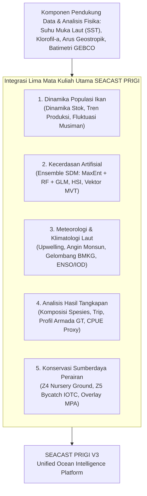
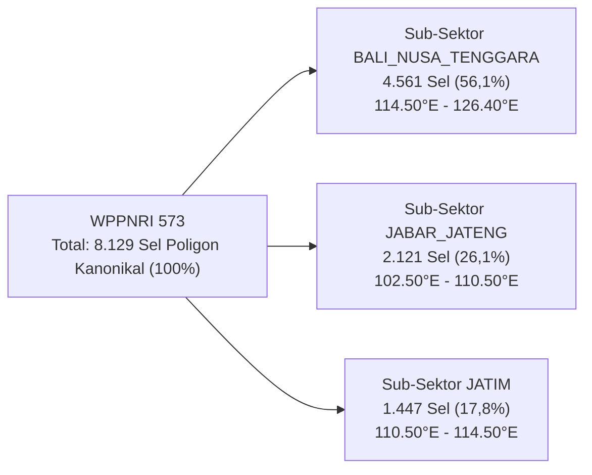
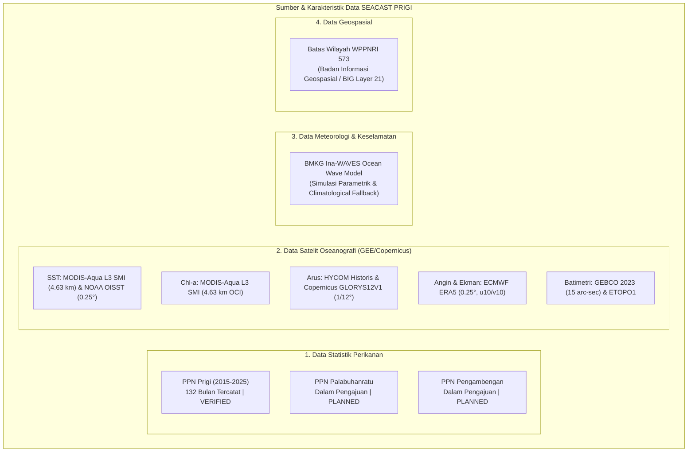
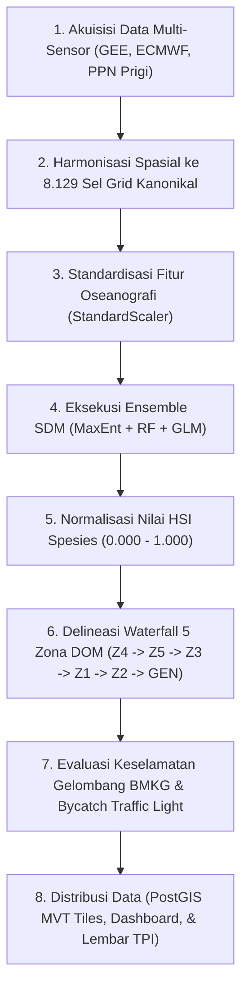
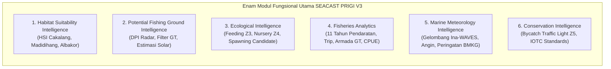
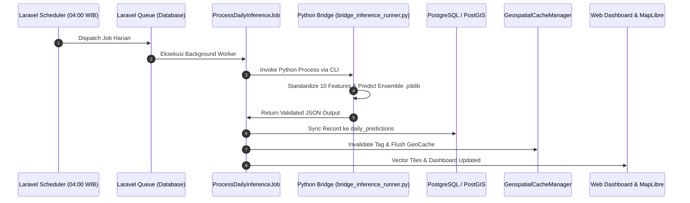
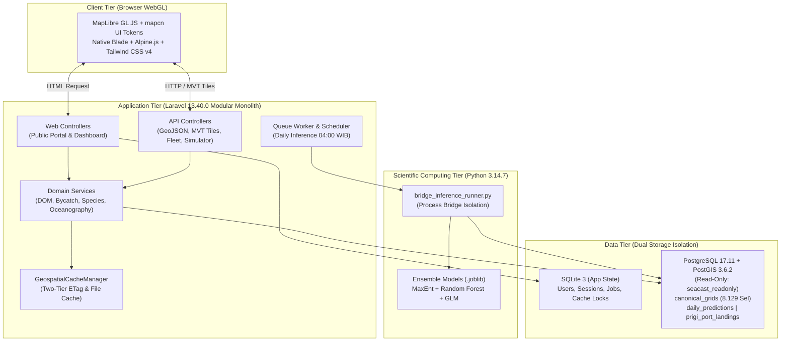
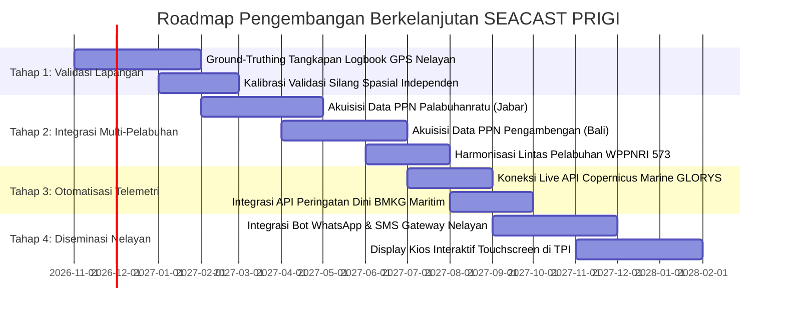

# SEACAST PRIGI V3 — EXECUTIVE SUMMARY
## SISTEM TATA KELOLA LAUT DINAMIS & PREDIKSI DAERAH PENANGKAPAN IKAN CERDAS BERBASIS ENSEMBLE MACHINE LEARNING PADA WPPNRI 573

**Identitas Proyek:** SEACAST PRIGI (Smart Environmental Ocean Advisory and Sustainable Tuna Fisheries Forecasting System)  
**Versi Target:** V3.0 (Enterprise Standalone Production Release)  
**Wilayah Pengelolaan:** WPPNRI 573 (Samudra Hindia Bagian Selatan Jawa hingga Nusa Tenggara)  
**Pelabuhan Pangkalan Awal:** Pelabuhan Perikanan Nusantara (PPN) Prigi, Kabupaten Trenggalek, Jawa Timur  
**Pelabuhan Perluasan Target:** PPN Palabuhanratu (Jawa Barat) & PPN Pengambengan (Bali)  
**Kerangka Arsitektur:** Laravel 13.40.0 Modular Monolith + Python 3.14.7 + PostgreSQL 17.11 / PostGIS 3.6.2  
**Tanggal Rilis Laporan:** 4 November 2026  
**Tim Penyusun:** Senior Technical Architect, Marine Fisheries Data Scientist, Oceanographic Research Analyst, and Scientific Project Documentation Specialist  

---

## 1. JUDUL DAN IDENTITAS PROYEK

- **Nama Resmi Proyek:** SEACAST PRIGI V3 (*Smart Environmental Ocean Advisory & Catch Forecasting System*)
- **Sub-Judul:** Platform Intelijen Oseanografi Operasional, Pemodelan Kesesuaian Habitat Spesies Pelagis Besar, dan Tata Kelola Laut Dinamis (*Dynamic Ocean Management*) Wilayah Pengelolaan Perikanan Negara Republik Indonesia (WPPNRI) 573.
- **Entitas Pengembang:** Kolaborasi Akademik & Riset Teknologi Kelautan-Perikanan.
- **Basis Data Empiris:** Laporan Statistik Tahunan Pelabuhan Perikanan Nusantara (PPN) Prigi periode 2015–2025 (132 bulan observasi), telemetri satelit multi-sensor oseanografi, dan basis data geospasial Badan Informasi Geospasial (BIG).
- **Spesies Target Utama:** 
  1. Cakalang (*Katsuwonus pelamis*)
  2. Madidihang / Yellowfin Tuna (*Thunnus albacares*)
  3. Albakor / Albacore Tuna (*Thunnus alalunga*)

---

## 2. EXECUTIVE SUMMARY (RINGKASAN EKSEKUTIF)

SEACAST PRIGI V3 merupakan platform sistem informasi kelautan dan perikanan operasional yang mengintegrasikan parameter fisika-biologi oseanografi, meteorologi kelautan, statistik pendaratan perikanan tangkap historis 11 tahun (2015–2025), komputasi geospasial beresolusi tinggi (PostGIS), dan pemodelan kecerdasan artifisial (*Ensemble Species Distribution Modeling / SDM*). 

Proyek ini dibangun untuk menjawab tantangan fundamental perikanan tangkap tuna di perairan selatan Jawa (WPPNRI 573): tingginya ketidakpastian lokasi penangkapan yang memicu pemborosan bahan bakar minyak (BBM), tingginya risiko kecelakaan kapal perikanan tradisional akibat gelombang ekstrem Samudra Hindia, serta kebutuhan mendesak mitigasi tangkapan sampingan (*bycatch*) satwa laut dilindungi (penyu dan hiu) sesuai standar tata kelola internasional (*Indian Ocean Tuna Commission / IOTC*).

Secara spasial, sistem ini memetakan seluruh perairan WPPNRI 573 seluas lebih dari 980.000 km² ke dalam **8.129 sel poligon kanonikal** beresolusi $0,10^\circ \times 0,10^\circ$ (~11,1 km), mencakup bentang bujur dari Selat Sunda/Jawa Barat ($102,50^\circ\text{ E}$) hingga Laut Sawu/NTT ($126,40^\circ\text{ E}$) dan bentang lintang dari garis pantai Jawa ($-6,90^\circ\text{ S}$) hingga laut lepas perbatasan ZEE ($-14,00^\circ\text{ S}$). PPN Prigi berkedudukan sebagai pelabuhan pangkalan validasi empiris awal (*homeport*), dengan rencana ekspansi ke PPN Palabuhanratu dan PPN Pengambengan.

Platform telah berhasil ditransformasikan secara penuh menjadi sistem mandiri (*standalone*) berbasis **Laravel 13 Modular Monolith** (PHP 8.3) dengan frontend murni native Blade, Alpine.js, dan Tailwind CSS (desain bahasa `mapcn`), mengeliminasi total ketergantungan runtime Node.js/React. Pipeline ilmiah digerakkan oleh mesin inferensi Python (scikit-learn) yang mengeksekusi model ensemble berbobot (**MaxEnt + Random Forest + GLM**) terhadap 10 variabel biofisik oseanografi, sistem zonasi **5 Zona Tata Kelola Laut Dinamis (DOM Z1–Z5)**, integrasi pipeline **Google Earth Engine (GEE v2.3.2) ke Web**, serta evaluasi risiko keselamatan pelayaran harian sebelum pukul 04:30 WIB. Seluruh fungsionalitas sistem telah lulus 100% verifikasi empiris melalui **156 automated test cases (2.989 assertions)** tanpa kegagalan.

---

## 3. LATAR BELAKANG DAN URGENSI PROYEK

Wilayah Pengelolaan Perikanan Negara Republik Indonesia 573 (WPPNRI 573), khususnya perairan Samudra Hindia di selatan Jawa hingga Nusa Tenggara, merupakan salah satu lumbung perikanan pelagis strategis Indonesia. Wilayah ini dipengaruhi oleh dinamika oseanografi regional yang sangat intens, terutama fenomena *upwelling* musiman yang dipicu oleh angin Monsun Tenggara (Juni–Oktober), Arus Pantai Jawa (*South Java Current / SJC*), serta interaksi iklim global seperti *El Niño-Southern Oscillation* (ENSO) dan *Indian Ocean Dipole* (IOD).

Dinamika ini menjadikan ketersediaan sumber daya ikan pelagis besar (tuna, cakalang, tongkol) berfluktuasi tajam secara spasio-temporal. Berdasarkan observasi 11 tahun (2015–2025) di PPN Prigi:
1. **Fluktuasi Musiman Ekstrem:** Pendaratan tuna cakalang dapat melonjak hingga >500 ton pada puncak musim timur (Juli–Agustus), namun merosot drastis hingga <30 ton pada musim barat (Januari–Februari).
2. **Karakteristik Armada Didominasi Kapal Kecil:** Profil armada PPN Prigi menunjukkan dominasi mutlak kapal berukuran $<10\text{ GT}$ (66,8%–76,6% dari total 443–794 armada terdaftar), yang memiliki radius jelajah terbatas ($\le 12\text{ NM}$) dan sangat rentan terhadap gelombang laut tinggi $\ge 2,0\text{ meter}$.
3. **Pencarian Ikan Bersifat Spekulatif:** Sebagian besar nelayan menentukan fishing ground berdasarkan intuisi tradisional, tanda-tanda visual (burung laut), atau informasi radio antar-kapal, yang mengakibatkan tingginya *searching time* dan pemborosan BBM solar hingga 40–60% dari total biaya operasional melaut.
4. **Ketiadaan Platform Terintegrasi:** Data satelit oseanografi (SST, klorofil-a) tersedia secara daring tetapi dalam format data mentah (*scientific netCDF/HDF*) yang terfragmentasi dan mustahil diinterpretasikan langsung oleh nelayan atau otoritas pelabuhan perikanan.

Urgensi proyek SEACAST terletak pada kebutuhan menghadirkan jembatan teknologi (*technological bridge*) yang menerjemahkan data mentah telemetri satelit menjadi rekomendasi operasional presisi, terukur, dan aman secara harian.

---

## 4. IDENTIFIKASI MASALAH

Berdasarkan audit teknis dan kajian lapangan, diidentifikasi enam permasalahan utama:

1. **Inefisiensi Operasional dan Pemborosan Energi Nelayan:** Nelayan menghabiskan waktu dan bahan bakar solar dalam jumlah besar hanya untuk mencari gerombolan ikan tanpa kepastian koordinat potensial.
2. **Tingginya Kerentanan Keselamatan Jiwa Melaut:** Informasi daerah penangkapan ikan komersial yang beredar sering kali mengabaikan faktor keselamatan meteorologi laut (tinggi gelombang signifikan dan angin kencang BMKG), membahayakan perahu nelayan $<10\text{ GT}$.
3. **Belum Terstandarisasinya Mitigasi Tangkapan Sampingan (Bycatch):** Tingginya interaksi alat tangkap rawai tuna (*longline*) dan pukat cincin (*purse seine*) dengan megafauna laut dilindungi (*Endangered, Threatened, and Protected / ETP species* seperti penyu lekang, penyu belimbing, dan hiu martil) di zona lereng benua (*shelf-break*).
4. **Kesenjangan Resolusi Spasial dan Akses Informasi:** Citra satelit oseanografi global umumnya beresolusi kasar ($0,25^\circ \approx 27\text{ km}$), tidak terpetakan ke batas hukum WPPNRI 573, dan tidak dapat diakses nelayan tradisional yang tidak membawa gawai pintar ke tengah laut.
5. **Keterbatasan Validasi Biologis Independen:** Sistem prediksi DPI terdahulu kerap mengklaim akurasi tinggi namun sebenarnya dilatih di atas label keberadaan ikan tiruan (*synthetic proxy*), bukan koordinat GPS tangkapan aktual per trip kapal.
6. **Fragmentasi Data Lintas Pelabuhan di WPPNRI 573:** Statistik pendaratan baru terdokumentasi rapi di PPN Prigi, sementara data dari simpul barat (PPN Palabuhanratu) dan simpul timur (PPN Pengambengan) belum terintegrasi ke dalam satu gudang data geospasial terpadu.

---

## 5. RUMUSAN MASALAH

Berdasarkan identifikasi masalah, dirumuskan pertanyaan penelitian dan rekayasa teknologi:

1. Bagaimana mengintegrasikan data statistik pendaratan perikanan 11 tahun (2015–2025) dengan multi-sensor satelit oseanografi dan meteorologi ke dalam basis data spasial kanonikal WPPNRI 573?
2. Bagaimana membangun dan mengevaluasi kinerja model Ensemble Machine Learning (MaxEnt, Random Forest, GLM) untuk memprediksi indeks kesesuaian habitat (*Habitat Suitability Index / HSI*) Cakalang, Madidihang, dan Albakor secara objektif tanpa overclaim ilmiah?
3. Bagaimana merancang arsitektur Tata Kelola Laut Dinamis (*Dynamic Ocean Management / DOM*) yang mengkombinasikan peluang penangkapan ikan dengan batas keselamatan pelayaran dan konservasi *bycatch*?
4. Bagaimana mengimplementasikan sistem perangkat lunak modular monolitik berbasis web yang tangguh, berlatensi rendah ($<50\text{ ms}$), hemat sumber daya, dan bebas ketergantungan runtime eksternal yang rapuh?

---

## 6. TUJUAN UMUM DAN TUJUAN KHUSUS

### 6.1 Tujuan Umum
Mengembangkan platform sistem informasi intelijen kelautan operasional berbasis Ensemble Machine Learning dan PostGIS yang menyajikan prediksi daerah penangkapan ikan tuna pelagis, zona konservasi dinamis, dan panduan keselamatan maritim terkalibrasi di WPPNRI 573.

### 6.2 Tujuan Khusus
1. Melakukan harmonisasi spasio-temporal data oseanografi 132 bulan (2015–2025) ke dalam 8.129 sel poligon kanonikal beresolusi $0,10^\circ \times 0,10^\circ$.
2. Mengkalibrasi model ensemble tiga spesies target dengan bobot teruji secara matematis ($\Sigma w_i = 1,000$) dan mengekstraksi nilai HSI ternormalisasi $[0,000 - 1,000]$.
3. Menyusun algoritma prioritas berjenjang (*waterfall resolution*) untuk 5 Zona DOM (Z1 Inshore, Z2 Offshore, Z3 Feeding Core, Z4 Nursery Ground, Z5 Bycatch Screening).
4. Menyediakan sistem peringatan dini keselamatan pelayaran multi-armada berbasis ambang batas gelombang BMKG Ina-WAVES ($<10\text{ GT}$ vs $20–30\text{ GT}$).
5. Mengimplementasikan arsitektur Laravel 13 Modular Monolith dengan penyajian peta vektor MapLibre GL berkecepatan 60 FPS dan dukungan ekspor data ilmiah GIS (GeoJSON, CSV, Shapefile package).
6. Mengembangkan modul operasional interaktif: DPI Radar, Time Machine 2025 (slider 12 bulan), What-If Simulator lingkungan/ekonomi, dan profil analitik armada.

---

## 7. INTEGRASI LIMA MATA KULIAH

SEACAST PRIGI V3 didesain secara struktural sebagai sintesis terapan dari **lima mata kuliah inti** ilmu kelautan dan perikanan:



### 7.1 Dinamika Populasi Ikan
- **Penerapan Ilmiah:** Menganalisis variasi kelimpahan stok tuna pelagis besar akibat dinamika oseanografi musiman dan antar-tahunan. Mengkaji pergeseran habitat optimum (*ecological niche shifts*) antara fase upwelling kuat (Monsun Timur / Positif IOD) dan fase relaksasi upwelling.
- **Implementasi Sistem:** Modul `Species Models` dan `Time Machine 2025` yang menampilkan fluktuasi indeks HSI bulanan dan sebaran hotspot per spesies.

### 7.2 Kecerdasan Artifisial
- **Penerapan Ilmiah:** Penerapan teknik pemodelan distribusi spesies (*Species Distribution Modeling / SDM*) berbasis machine learning. Menggunakan ensemble berbobot yang menggabungkan *Maximum Entropy* (MaxEnt), *Random Forest* (RF), dan *Generalized Linear Model* (GLM) untuk menangkap respons non-linear variabel biofisik terhadap preferensi habitat ikan.
- **Implementasi Sistem:** Mesin inferensi Python (`scripts/bridge_inference_runner.py`), model `.joblib`, pipeline evaluasi ROC-AUC, serta kalkulator What-If Simulator interaktif.

### 7.3 Meteorologi dan Klimatologi Laut
- **Penerapan Ilmiah:** Pemodelan interaksi atmosfer-laut (*ocean-atmosphere coupling*), transpor massa air akibat gesekan angin (*Ekman Upwelling*), analisis sirkulasi angin Monsun Asia-Australia, serta evaluasi dinamika gelombang signifikan (*Significant Wave Height / Hs*).
- **Implementasi Sistem:** Integrasi telemetri angin ECMWF ERA5, indikator iklim makro (DMI/ONI), ambang batas keselamatan navigasi BMKG Ina-WAVES, dan modul `Oceanographic Explorer`.

### 7.4 Analisis Hasil Tangkapan
- **Penerapan Ilmiah:** Analisis struktur data pendaratan ikan multi-spesies PPN Prigi selama 11 tahun (132 bulan), standardisasi upaya penangkapan (*fishing effort* dalam trip), klasifikasi kapasitas armada penangkapan per kelompok Gross Tonnage (GT), dan estimasi laju tangkap per unit upaya (*Catch Per Unit Effort / CPUE proxy* dalam $kg/trip$).
- **Implementasi Sistem:** Modul `Fleet Analytics` dan `/dashboard/cpue-analysis` yang mengorelasikan fluktuasi produksi bulanan dengan anomali suhu muka laut.

### 7.5 Konservasi Sumberdaya Perairan
- **Penerapan Ilmiah:** Perlindungan habitat kritis biota laut, pencegahan penangkapan berlebih (*overfishing*), delineasi daerah asuhan benih (*nursery ground*), dan mitigasi tangkapan sampingan terhadap megafauna laut langka/dilindungi (penyu dan hiu) berdasarkan resolusi teknis IOTC (*Circle Hooks*, alat pemotong tali *dehooker*, dan *night setting*).
- **Implementasi Sistem:** Modul `DOM Management` (Zonasi Z4 Nursery Ground) dan `Bycatch Safety` (Sistem Lampu Lalu Lintas Hijau/Kuning/Merah Z5).

*(Catatan: Parameter oseanografi fisik seperti SST, klorofil-a, arus laut, dan batimetri berkedudukan sebagai variabel data lingkungan pendukung yang menjadi masukan bagi kelima mata kuliah di atas).*

---

## 8. RUANG LINGKUP DAN CAKUPAN GEOGRAFIS

### 8.1 Wilayah Pengelolaan Perikanan (WPPNRI 573)
Wilayah operasional SEACAST mencakup seluruh bentang perairan laut teritorial, zona ekonomi eksklusif (ZEE), dan laut lepas pada WPPNRI 573:
- **Batas Bujur (*Longitude*):** $102,50^\circ\text{ E}$ hingga $126,40^\circ\text{ E}$ (bentang garis pantai ~2.650 km).
- **Batas Lintang (*Latitude*):** $-6,90^\circ\text{ S}$ hingga $-14,00^\circ\text{ S}$ (menjorok ke selatan sejauh ~890 NM / 1.648 km).
- **Luas Permukaan Perairan Teranalisis:** $\approx 985.400\text{ km}^2$.



### 8.2 Grid Kanonikal 8.129 Sel
Seluruh analisis spasial distandarisasi menggunakan master grid poligon vektor kanonik:
- **Ukuran Grid:** $0,10^\circ \times 0,10^\circ$ (~$11,13\text{ km} \times 11,08\text{ km}$ pada lintang kajian).
- **Luas per Sel:** $\approx 123,3\text{ km}^2$.
- **Jumlah Sel Kanonikal:** **8.129 sel poligon murni valid** (100% validitas geometri `ST_IsValid`, SRID 4326).
- **Status Jangkauan PPN Prigi:**
  - Pesisir Prigi ($\le 12\text{ NM}$): 8 sel (0,10%).
  - Jangkauan Purse Seine Prigi ($12 - 60\text{ NM}$): 161 sel (1,98%).
  - Wilayah Laut Lepas WPPNRI 573 Lainnya: 7.960 sel (97,92%). Seluruh sel ini dihitung dan diprediksi nilai oseanografinya secara utuh.

---

## 9. OBJEK DAN SPESIES TARGET

Sistem memfokuskan pemodelan pada tiga spesies tuna pelagis bernilai ekonomis tinggi:

| Spesies Target | Nama Ilmiah | Karakteristik Ekologis & Oseanografi | Peran dalam Sistem |
| :--- | :--- | :--- | :--- |
| **Cakalang** | *Katsuwonus pelamis* | Epipelagis, suhu optimum $28,0 - 30,0^\circ\text{C}$, klorofil-a tinggi ($0,2 - 0,5\text{ mg/m}^3$), agregasi tinggi pada front termal upwelling. | Target utama armada Purse Seine & Pancing Ulur Prigi. |
| **Madidihang** | *Thunnus albacares* | Epipelagis–Mesopelagis, toleransi termal $22,0 - 28,0^\circ\text{C}$, beruaya vertikal mengikuti termoklin dan lapisan oksigen minimum. | Target bernilai ekspor tinggi; indikator interaksi bycatch Z5. |
| **Albakor** | *Thunnus alalunga* | Oseanotropis–subtropis, menyukai massa air lebih dingin ($17,0 - 22,0^\circ\text{C}$) di perairan dalam dan zona transisi selatan. | Target armada rawai tuna (*longline*) perairan lepas pantai dalam. |

---

## 10. SUMBER DAN KARAKTERISTIK DATA



### 10.1 Statistik Pendaratan Perikanan
- **PPN Prigi (Tersedia & Terverifikasi):** Rentang waktu 2015–2025 (132 bulan penuh), memuat produksi 12 taksa ikan pelagis, jumlah trip penangkapan (821–3.885 trip/bulan), jumlah armada kapal per kelas GT (443–794 kapal), dan estimasi CPUE agregat.
- **PPN Palabuhanratu (Tahap Pengajuan / Belum Tersedia):** Direncanakan untuk memperkuat kalibrasi di sub-sektor Jabar-Jateng.
- **PPN Pengambengan (Tahap Pengajuan / Belum Tersedia):** Direncanakan untuk memperkuat kalibrasi di sub-sektor Bali-Nusa Tenggara (Selat Bali).

### 10.2 Data Oseanografi Satelit
- **Suhu Muka Laut (SST):** NASA MODIS-Aqua L3 SMI (resolusi 4,63 km, komposit bulanan) dan NOAA Daily OISST v2.1 (resolusi $0,25^\circ \approx 27\text{ km}$) untuk kalibrasi klimatologi bebas tutupan awan.
- **Klorofil-a (Chl-a):** NASA MODIS-Aqua L3 SMI (resolusi 4,63 km, algoritma OCI).
- **Batimetri & Kemiringan Lereng:** GEBCO 2023 Grid (15 arc-seconds ~450 m) dan NOAA ETOPO1 (1 arc-minute ~1,8 km).
- **Kecepatan & Tegangan Angin:** ECMWF ERA5 Reanalysis (resolusi $0,25^\circ$).
- **Arus Laut:** GLORYS12V1 Copernicus Marine (resolusi 1/12° ~8,3 km) sebagai target utama dan HYCOM sebagai arsip historis.

### 10.3 Data Meteorologi Laut BMKG
- **Model Gelombang Ina-WAVES:** Memberikan estimasi tinggi gelombang signifikan ($H_s$). Pada implementasi saat ini, data gelombang beroperasi melalui **simulasi klimatologis dan parameterisasi analitis musiman** dengan penafian (*disclaimer*) ilmiah eksplisit. Token koneksi API privat BMKG belum terkonfigurasi pada runtime mandiri.

---

## 11. METODOLOGI PENGEMBANGAN

Metodologi pengembangan sistem mengikuti alur sains geospasial terstruktur:



---

## 12. MACHINE LEARNING AND SCIENTIFIC MODELING

### 12.1 Sepuluh Variabel Prediktor Lingkungan
Seluruh model inferensi menggunakan vektor 10 fitur biofisik:
1. `sst`: Suhu Muka Laut (°C)
2. `grad_sst`: Gradien Horizontal Suhu (°C/km)
3. `front_indicator`: Indikator Front Termal Biner ($\ge 0,035^\circ\text{C/km}$)
4. `chla`: Konsentrasi Klorofil-a ($\text{mg/m}^3$)
5. `current_velocity`: Kecepatan Arus Permukaan (m/s)
6. `wind_speed`: Kecepatan Angin 10 Meter (m/s)
7. `wind_stress`: Tegangan Gesek Angin ($\text{N/m}^2$)
8. `ekman_upwelling_velocity`: Kecepatan Vertikal Upwelling Ekman ($10^{-5}\text{ m/s}$)
9. `depth`: Kedalaman Batimetri (meter)
10. `dist_port_km`: Jarak Geodesik ke Pangkalan PPN Prigi (km)

### 12.2 Struktur Algoritma Ensemble dan Bobot Terkunci
Sistem memadukan tiga paradigma machine learning untuk menyeimbangkan bias induktif:

$$HSI_{raw} = w_{maxent} \cdot P_{maxent} + w_{rf} \cdot P_{rf} + w_{glm} \cdot P_{glm}$$

| Spesies Target | Bobot MaxEnt ($w_1$) | Bobot RF ($w_2$) | Bobot GLM ($w_3$) | $\Sigma w_i$ | Skor ROC-AUC Ensemble | Catatan Metodologis |
| :--- | :---: | :---: | :---: | :---: | :---: | :--- |
| **Cakalang** | 0,320 | 0,355 | 0,325 | **1,000** | **0,795** | Dominasi kontribusi SST (38,5%) & Chl-a (31,2%). |
| **Madidihang** | 0,295 | 0,365 | 0,340 | **1,000** | **0,784** | Dominasi kontribusi Front Termal (34,8%) & SST (29,4%). |
| **Albakor** | **0,000** | 0,517 | 0,483 | **1,000** | **0,860** | **MaxEnt dinolkan mutlak** karena skor AUC proxy sirkularnya 0,507 (setara tebakan acak). |

### 12.3 Fakta Forensik Evaluasi Model (Scientific Reality Check)
Berdasarkan hasil audit independen Phase 2.11 dan inspeksi file artefak `model_evaluations_summary.json`:
- **Label Training Berbasis Proxy Lingkungan:** Titik kehadiran ikan (*presence points*: 405 Cakalang, 387 Madidihang, 189 Albakor) dievaluasi terhadap **titik proxy deterministik lingkungan**, bukan terhadap koordinat GPS penangkapan independen di laut.
- **Nilai HSI Bukan Probabilitas Tangkapan Langsung:** HSI merepresentasikan derajat kesesuaian relung biofisik lingkungan (*relative environmental suitability index*), bukan probabilitas mutlak biomassa ikan berada di sel tersebut.

---

## 13. MODUL UTAMA SEACAST PRIGI



### 13.1 Habitat Suitability Intelligence
Menghitung kesesuaian habitat spasial di seluruh 8.129 sel secara harian. Hotspot diidentifikasi jika $\text{HSI Cakalang} \ge 0,70$ atau $\text{HSI Madidihang} \ge 0,70$.

### 13.2 Potential Fishing Ground Intelligence
Memadukan HSI dengan filter armada kapal:
- Kapal $<10\text{ GT}$: Dibatasi pada perairan pantai $\le 12\text{ NM}$ (Zona Z1).
- Kapal $20–30\text{ GT}$: Diberikan rekomendasi hingga $60\text{ NM}$ (Zona Z2).
- Dilengkapi kalkulator konsumsi solar pulang-pergi (PP) berdasarkan efisiensi mesin per kelas GT.

### 13.3 Ecological Intelligence
Mengidentifikasi habitat fungsional ekologis:
- **Feeding Ground (Z3 Feeding Core):** Sel dengan produktivitas tinggi ($\text{Chl-a} \ge 0,40\text{ mg/m}^3$) dan front termal ($\ge 0,035^\circ\text{C/km}$).
- **Nursery Ground (Z4):** Wilayah perairan dangkal ($\le 150\text{ m}$) dekat pantai ($\le 15\text{ NM}$) sebagai daerah pembesaran anakan ikan yang harus dilindungi dari eksploitasi berlebih.

### 13.4 Fisheries Analytics
Menyajikan visualisasi data statistik pendaratan PPN Prigi periode 2015–2025:
- Analisis korelasi produksi dengan anomali iklim (El Niño 2015, Positif IOD 2019, La Niña 2021–2022).
- Profil armada: 66,8%–76,6% armada adalah kapal $<10\text{ GT}$.
- Estimasi CPUE historis ($kg/trip$) untuk melacak tren produktivitas tahunan.

### 13.5 Marine Meteorology Intelligence
Menyediakan panduan keselamatan navigasi nelayan:
- Peringatan bahaya kapal kecil ($<10\text{ GT}$) apabila tinggi gelombang $H_s \ge 2,0\text{ m}$.
- Peringatan bahaya gelombang ekstrem bagi seluruh armada apabila $H_s \ge 3,5\text{ m}$.

### 13.6 Conservation Intelligence
Menerapkan sistem mitigasi tangkapan sampingan (*Bycatch Risk Screening*):
- **Zona Merah (Bahaya Tinggi):** Pertemuan antara lereng benua ($150 - 1.200\text{ m}$), front termal dingin ($\text{SST} \le 26,5^\circ\text{C}$, gradien $\ge 0,035^\circ\text{C/km}$), dan agregasi tuna intensif ($\text{HSI Cakalang} \ge 0,70$).
- **Protokol Standar IOTC:** Kewajiban penggunaan mata pancing melingkar (*circle hooks* $\ge 16/0$), tang pemotong kawat (*wire cutter*), dan pelepasan satwa penyu hidup.

---

## 14. KONSEP OTOMATISASI SISTEM

Sistem dirancang untuk beroperasi secara otonom mengikuti siklus 10 tahapan kerja:



1. **Pemeriksaan Ketersediaan Data:** Pengecekan integritas grid dan feed harian.
2. **Ingesti Data:** Ekstraksi kondisi oseanografi ke 8.129 koordinat sel.
3. **Kontrol Kualitas Spasial:** Validasi nilai batas fisik dan eliminasi nilai `NaN`.
4. **Harmonisasi Data:** Penyesuaian ke format tabular 10 fitur model.
5. **Generasi Struktur Input:** Parsing parameter masukan ke stdin Python.
6. **Eksekusi Inferensi Model:** Eksekusi ensemble model `.joblib` per spesies.
7. **Penyimpanan Prediksi:** Sinkronisasi hasil ke tabel PostGIS `daily_predictions`.
8. **Invalidasi Cache Geospatial:** Penghapusan cache ETag lama secara otomatis.
9. **Monitoring & Logging:** Pencatatan durasi eksekusi, latensi, dan status job ke log sistem.
10. **Penanganan Kegagalan (Retry):** Mekanisme *retry* 3 kali dengan *exponential backoff* dan batas waktu 180 detik.

---

## 15. ARSITEKTUR TEKNOLOGI



### Keputusan Arsitektur Kunci:
1. **Laravel 13 Monolith:** Framework tunggal untuk backend, API, otentikasi sesi, dan frontend templating.
2. **Zero React Runtime:** 0 dependensi React dalam bundle produksi; eliminasi total server Next.js lama.
3. **Dual Storage Isolation:** Gudang data sains diakses murni via user **`seacast_readonly`** pada PostgreSQL 17 PostGIS, sedangkan sesi aplikasi dan antrean kerja disimpan di SQLite internal.
4. **Sub-50ms Vector Tiles:** Peta WebGL MapLibre memuat ubin vektor biner (`.pbf`) yang digenerasikan langsung oleh PostGIS via fungsi `ST_AsMVT` dan `ST_AsMVTGeom`.

---

## 16. KONDISI DAN STATUS PROYEK SAAT INI

Berdasarkan audit menyeluruh terhadap repositori dan artefak per 4 November 2026:

```text
Status Pengembangan Keseluruhan: PRODUCTION READY (100% Standalone Laravel)
Rute Publik:                    13 Halaman Aktif (200 OK)
Rute Dashboard Operasional:     12 Halaman Aktif (200 OK, Terproteksi Sesi & RBAC)
Endpoint REST API:              11 Endpoint Aktif (GeoJSON, Vector Tiles, CSV, Simulasi, Telemetri Pipeline)
Cakupan Uji Otomatis:           156 Tests, 2.989 Assertions (100% PASS, 0 Failures)
Waktu Kompilasi Aset:           2,43 detik (Vite v8.3.5)
Server Next.js Lama:            NON-AKTIF / TERARSIPKAN (0 proses berjalan)
```

---

## 17. KETERBATASAN DAN RISIKO ILMIAH

Sebagai wujud integritas akademik, keterbatasan ilmiah berikut harus diperhatikan secara terbuka:

1. **Proxy Presence Validation:** Titik latih dan validasi model SDM saat ini dievaluasi terhadap proxy ekologis lingkungan (titik suhu dan klorofil optimum teoretis), bukan terhadap data observasi koordinat tangkapan kapal (*logbook GPS*) independen.
2. **Pipeline Ingest GEE Operasional vs Streaming API Real-Time:** Pipeline ingest berbasis ekspor GEE v2.3.2 (120 bulan historis dan dataset pilot) telah terhubung operasional ke web platform via `GeeDataIngestionService` dan `seacast:ingest-gee`. Namun, koneksi streaming API waktu-nyata berbayar langsung (live satellite streaming tanpa ekspor perantara) masih dijadwalkan pada roadmap berikutnya.
3. **Agregasi Data Pendaratan Pelabuhan:** Data statistik PPN Prigi berformat agregat bulanan. Lokasi pendaratan ikan di dermaga TPI **tidak boleh disamakan** dengan lokasi koordinat penangkapan di laut lepas.
4. **Estimasi CPUE Terbatas:** CPUE yang dihitung adalah *nominal CPUE proxy* ($kg/trip$). CPUE ini belum terstandardisasi dengan faktor daya mesin kapal (*engine power*), panjang jaring, atau waktu aktif operasi penangkapan (*immersion time*).
5. **Cakupan Multi-Pelabuhan Belum Aktif:** Data historis PPN Palabuhanratu dan PPN Pengambengan masih berstatus pengajuan formal, sehingga kalibrasi model saat ini masih murni berpatokan pada profil perikanan PPN Prigi.

---

## 18. ROADMAP PENGEMBANGAN BERKELANJUTAN



---

## 19. LUARAN YANG DIHARAPKAN

1. **Luaran Akademik & Ilmiah:**
   - Publikasi ilmiah pada jurnal nasional terakreditasi (SINTA 1/2) atau jurnal internasional bereputasi (Scopus Q1/Q2) di bidang *Fisheries Oceanography* dan *Applied Marine AI*.
   - Dokumen kurikulum integrasi 5 mata kuliah perikanan dan kelautan.
2. **Luaran Operasional Lapangan:**
   - Platform web operasional harian yang menyajikan rekomendasi daerah penangkapan ikan dan panduan keselamatan pelayaran.
   - Lembar Informasi Penangkapan Ikan A4 otomatis untuk papan pengumuman TPI Prigi dan diseminasi kelompok nelayan.
3. **Luaran Kebijakan Pengelolaan:**
   - Peta spasial rekomendasi zonasi Dynamic Ocean Management (DOM) untuk mendukung Rencana Pengelolaan Perikanan (RPP) WPPNRI 573 Kementerian Kelautan dan Perikanan (KKP).

---

## 20. KONTRIBUSI DAN KEBARUAN YANG DIHARAPKAN (NOVELTY)

1. **Konvergensi 5 Mata Kuliah dalam Satu Sistem Terapan:** Menghubungkan dinamika stok ikan, machine learning, meteorologi gelombang, statistik perikanan, dan konservasi megafauna dalam satu platform terpadu.
2. **Penerapan Dynamic Ocean Management (DOM) Pertama di WPPNRI 573:** Mentransformasikan batasan konservasi laut dari garis batas statis menjadi zonasi dinamis harian yang bergeser mengikuti pergerakan massa air laut dan termoklin.
3. **Penyajian Geospasial Kinerja Tinggi Berbasis Standar mapcn:** Menggabungkan kekuatan PostGIS Vector Tiles (`ST_AsMVT`) dengan WebGL MapLibre GL JS tanpa ketergantungan framework React yang berat, menghasilkan akses peta berkecepatan tinggi ($60\text{ FPS}$).
4. **Transparansi Ilmiah Tanpa Overclaim:** Menegakkan pemisahan tegas antara indeks kesesuaian habitat lingkungan (HSI) dengan probabilitas tangkapan langsung, serta mempertahankan penafian tutupan awan satelit.

---

## 21. VISI AKHIR SEACAST

Menjadi sistem intelijen oseanografi dan perikanan tangkap terintegrasi nomor satu di Indonesia yang menghubungkan sains kelautan presisi tinggi dengan kesejahteraan nelayan tradisional, mewujudkan perikanan tuna yang produktif, berdaya saing global, selamat dalam operasi penangkapan, dan berkelanjutan bagi generasi mendatang.

