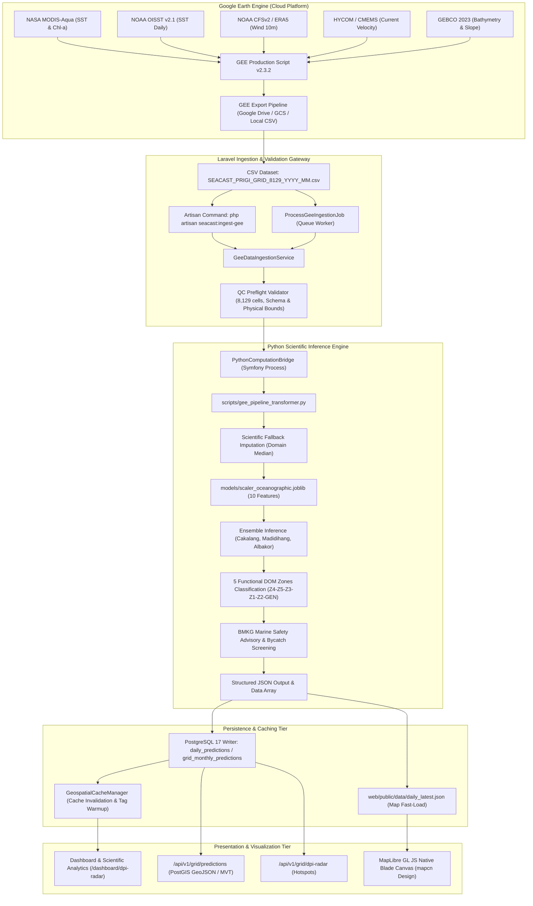

# SEACAST PRIGI V3 — GEE TO WEB INTEGRATION ARCHITECTURE
## End-to-End Operational Pipeline Specification: From Earth Engine Extraction to PostGIS Storage and MapLibre Visualization

**Document Version:** 1.0.0  
**Status:** Approved Technical Architecture  
**Target Domain:** WPPNRI 573 (8,129 Canonical Grid Cells)  
**System Stack:** GEE JavaScript/Python → Python 3.14 (Inference) → Laravel 13 (Modular Monolith) → PostgreSQL 17 + PostGIS 3.6 → MapLibre GL JS (Blade + Alpine.js + Tailwind CSS)  

---

## 1. END-TO-END SYSTEM OVERVIEW

Integrasi **Google Earth Engine (GEE)** ke platform web **SEACAST PRIGI V3** dirancang untuk menghubungkan telemetri satelit oseanografi resolusi tinggi dengan antarmuka analitik keputusan nelayan secara terstandarisasi, otomatis, dan dapat diaudit secara ilmiah.



---

## 2. THE SEVEN OPERATIONAL PIPELINE STAGES

### 2.1 Stage 1: GEE Data Extraction & Multi-Sensor Fusion
- **Tanggung Jawab:** Mengekstraksi parameter oseanografi dari koleksi satelit publik pada Google Earth Engine melalui skrip produksi `gee/SEACAST_PRIGI_GEE_PRODUCTION_2015_2025_v2_3_2.js` atau pipeline otomatis `gee/py/run_gee_pipeline.py`.
- **Resolusi & Domain:** Memotong citra satelit pada batas poligon WPPNRI 573 dan mengagregasi nilai rata-rata (*spatial mean*) ke dalam 8.129 sel kanonis ($0.10^\circ \times 0.10^\circ$).
- **Fusi Sensor:**
  - SST: MODIS-Aqua (4 km) digabung dengan NOAA OISST v2.1 ($0.25^\circ$).
  - Front Termal: Gradien dihitung menggunakan matriks Sobel $3 \times 3$ yang dikoreksi orientasi baris $K_y$.
  - Angin & Ekman: Angin 10m CFSv2 dikonversi ke tegangan angin $\tau$ menggunakan koefisien drag Wu (1982), dilanjutkan komputasi pemompaan Ekman dengan parameter Coriolis dan suku $\beta$.

### 2.2 Stage 2: Export Contract & File Transfer Specification
- **Nama Berkas Standar:**
  - Arsip Bulanan: `SEACAST_PRIGI_GRID_8129_{YEAR}_{MONTH}.csv` (contoh: `SEACAST_PRIGI_GRID_8129_2015_01.csv`).
  - Arsip Harian / Pilot: `PILOT_2024_WPP573_R010_M{MONTH}.csv` atau `SEACAST_PRIGI_DAILY_{YYYY_MM_DD}.csv`.
- **Integritas Berkas:**
  - Tepat 8.129 baris data (+1 baris header).
  - Tanda pemisah koma (CSV standar RFC 4180).
  - Dilengkapi checksum SHA-256 untuk verifikasi integritas data transfer.

### 2.3 Stage 3: Laravel Ingestion & QC Preflight Validation
- **Komponen:** `App\Domain\ScientificData\Services\GeeDataIngestionService`.
- **Prosedur Validasi (Preflight Gate):**
  1. *File Existence & Readability:* Memastikan berkas ada, tidak kosong, dan memiliki ekstensi `.csv`.
  2. *Header Schema:* Memastikan kolom wajib (`cell_id`, SST, gradien, Chl-a, arus, angin, batimetri) tersedia.
  3. *Cell Count Integrity:* Memverifikasi bahwa jumlah baris tepat 8.129 sel kanonis WPPNRI 573.
  4. *Physical Bounds Check:* Memastikan nilai data berada pada rentang oseanografi yang masuk akal:
     - SST: $18.0^\circ\text{C} \le T \le 34.0^\circ\text{C}$
     - Chl-a: $0.01 \le C \le 20.0\text{ mg/m}^3$
     - Kecepatan Angin: $0.0 \le U_{10} \le 35.0\text{ m/s}$
     - Batimetri: $1.0 \le D \le 8.500\text{ m}$

### 2.4 Stage 4: Feature Transformation & Imputation Protocol
- **Komponen:** `scripts/gee_pipeline_transformer.py` / `scripts/bridge_inference_runner.py`.
- **Prosedur:**
  - Melakukan join antara data GEE dengan metadata sel kanonis (`depth_m`, `dist_nm`, koordinat sentroid) dari `data/geojson/canonical_grid_8129_cells.geojson`.
  - Imputasi nilai kosong (*NaN*) akibat tutupan awan:
    - Nilai kosong SST diganti dengan median domain perairan terbuka pada bulan tersebut (bukan $0^\circ\text{C}$).
    - Nilai kosong Chl-a diganti dengan median domain perairan terbuka.
    - Nilai kosong kecepatan arus diganti dengan median domain.
  - Membangun matriks fitur 10 kolom:
    $$\mathbf{X} = [\text{sst}, \text{grad\_sst}, \text{front\_indicator}, \text{chla}, \text{current\_velocity}, \text{wind\_speed}, \text{wind\_stress}, \text{ekman\_upwelling\_velocity}, \text{depth}, \text{dist\_port\_km}]$$
  - Melakukan penskalaan menggunakan `models/scaler_oceanographic.joblib` (StandardScaler terkalibrasi).

### 2.5 Stage 5: Python Model Inference Bridge
- **Komponen:** `App\Infrastructure\Python\PythonComputationBridge`.
- **Eksekusi Model:**
  - Memanggil `joblib.load()` untuk ketiga model ensemble:
    - `models/cakalang_ensemble_model.joblib`
    - `models/madidihang_ensemble_model.joblib`
    - `models/albakor_ensemble_model.joblib`
  - Menerapkan pembobotan ensemble terkunci (*locked scientific weights*):
    - Cakalang: $\text{MaxEnt}(0.320) + \text{RF}(0.355) + \text{GLM}(0.325)$
    - Madidihang: $\text{MaxEnt}(0.295) + \text{RF}(0.365) + \text{GLM}(0.340)$
    - Albakor: $\text{MaxEnt}(0.000) + \text{RF}(0.517) + \text{GLM}(0.483)$
  - Normalisasi HSI ke rentang $0.000 - 1.000$.
- **Klasifikasi DOM & Keselamatan:**
  - Evaluasi 5 Zona Dinamis DOM berdasarkan prioritas bertingkat (*waterfall*):
    $$Z4 \ (\text{Nursery}) \succ Z5 \ (\text{Bycatch Screening}) \succ Z3 \ (\text{Feeding Core}) \succ Z1 \ (\text{PFG Inshore}) \succ Z2 \ (\text{PFG Offshore}) \succ \text{GENERAL\_OCEANIC}$$
  - Evaluasi Lampu Lalu Lintas Bycatch (Green / Yellow / Red).
  - Evaluasi Peringatan Keselamatan BMKG berdasarkan tinggi gelombang signifikan:
    - $H_s \ge 3.5\text{ m}$: `BAHAYA_GELOMBANG_EKSTREM`
    - $H_s \ge 2.0\text{ m}$: `WASPADA_KAPAL_KECIL_GELOMBANG_TINGGI`
    - $H_s < 2.0\text{ m}$: `AMAN_MELAUT`

### 2.6 Stage 6: Database Persistence & Storage Architecture
- **Penulisan Basis Data Relasional:**
  - Hasil inferensi disimpan ke tabel `daily_predictions` (untuk data harian operasional) dan/atau `grid_monthly_predictions` (untuk data bulanan historis).
  - Menggunakan koneksi PostgreSQL dengan izin tulis (`postgres`) secara terkontrol di backend, sementara akses publik tetap dibatasi pada peran `seacast_readonly`.
- **Snapshot File Web:**
  - Hasil inferensi terbaru diekspor ke `web/public/data/daily_latest.json` untuk konsumsi langsung oleh browser tanpa kueri SQL berat.
- **Geospatial Cache Management:**
  - `GeospatialCacheManager` memicu invalidasi tag cache untuk tanggal yang diperbarui (`invalidateDate($targetDate)`).
  - Pemanasan cache (*warm-up*) otomatis untuk sektor-sektor utama (Jatim, Jabar-Jateng, Bali-Nusa Tenggara).

### 2.7 Stage 7: Laravel REST API & MapLibre Web Map Presentation
- **Endpoints:**
  - `GET /api/v1/grid/predictions?date=YYYY-MM-DD`: Data prediksi 8.129 sel berformat GeoJSON / JSON terkompresi.
  - `GET /api/v1/grid/dpi-radar`: Titik-titik hotspot penangkapan ikan berbobot tinggi ($HSI \ge 0.70$).
  - `GET /api/monitoring/pipeline`: Telemetri status pipeline, tanggal observasi satelit terbaru, dan indikator QC.
- **Visualisasi MapLibre GL JS:**
  - Menggunakan arsitektur native Blade + Alpine.js + Tailwind CSS (`mapcn` design language).
  - Pewarnaan raster poligon vektor secara dinamis berdasarkan HSI spesies, zona DOM, dan peta keselamatan BMKG.

---

## 3. DATA SCHEMA & FEATURE CONTRACT

### 3.1 Input GEE CSV Schema (104 Kolom / 51 Kolom)
```csv
cell_id,lat_center,lon_center,depth_m_mean,sst_mean_c_mean,sst_gradient_deg_km_mean,thermal_front_flag_mean,chla_mg_m3_mean,current_speed_m_s_mean,wind_speed_mean_m_s_mean,wind_stress_tau_mag_mean,ekman_w_e_m_s_mean
```

### 3.2 Output Inference JSON Schema
```json
{
  "status": "SUCCESS",
  "engine": "SEACAST_PRIGI_SDM_ENGINE",
  "model_version": "2.3.2",
  "prediction_date": "2026-11-04",
  "total_cells": 8129,
  "hotspots_count": 642,
  "summary": {
    "mean_hsi_cakalang": 0.232,
    "mean_hsi_madidihang": 0.447,
    "mean_hsi_albakor": 0.557,
    "safe_cells_pct": 94.2,
    "red_bycatch_cells": 84,
    "yellow_bycatch_cells": 312,
    "green_bycatch_cells": 7733
  },
  "provenance": {
    "satellite_sources": {
      "sst": "NOAA OISST v2.1 + NASA MODIS-Aqua L3SMI",
      "chla": "NASA MODIS-Aqua L3SMI (chlor_a)",
      "wind": "NOAA CFSv2 6-Hourly Harmonized",
      "current": "HYCOM GLBu0.08 / CMEMS Global Reanalysis",
      "bathymetry": "GEBCO 2023 Grid / NOAA ETOPO1"
    },
    "applied_weights": {
      "cakalang": {"maxent": 0.320, "rf": 0.355, "glm": 0.325},
      "madidihang": {"maxent": 0.295, "rf": 0.365, "glm": 0.340},
      "albakor": {"maxent": 0.000, "rf": 0.517, "glm": 0.483}
    }
  }
}
```

---

## 4. ERROR HANDLING & SECURITY POLICIES

1. **Fail-Closed on Validation Failure:** Jika berkas CSV tidak memenuhi syarat (misalnya jumlah sel kurang dari 8.129, korupsi header, atau rentang fisik tidak masuk akal), proses ingest akan berhenti seketika dengan pesan galat terstruktur tanpa merusak data yang telah tersimpan.
2. **Atomic Ingestion Transaction:** Penulisan ke basis data relasional dibungkus dalam transaksi database untuk mencegah status *partial write*.
3. **Strict Whitelist Python Bridge:** `PythonComputationBridge` hanya mengizinkan eksekusi skrip Python yang terdaftar dalam daftar putih (`whitelistedScripts`). Setiap argumen CLI disanitasi terhadap karakter injeksi perintah shell (`;`, `|`, `&`, `$`, dsb.).
4. **Database Read-Only Principle:** Seluruh lalu lintas web publik tetap menggunakan koneksi basis data `seacast_readonly`, sehingga tidak ada kemungkinan manipulasi data oleh pengguna eksternal.

---
*Dokumen ini merupakan spesifikasi arsitektur resmi integrasi GEE ke Web SEACAST PRIGI V3.*

