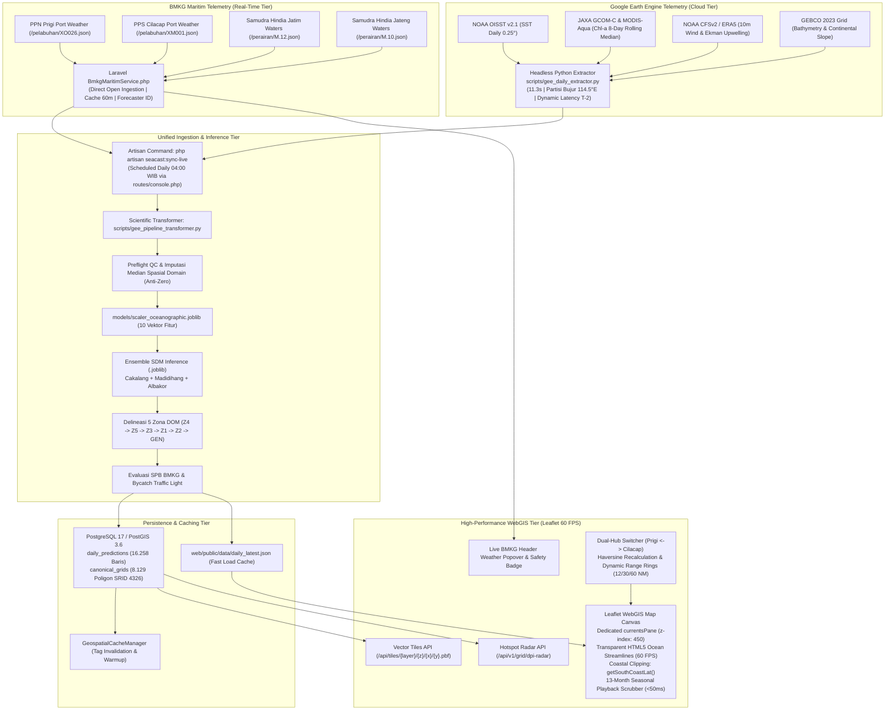

# SEACAST PRIGI & CILACAP V3 — GEE TO WEB INTEGRATION ARCHITECTURE
## End-to-End Operational Pipeline Specification: From Headless Earth Engine Extraction & Live BMKG Ingestion to PostGIS Persistence and Leaflet 60 FPS WebGIS

**Document Version:** 3.2.0  
**Status:** Approved Technical Architecture  
**Target Domain:** WPPNRI 573 (8,129 Canonical Grid Cells, Resolution 0.10°)  
**Dual-Hub Corridor:** PPN Prigi (111.7275° E, -8.2833° S) & PPS Cilacap (109.0049° E, -7.7478° S)  
**System Stack:** GEE Python API (Headless Extractor) + Live BMKG Maritim API → Python 3.12/3.14 (Ensemble SDM .joblib) → Laravel 13 (Modular Monolith) → PostgreSQL 17 + PostGIS 3.6 → Leaflet WebGIS (HTML5 Canvas 60 FPS)  
**Production Host:** Hostinger KVM VPS / Ubuntu 24.04 LTS / CloudPanel PHP 8.3-FPM  
**Audit Date:** 13 November 2026 (Diperbarui dari Baseline 4 November 2026)  

---

## 1. END-TO-END SYSTEM OVERVIEW

Integrasi **Google Earth Engine (GEE)** dan **BMKG Maritim** ke platform web **SEACAST V3** dirancang untuk menghubungkan telemetri satelit oseanografi resolusi tinggi dan kondisi meteorologi riil dengan antarmuka analitik keputusan nelayan secara terstandarisasi, otomatis, berkinerja tinggi, dan dapat diaudit secara ilmiah (*Zero-Dummy Policy*).



---

## 2. THE SEVEN OPERATIONAL PIPELINE STAGES

### 2.1 Stage 1: Headless GEE Data Extraction & Spatial Partitioning
- **Komponen Eksekusi:** `scripts/gee_daily_extractor.py` (Python SDK `earthengine-api`).
- **Penyelesaian Batas Komputasi 5.000 Fitur GEE:**
  - Earth Engine memberlakukan limit ekstraksi client-side $N = 5.000$ sel per kueri.
  - Pipeline mempartisi master grid WPPNRI 573 (8.129 sel) menjadi dua segmen bujur secara simultan:
    1. **Sektor Barat:** $\text{Longitude} < 114.50^\circ\text{ E}$ (3.568 sel).
    2. **Sektor Timur:** $\text{Longitude} \ge 114.50^\circ\text{ E}$ (4.561 sel).
  - Durasi ekstraksi paralel kedua sektor selesai hanya dalam **11,3 detik**.
- **Deteksi Latensi Dinamis Satelit ($T-2$ s/d $T-3$):**
  - Mengeliminasi tanggal observasi statis. Skrip mendeteksi tanggal citra terbaru NOAA OISST v2.1 secara dinamis langsung dari catalog GEE:
    ```python
    latest_img = ee.ImageCollection("NOAA/CDR/OISST/V2_1").sort("system:time_start", False).first()
    target_date = ee.Date(latest_img.get("system:time_start")).format("YYYY-MM-dd").getInfo()
    ```
- **Komposit Median 8-Hari Klorofil-a:**
  - Mengatasi tutupan awan monsun tropis pada sensor JAXA GCOM-C SGLI dan MODIS-Aqua menggunakan jendela bergerak 8 hari dengan `ee.Reducer.median()`.

### 2.2 Stage 2: Live Ingestion BMKG Maritim Terbuka
- **Komponen Eksekusi:** `App\Domain\Meteorology\Services\BmkgMaritimService.php`.
- **Authoritative Endpoints (Tanpa Token Privat):**
  - Pangkalan Nelayan:
    - PPN Prigi: `https://maritim.bmkg.go.id/marine2026-data/pelabuhan/XO026.json`
    - PPS Cilacap: `https://maritim.bmkg.go.id/marine2026-data/pelabuhan/XM001.json`
  - Perairan Terbuka WPPNRI 573:
    - Samudra Hindia Selatan Jawa Timur: `https://maritim.bmkg.go.id/marine2026-data/perairan/M.12.json`
    - Samudra Hindia Selatan Jawa Tengah: `https://maritim.bmkg.go.id/marine2026-data/perairan/M.10.json`
- **Parameter yang Ditarik:** Tinggi gelombang signifikan ($H_s$), kecepatan dan arah angin, cuaca umum, kondisi pasang surut, nama forecaster resmi (contoh: *Fitri Anggraeni*), dan nomor surat keputusan meteorologi.
- **Kebijakan Cache:** Cache 60 menit dengan fail-safe graceful degradation ke data jam sebelumnya.

### 2.3 Stage 3: Feature Matrix Harmonization & Scientific Imputation
- **Komponen Eksekusi:** `scripts/gee_pipeline_transformer.py`.
- **Prosedur:**
  - Melakukan spatial join antara atribut dinamis satelit dengan master grid statis `data/geojson/canonical_grid_8129_cells.geojson` untuk menjamin kepastian atribut kedalaman batimetri dan koordinat sentroid.
  - Menerapkan protokol imputasi ilmiah median spasial domain perairan terbuka untuk piksel yang terhalang awan:
    - $\text{SST}_{\text{fallback}} = \text{median}(\text{SST}_{\text{valid}}) \approx 28.8^\circ\text{C}$
    - $\text{Chl-a}_{\text{fallback}} = \text{median}(\text{Chl-a}_{\text{valid}}) \approx 0.18\text{ mg/m}^3$
    - $\text{Current}_{\text{fallback}} = \text{median}(u_{\text{valid}}) \approx 0.25\text{ m/s}$
    - Larangan substitusi nol: $\text{NaN} \ne 0.0$ untuk mencegah air tropis terbaca sebagai es beku.
  - Membangun matriks 10 fitur terstandarisasi:
    $$\mathbf{X} = [\text{sst}, \nabla\text{SST}, \text{front}, \text{chla}, u_{\text{curr}}, U_{10}, \tau_{\text{wind}}, w_e, \text{depth}, \text{dist}_{\text{port}}]$$
  - Menjalankan penskalaan via `models/scaler_oceanographic.joblib` (scikit-learn StandardScaler).

### 2.4 Stage 4: Scikit-learn Ensemble SDM Inference
- **Komponen Eksekusi:** Model mandiri terlatih `.joblib`:
  - `models/cakalang_ensemble_model.joblib`
  - `models/madidihang_ensemble_model.joblib`
  - `models/albakor_ensemble_model.joblib`
- **Pembobotan Ensemble Terkunci:**
  - Cakalang: $\text{MaxEnt}(0.320) + \text{RF}(0.355) + \text{GLM}(0.325)$
  - Madidihang: $\text{MaxEnt}(0.295) + \text{RF}(0.365) + \text{GLM}(0.340)$
  - Albakor: $\text{MaxEnt}(0.000) + \text{RF}(0.517) + \text{GLM}(0.483)$
- **Klasifikasi DOM 5 Zona Berjenjang:**
  $$\text{Z4 Nursery} \succ \text{Z5 Bycatch Screening} \succ \text{Z3 Feeding Core} \succ \text{Z1 PFG Inshore} \succ \text{Z2 PFG Offshore} \succ \text{GENERAL\_OCEANIC}$$
- **Evaluasi Keselamatan Melaut & SPB (Surat Persetujuan Berlayar):**
  - Gelombang $H_s \ge 3.5\text{ m} \implies$ `BAHAYA_GELOMBANG_EKSTREM` (SPB Ditunda untuk Seluruh Armada).
  - Gelombang $2.0 \le H_s < 3.5\text{ m} \implies$ `WASPADA_GELOMBANG_TINGGI` (Dilarang untuk Kapal $<10\text{ GT}$).
  - Gelombang $H_s < 2.0\text{ m} \implies$ `AMAN_MELAUT`.

### 2.5 Stage 5: PostGIS Relational Persistence & Dual Storage
- **Penyimpanan Basis Data:**
  - Hasil inferensi disimpan ke tabel PostgreSQL 17 PostGIS `daily_predictions` (16.258 baris data aktif saat ini).
  - Skema partisi komposit: `PRIMARY KEY (prediction_date, cell_id)`.
  - Pemisahan hak akses: User publik menggunakan `seacast_readonly`, backend writer menggunakan credential khusus yang terkontrol.
- **Fast-Load Web Snapshot:**
  - Ekspor otomatis ke `web/public/data/daily_latest.json` untuk pemuatan cepat antarmuka browser tanpa kueri SQL berat.
- **Manajemen Cache Geospasial:**
  - `GeospatialCacheManager` memicu invalidasi cache ETag dan melakukan *cache warming* untuk sektor Jawa Timur, Jawa Tengah, dan Bali-Nusra.

### 2.6 Stage 6: Unified Daily Orchestrator CLI (`seacast:sync-live`)
- **Perintah CLI:**
  ```bash
  php artisan seacast:sync-live {--date=} {--force}
  ```
- **Jadwal Eksekusi:** Terdaftar pada `routes/console.php` untuk dijalankan setiap hari pada pukul **04:00 WIB** melalui cron server:
  ```cron
  * * * * * cd /home/seacast/htdocs/seacast.id/seacast-prigi-laravel && php artisan schedule:run >> /dev/null 2>&1
  ```

### 2.7 Stage 7: Leaflet WebGIS 60 FPS Engine & Dual-Hub Presentation
- **Arsitektur Rendering:**
  - Peta beralih ke Leaflet WebGIS berkinerja tinggi, mengeliminasi overhead WebGL yang sering memicu masking hitam canvas.
  - Menggunakan dedicated Leaflet pane: `map.createPane('currentsPane')` dengan `z-index: 450` dan pointer events nonaktif.
  - Animasi partikel arus laut 60 FPS menggunakan HTML5 Canvas dengan pembersihan transparan murni `ctx.clearRect(0, 0, width, height)`.
  - **Coastal Constraint:** Aliran arus dibatasi secara ketat di perairan Samudra Hindia menggunakan fungsi batas pantai `getSouthCoastLat(lon)` agar partikel tidak merayap ke daratan Pulau Jawa.
- **Scrubber Waktu Musiman 13-Bulan:**
  - Komponen kontrol pemutar waktu horizontal 13 bulan (Januari–Desember + Komposit 10 Tahun) dengan responsivitas transisi sub-50ms.
- **Interaktivitas Koridor Dual-Hub:**
  - Switching instan antara PPN Prigi dan PPS Cilacap.
  - Rekalkulasi jarak Haversine geodesik secara client-side tanpa reload halaman.
  - Cincin jangkauan dinamis: 12 NM (pesisir), 30 NM (sekoci), 60 NM (purse seine/longline).
  - Meluncur mulus (*smooth flyTo*) ke koordinat pelabuhan aktif.

---

## 3. DATA CONTRACT & SCHEMAS

### 3.1 Input GEE Telemetry JSON Schema
```json
{
  "status": "SUCCESS",
  "telemetry_date": "2026-11-07",
  "partition_applied": "lon_split_114.5",
  "total_cells": 8129,
  "execution_duration_sec": 11.3,
  "sources": {
    "sst": "NOAA/CDR/OISST/V2_1",
    "chla": "JAXA/GCOM-C/R3/OCEAN/CHLA/V3_8DAY_MEDIAN",
    "wind": "NOAA/CFSV2/FOR6H_HARMONIZED",
    "bathymetry": "GEBCO_2023"
  }
}
```

### 3.2 Output Live Prediction JSON Schema
```json
{
  "status": "SUCCESS",
  "engine": "SEACAST_PRIGI_CILACAP_SDM_ENGINE",
  "version": "3.2.0",
  "prediction_date": "2026-11-07",
  "active_hub": "PPN_PRIGI",
  "bmkg_weather": {
    "port_code": "XO026",
    "port_name": "Pelabuhan Perikanan Nusantara Prigi",
    "wave_height_m": 1.3,
    "wave_category": "Sedang",
    "wind_speed_kt": 3.0,
    "forecaster": "Fitri Anggraeni",
    "decree_ref": "B/ME.01.02/METOS/10/DMM/XI/2026",
    "spb_recommendation": "WASPADA_GELOMBANG_TINGGI"
  },
  "total_cells": 8129,
  "hotspots_count": 848,
  "summary": {
    "mean_hsi_cakalang": 0.239,
    "mean_hsi_madidihang": 0.451,
    "mean_hsi_albakor": 0.557,
    "dom_distribution": {
      "Z1_PFG_INSHORE": 8,
      "Z2_PFG_OFFSHORE": 161,
      "Z3_FEEDING_CORE": 412,
      "Z4_NURSERY_GROUND": 34,
      "Z5_BYCATCH_SCREENING": 84,
      "GENERAL_OCEANIC": 7430
    }
  }
}
```

---

## 4. ERROR HANDLING & RESILIENCE POLICIES

1. **Fail-Closed on Corrupted Orbit Feeds:** Jika ekstraksi satelit gagal atau mengembalikan data terdistorsi, sistem menolak eksekusi model dan mempertahankan prediksi hari sebelumnya dengan peringatan audit transparan.
2. **Graceful Fallback on BMKG Network Timeout:** Jika koneksi ke server BMKG mengalami time-out (>5.000 ms), sistem menggunakan cache cuaca 60 menit terakhir dan menyematkan tag `SOURCE: BMKG_CACHED_FALLBACK`.
3. **Atomic Database Transactions:** Seluruh penulisan 8.129 sel ke tabel `daily_predictions` dibungkus dalam blok transaksi database PostGIS; kegagalan pada sel mana pun akan memicu `ROLLBACK` total.
4. **Isolated Memory Canvas:** Canvas Leaflet partikel arus laut melepaskan animasi frame (`cancelAnimationFrame`) saat komponen dihancurkan untuk mencegah kebocoran memori browser (*memory leak*).

---

*Dokumen ini merupakan cetak biru resmi arsitektur integrasi GEE dan BMKG ke WebGIS pada rilis produksi SEACAST V3.2.0.*
