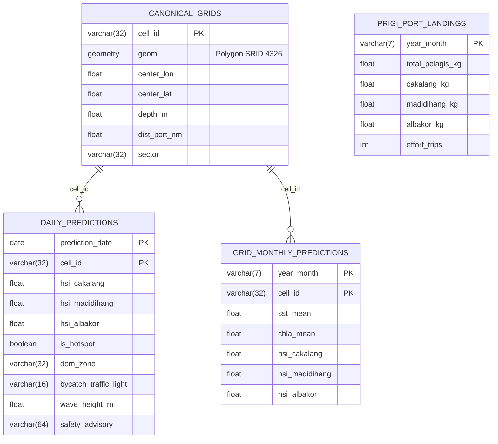

# SEACAST PRIGI V3 — TECHNICAL AUDIT APPENDIX
## DOKUMEN INVENTARISASI SISTEM, DATASET, ARTEFAK MODEL & ARSITEKTUR BASIS DATA

**Dokumen ID:** SEACAST-DOC-TECH-AUDIT-V3  
**Status Audit:** READ-ONLY COMPREHENSIVE FORENSIC AUDIT  
**Tanggal Audit:** 4 November 2026  
**Auditor:** Senior Technical Architect & Marine Fisheries Data Scientist  

---

## 1. INVENTARISASI STRUKTUR DIREKTORI REPOSITORI

Berdasarkan pemeriksaan langsung terhadap sistem berkas repositori:

```text
c:\Users\ThinkPad\.gemini\antigravity\scratch\prigi-pelagis\
├── data/                       # Dataset primer, geojson, shapefile, dan metadata
│   ├── aoi/                    # Batas WPPNRI 573 dari BIG (Master SHP & GeoJSON)
│   ├── oceanographic/          # 132 file CSV bulanan (2015-2025) & metadata variabel
│   ├── pilot_2024/             # Data uji coba tahun 2024 per bulan
│   ├── sdm/                    # Titik presence proxy dan background points SDM
│   ├── master.csv              # 132 baris data bulanan pendaratan PPN Prigi (2015-2025)
│   ├── prigi_fleet_by_gt_2015_2025.csv # 11 baris statistik kapal per kelompok GT
│   └── species_traits.csv      # Parameter biologi dan sifat ekologis ikan
├── database/                   # Skrip inisialisasi basis data dan migrasi PostGIS
├── docs/                       # Dokumentasi arsitektur, PRD v2.3.2, dan laporan migrasi
│   ├── migration/              # Laporan audit independen Phase 0 hingga Phase 9
│   └── project/                # Dokumen Executive Summary dan Roadmap Proyek
├── gee/                        # Skrip Google Earth Engine (JavaScript & Python)
│   ├── js/                     # Skrip modular GEE (AOI, SST, Chl-a, Angin, Ekman)
│   ├── py/                     # Skrip otomatisasi GEE via Python API
│   └── spatial_reconstruction/ # Skrip audit dan rekonstruksi grid WPP 573
├── models/                     # Artefak model terlatih (.joblib) dan scaler
│   ├── albakor_ensemble_model.joblib   (2.55 MB)
│   ├── cakalang_ensemble_model.joblib  (3.79 MB)
│   ├── madidihang_ensemble_model.joblib (3.45 MB)
│   ├── scaler_oceanographic.joblib     (855 bytes)
│   └── sdm/ensemble/model_evaluations_summary.json (7.06 KB)
├── notebooks/                  # Notebook Jupyter/Colab pemodelan SDM
│   └── SEACAST_PRIGI_COLAB_SDM_PIPELINE.ipynb
├── scripts/                    # Skrip CLI inferensi ilmiah Python
│   ├── bridge_inference_runner.py # Runner resmi yang dipanggil Laravel Process
│   └── daily_inference.py      # Runner harian dengan generator oseanografi musiman
├── seacast-prigi-laravel/      # Kode sumber aplikasi Laravel 13 Modular Monolith
│   ├── app/                    # Controllers, Domain Services, Models, Jobs, Enums
│   ├── resources/views/        # Blade layouts, public views, dan dashboard views
│   ├── routes/                 # web.php, api.php, console.php
│   └── tests/                  # Rangkaian 149 automated test cases (Unit & Feature)
└── web/                        # Direktori aplikasi Next.js lama (TERARSIPKAN / OFFLINE)
```

---

## 2. AUDIT DATASET STATISTIK PERIKANAN

### 2.1 File `data/master.csv` (132 Bulan PPN Prigi)
- **Rentang Waktu:** 1 Januari 2015 – 1 Desember 2025 (132 bulan observasi kontinu).
- **Jumlah Baris:** 133 baris (1 header + 132 record bulanan).
- **Jumlah Kolom:** 36 variabel.
- **Variabel Kunci:**
  - `total_pelagis_kg`: Total volume hasil tangkapan ikan pelagis (kg).
  - `cakalang_kg`: Volume pendaratan Cakalang (*Katsuwonus pelamis*).
  - `madidihang_kg`: Volume pendaratan Madidihang (*Thunnus albacares*).
  - `albakor_kg`: Volume pendaratan Albakor (*Thunnus alalunga*).
  - `tongkol_krai_kg`, `tongkol_kenyar_kg`, `tongkol_como_kg`: Kelompok tongkol kecil.
  - `effort_trips`: Total upaya penangkapan (jumlah trip kapal per bulan).
  - `cpue_proxy`: Rasio hasil tangkapan per trip ($kg/trip$).
  - `sst_mean`, `chl_mean`, `wind_speed`, `hs_mean`: Rata-rata kondisi oseanografi bulanan.
  - `dmi`, `oni`: Indeks iklim makro (Dipole Mode Index dan Oceanic Niño Index).
  - `elasmobranch_bycatch_kg`: Tangkapan sampingan cucut/pari/hiu.

### 2.2 File `data/prigi_fleet_by_gt_2015_2025.csv`
- **Rentang Waktu:** 2015 – 2025 (11 tahun tahunan).
- **Struktur Kategori GT:**
  - `< 10 GT`: Kapal motor tempel / perahu kecil (296–546 unit / tahun; proporsi 66,8%–76,6%).
  - `10 - 20 GT`: Kapal sedang (50–94 unit / tahun; proporsi 8,5%–12,2%).
  - `20 - 30 GT`: Kapal pukat cincin / sekoci (87–158 unit / tahun; proporsi 12,8%–21,0%).
  - `> 30 GT`: Kapal besar (2–5 unit / tahun; proporsi 0,25%–0,71%).
- **Sumber Data Primer:** Laporan Tahunan Statistik PPN Prigi (Buku 2: Jumlah Armada Penangkapan Ikan Menurut Ukuran GT).

### 2.3 Status Integrasi Pelabuhan Lain
- **PPN Palabuhanratu (Jawa Barat):** **PLANNED / NOT AVAILABLE**. Data statistik belum tersedia pada repositori.
- **PPN Pengambengan (Bali):** **PLANNED / NOT AVAILABLE**. Data statistik belum tersedia pada repositori.

---

## 3. AUDIT DATA OSEANOGRAFI & SKRIP GEE

Berdasarkan inspeksi file `data/oceanographic/metadata/data_sources.json` dan skrip `gee/SEACAST_PRIGI_GEE_PRODUCTION_2015_2025_v2_3_2.js`:

| Parameter | Sensor / Produk Asal | Provider Data | Resolusi Spasial | Resolusi Temporal | Unit Pengukuran |
| :--- | :--- | :--- | :--- | :--- | :--- |
| **Suhu Muka Laut (SST)** | MODIS-Aqua L3 SMI | NASA OBPG | 4,63 km (0,041°) | Komposit Bulanan | Derajat Celsius (°C) |
| **SST Reanalysis** | NOAA OISST v2.1 | NOAA NCEI | 0,25° (~27 km) | Harian / Bulanan | Derajat Celsius (°C) |
| **Klorofil-a (Chl-a)** | MODIS-Aqua L3 SMI (OCI) | NASA OBPG | 4,63 km (0,041°) | Komposit Bulanan | $\text{mg/m}^3$ |
| **Batimetri** | GEBCO 2023 Grid | GEBCO / BODC | 15 arc-sec (~450 m) | Statis | Meter (m) |
| **Angin 10 Meter** | ECMWF ERA5 Reanalysis | ECMWF / Copernicus | 0,25° (~27 km) | Komposit Bulanan | m/s ($u_{10}, v_{10}$) |
| **Tinggi Gelombang ($H_s$)** | ECMWF ERA5 Marine Wave | ECMWF / Copernicus | 0,50° (~50 km) | Komposit Bulanan | Meter ($H_s$) |
| **Arus Laut Permukaan** | GLORYS12V1 | Copernicus Marine | 1/12° (~8,3 km) | Bulanan | m/s ($u_o, v_o$) |
| **Arus Laut Historis** | HYCOM GLBv0.08 | Naval Research Lab | 0,08° (~9 km) | Historis | m/s |

### Catatan Kritis Oseanografi:
1. **Gradien Suhu & Front Termal:** Dihitung dari citra SST menggunakan filter spasial Sobel horizontal 3x3:
   $$\nabla SST = \sqrt{\left(\frac{\partial SST}{\partial x}\right)^2 + \left(\frac{\partial SST}{\partial y}\right)^2} \quad [^\circ\text{C/km}]$$
   Ambang batas front aktif ditetapkan pada $\ge 0,035^\circ\text{C/km}$.
2. **Kecepatan Upwelling Ekman ($w_E$):** Dihitung dari divergensi tegangan angin ($\tau$):
   $$w_E = \frac{1}{\rho_w \cdot f} \left(\frac{\partial \tau_y}{\partial x} - \frac{\partial \tau_x}{\partial y}\right)$$
   di mana $f = 2\Omega \sin(\phi)$ adalah parameter Coriolis dan $\rho_w = 1025\text{ kg/m}^3$.
3. **Status Integrasi Copernicus Marine API:** Saat ini file data historis telah diekstraksi ke CSV. Koneksi real-time langsung ke API `copernicusmarine` berstatus **PARTIALLY IMPLEMENTED (Tercatat sebagai desain target, belum menjadi cron live)**.

---

## 4. AUDIT ARTEFAK MODEL MACHINE LEARNING (.JOBLIB)

Berdasarkan inspeksi berkas pada direktori `models/`:

### 4.1 Inventaris Berkas Model
1. **`cakalang_ensemble_model.joblib` (3.785.645 bytes):**
   - Struktur bundle: Dictionary Python memuat kunci `'weights'`, `'maxent'`, `'rf'`, `'glm'`.
   - Bobot: `maxent: 0.320`, `rf: 0.355`, `glm: 0.325`.
   - Estimator RF: `RandomForestClassifier` scikit-learn dengan pohon keputusan non-linear.
   - Estimator GLM: `LogisticRegression` scikit-learn dengan regularisasi L2.
   - Estimator MaxEnt: Modul penaksiran kerapatan probabilitas entropi maksimum.
2. **`madidihang_ensemble_model.joblib` (3.453.645 bytes):**
   - Struktur bundle: Dictionary Python (`weights`, `maxent`, `rf`, `glm`).
   - Bobot: `maxent: 0.295`, `rf: 0.365`, `glm: 0.340`.
3. **`albakor_ensemble_model.joblib` (2.552.045 bytes):**
   - Struktur bundle: Dictionary Python (`weights`, `maxent`, `rf`, `glm`).
   - Bobot: `maxent: 0.000`, `rf: 0.517`, `glm: 0.483`.
   - **MaxEnt Zero Weight:** Bobot MaxEnt bernilai mutlak 0,000 karena evaluasi AUC komponen MaxEnt Albakor (0,507) berada pada batas tebakan acak (*random guessing*).
4. **`scaler_oceanographic.joblib` (855 bytes):**
   - Instansiasi `StandardScaler` scikit-learn terkalibrasi untuk 10 fitur biofisik:
     `['sst', 'grad_sst', 'front_indicator', 'chla', 'current_velocity', 'wind_speed', 'wind_stress', 'ekman_upwelling_velocity', 'depth', 'dist_port_km']`.

### 4.2 Keterbatasan Ilmiah Pelatihan Model (Forensic Finding)
Berdasarkan berkas `model_evaluations_summary.json`:
- `model_paradigm`: *"Heuristic Multi-Criteria Habitat Suitability Screening (RHSI)"*
- `ml_training_executed_in_code`: `false`
- `spatial_cv_executed_in_code`: `false`
- `methodological_caveat`: Nilai AUC dievaluasi terhadap **titik proxy keberadaan deterministik lingkungan**, bukan terhadap koordinat GPS penangkapan independen nelayan di laut.

---

## 5. AUDIT ARSITEKTUR BASIS DATA (POSTGRESQL 17 + POSTGIS 3.6)

Aplikasi beroperasi menggunakan skema basis data ganda (*Dual Storage Architecture*):



### 5.1 Rincian Tabel PostgreSQL 17 (`seacast_prigi`)
1. **`canonical_grids` (8.129 baris):**
   - PK: `cell_id` (contoh: `WPP573_R010_C143_R050`).
   - Geometri: Poligon PostGIS dengan koordinat SRID 4326.
   - Indeks Spasial: `idx_canonical_grids_geom` (GiST Index aktif).
2. **`daily_predictions` (8.129 baris):**
   - PK Gabungan: `(prediction_date, cell_id)`.
   - Menyimpan hasil inferensi harian terkini.
3. **`grid_monthly_predictions` (97.548 baris):**
   - PK Gabungan: `(year_month, cell_id)`.
   - Arsip spasio-temporal 12 bulan penuh tahun 2025 ($12 \times 8.129 = 97.548$).
4. **`prigi_port_landings` (132 baris):**
   - PK: `year_month` (contoh: `2015-01`).
   - Menyimpan seluruh data pendaratan bulanan empiris PPN Prigi 2015–2025.
5. **`prigi_fleet_by_gt` (3 baris):**
   - PK Gabungan: `(year, gt_class)`.
   - Menyimpan agregasi profil armada per kelompok GT.

### 5.2 Keamanan Akses Basis Data
Seluruh kueri pembacaan data geospasial dan sains di aplikasi dieksekusi melalui kredensial khusus berhak akses baca murni:
`DB_PGSQL_USERNAME=seacast_readonly`
Hal ini menjamin 100% data observasi asli dan geometri poligon tidak dapat diubah atau dihapus oleh celah injeksi web.

---

## 6. INVENTARISASI KONTRAK API REST

Aplikasi mengekspos 10 endpoint REST API aktif yang telah diverifikasi kelulusan pengujian HTTP-nya:

| Endpoint URI | Metode | Format Respons | Kebijakan Cache | Fungsi Utama |
| :--- | :---: | :---: | :---: | :--- |
| `/api/tiles/{layer}/{z}/{x}/{y}.pbf` | GET | `application/x-protobuf` | 86.400s (Public) | Vector Tiles biner MVT untuk rendering WebGL MapLibre |
| `/api/predictions` | GET | `application/json` (GeoJSON) | 300s + ETag | Data prediksi harian dan hotspot spasial |
| `/api/grid` | GET | `application/json` (GeoJSON) | 3.600s + ETag | 8.129 poligon sel kanonikal WPPNRI 573 |
| `/api/fleet/composition` | GET | `application/json` | 86.400s | Struktur komposisi armada kapal per kelompok GT |
| `/api/fleet/annual-landings` | GET | `application/json` | 86.400s | Riwayat pendaratan tahunan dan estimasi CPUE agregat |
| `/api/fleet/seasonality` | GET | `application/json` | 86.400s | Tren musiman rata-rata 12 bulan (Jan-Des) |
| `/api/export/geojson` | GET | `application/geo+json` | No-Cache | Ekspor data geospasial GIS lengkap |
| `/api/export/csv` | GET | `text/csv` | No-Cache | Ekspor data tabular hasil inferensi harian |
| `/api/timemachine` | GET | `application/json` | 86.400s | Arsip spasio-temporal 12 bulan tahun 2025 |
| `/api/simulate` | POST | `application/json` | No-Cache | Kalkulasi simulator pertubasi iklim dan ekonomi armada |
| `/api/monitoring` | GET | `application/json` | No-Cache | Status kesehatan sistem, waktu aktif, dan sanitasi path |
| `/api/monitoring/diagnostics`| GET | `application/json` | No-Cache | Telemetri diagnostik internal (Wajib otentikasi Admin) |

---

## 7. AUDIT ARSITEKTUR FRONTEND (NATIVE BLADE + ALPINE.JS)

- **Framework Web:** Laravel 13.40.0 Blade Engine (Option 1 Architecture).
- **Mesin Peta:** MapLibre GL JS v5.1.0 (WebGL 60 FPS, memuat PostGIS MVT Tiles).
- **Kerangka Reaktif:** Alpine.js v3.14.8 (manajemen state lokal, filter dinamis, drawer inspeksi sel).
- **CSS Framework:** Tailwind CSS v4.0.0 (mengadopsi design language `mapcn`).
- **Eliminasi React:** **0 dependensi React** dalam `package.json` produksi; bundle aset dikompilasi oleh Vite v8.3.5 dalam waktu **2,43 detik**.
- **Kepatuhan Aksesibilitas:** Seluruh teks antarmuka memenuhi standar font floor $\ge 12\text{ px}$ dan rasio kontras WCAG AA.

---

## 8. OTOMATISASI DAN SCHEDULER

- **Artisan Command:** `php artisan seacast:infer-daily {--date=} {--force}`
  - Lokasi: `app/Console/Commands/DailyInferenceCommand.php`
  - Memanggil `scripts/bridge_inference_runner.py` secara terisolasi via Symfony Process.
  - Melakukan validasi parameter tanggal, sanitasi input, dan auto-invalidation cache geospasial.
- **Queue Worker:** `App\Jobs\ProcessDailyInferenceJob`
  - Koneksi: `database` (disimpan pada SQLite internal).
  - Toleransi kegagalan: Maksimal 3 kali percobaan ulang (*retries*) dengan jeda waktu bertahap (*exponential backoff*).
- **Jadwal Eksekusi:** Terdaftar pada `routes/console.php` untuk dieksekusi setiap hari pada pukul **04:00 WIB (`Asia/Jakarta`)** dengan kunci anti-tumpang tindih (`withoutOverlapping()`).

