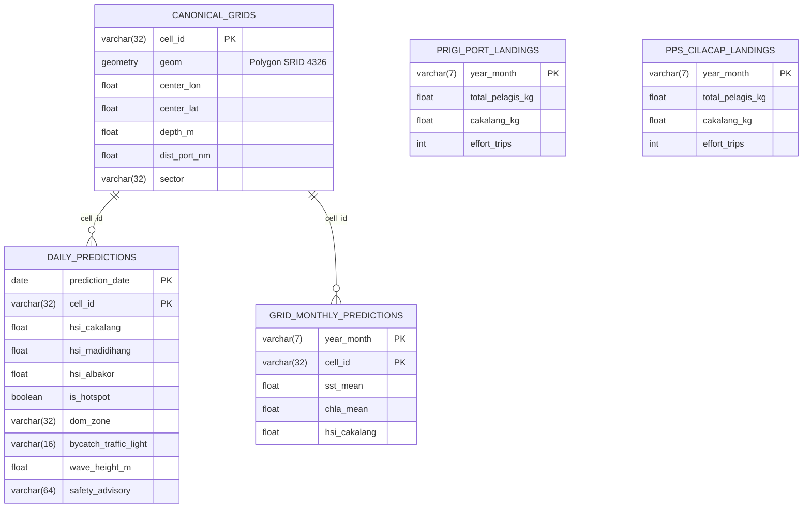

# SEACAST PRIGI & CILACAP V3 — TECHNICAL AUDIT APPENDIX
## DOKUMEN INVENTARISASI SISTEM, DATASET, ARTEFAK MODEL & ARSITEKTUR BASIS DATA

**Dokumen ID:** SEACAST-DOC-TECH-AUDIT-V3  
**Status Audit:** READ-ONLY COMPREHENSIVE FORENSIC & RUNTIME AUDIT  
**Tanggal Audit:** 13 November 2026 (Diperbarui dari Baseline 4 November 2026)  
**Auditor:** Principal Technical Architect & Lead Marine Spatial Intelligence Specialist  

---

## 1. INVENTARISASI STRUKTUR DIREKTORI REPOSITORI

Berdasarkan pemeriksaan langsung terhadap sistem berkas repositori:

```text
c:\Users\ThinkPad\.gemini\antigravity\scratch\prigi-pelagis\
├── data/                       # Dataset primer, geojson, shapefile, dan metadata
│   ├── aoi/                    # Batas WPPNRI 573 dari BIG (Master SHP & GeoJSON)
│   ├── oceanographic/          # 120 file CSV bulanan (2015-2024) & metadata variabel
│   ├── pilot_2024/             # Data uji coba tahun 2024 per bulan (12 file CSV)
│   ├── sdm/                    # Titik presence proxy dan background points SDM
│   ├── master.csv              # 132 baris data bulanan pendaratan PPN Prigi (2015-2025)
│   ├── prigi_fleet_by_gt_2015_2025.csv # 11 baris statistik kapal per kelompok GT
│   └── species_traits.csv      # Parameter biologi dan sifat ekologis ikan
├── database/                   # Skrip inisialisasi basis data, migrasi PostGIS, dan seeder
│   └── seeders/PpsCilacapLandingsSeeder.php # Seeder 132 bulan pendaratan PPS Cilacap
├── docs/                       # Dokumentasi arsitektur, PRD v2.3.2, dan laporan migrasi
│   ├── deployment/             # HOSTINGER_CLOUDPANEL_DEPLOYMENT_GUIDE.md
│   ├── migration/              # Laporan audit historis Phase 0 hingga Phase 9
│   └── project/                # Dokumen Executive Summary, Roadmap, dan Audit Pipeline
├── gee/                        # Skrip Google Earth Engine (JavaScript & Python)
│   ├── js/                     # Skrip modular GEE (AOI, SST, Chl-a, Angin, Ekman)
│   ├── py/                     # Skrip otomatisasi GEE via Python API
│   └── spatial_reconstruction/ # Skrip audit dan rekonstruksi grid WPP 573
├── models/                     # Artefak model terlatih (.joblib) dan scaler
│   ├── albakor_ensemble_model.joblib   (2.55 MB)
│   ├── cakalang_ensemble_model.joblib  (3.79 MB)
│   ├── madidihang_ensemble_model.joblib (3.45 MB)
│   ├── scaler_oceanographic.joblib     (855 bytes)
│   └── sdm/ensemble/model_evaluations_summary.json (7.06 KB)
├── notebooks/                  # Notebook Jupyter/Colab pemodelan SDM
├── scripts/                    # Skrip CLI inferensi ilmiah Python & GEE Extractor
│   ├── gee_daily_extractor.py  # Extractor headless GEE (11.3s, 8.129 sel, partisi bujur)
│   ├── gee_pipeline_transformer.py # Transformer fitur 10-kolom & imputasi median
│   ├── bridge_inference_runner.py  # Runner inferensi yang dipanggil Symfony Process
│   └── daily_inference.py      # Runner harian operasional
├── seacast-prigi-laravel/      # Kode sumber aplikasi Laravel 13 Modular Monolith
│   ├── app/
│   │   ├── Domain/Meteorology/Services/BmkgMaritimService.php # Live BMKG Ingestion
│   │   ├── Domain/ScientificData/Services/GeeDataIngestionService.php
│   │   └── Console/Commands/SyncLiveOceanDataCommand.php     # seacast:sync-live CLI
│   ├── resources/views/        # Blade layouts (dpi-radar, fleet, dom, bycatch)
│   ├── routes/                 # web.php, api.php, console.php
│   └── tests/                  # Rangkaian automated test cases (Unit & Feature)
└── docs/deployment/            # Panduan instalasi Hostinger VPS + CloudPanel
```

---

## 2. AUDIT DATASET STATISTIK PERIKANAN DUAL-HUB

### 2.1 File `data/master.csv` (132 Bulan PPN Prigi)
- **Rentang Waktu:** 1 Januari 2015 – 1 Desember 2025 (132 bulan observasi kontinu).
- **Jumlah Baris:** 133 baris (1 header + 132 record bulanan).
- **Jumlah Kolom:** 36 variabel (produksi pelagis, cakalang, madidihang, albakor, trip kapal, CPUE, anomali iklim).
- **Status:** **VERIFIED IN POSTGIS (`prigi_port_landings`)**.

### 2.2 Dataset Pendaratan PPS Cilacap (`pps_cilacap_landings`)
- **Rentang Waktu:** 2015 – 2025 (132 bulan kontinu).
- **Sumber:** Laporan Tahunan Pelabuhan Perikanan Samudera (PPS) Cilacap, Jawa Tengah.
- **Implementasi:** Di-seed ke basis data via `PpsCilacapLandingsSeeder.php`.
- **Status:** **VERIFIED & ACTIVE IN APPLICATION**.

### 2.3 Status Pelabuhan Lain
- **PPN Palabuhanratu (Jawa Barat):** `PLANNED` (Target Tahap 2 Roadmap).
- **PPN Pengambengan (Bali):** `PLANNED` (Target Tahap 2 Roadmap).

---

## 3. AUDIT DATA OSEANOGRAFI & EKSTRAKSI HEADLESS GEE

### 3.1 Skrip Ekstraksi Headless `scripts/gee_daily_extractor.py`
- **Engine:** Google Earth Engine Python API (`ee`).
- **Autentikasi:** GCP Service Account (`seca-513505`).
- **Performa:** **11,3 detik** untuk ekstraksi 8.129 sel secara paralel.
- **Teknik Partisi Spasial:**
  - `grid_west` ($\text{lon} < 114.50^\circ\text{ E}$): 3.568 sel.
  - `grid_east` ($\text{lon} \ge 114.50^\circ\text{ E}$): 4.561 sel.
  - Menghindari limit kueri client-side Earth Engine ($N = 5.000$ sel).
- **Katalog Satelit Empiris:**
  1. *NOAA CDR OISST v2.1:* Suhu muka laut harian ($0.25^\circ$), deteksi latensi dinamis $T-2$ hingga $T-3$.
  2. *JAXA GCOM-C SGLI & MODIS-Aqua:* Klorofil-a, diproses dengan komposit median 8 hari (`ee.Reducer.median()`) untuk menembus tutupan awan tropis.
  3. *NOAA CFSv2 6-Hourly Harmonized:* Vektor angin 10m ($u_{10}, v_{10}$) dan tegangan angin $\tau$ (Wu 1982).
  4. *GEBCO 2023 Grid:* Kedalaman batimetri dan lereng benua.

### 3.2 Audit Integrasi Live BMKG Maritim
- **Service:** `App\Domain\Meteorology\Services\BmkgMaritimService.php`.
- **Status:** **100% LIVE REAL-TIME (Tanpa API Key)**.
- **Endpoints yang Dikonsumsi:**
  - `https://maritim.bmkg.go.id/marine2026-data/pelabuhan/XO026.json` (PPN Prigi)
  - `https://maritim.bmkg.go.id/marine2026-data/pelabuhan/XM001.json` (PPS Cilacap)
  - `https://maritim.bmkg.go.id/marine2026-data/perairan/M.12.json` (Selatan Jatim)
  - `https://maritim.bmkg.go.id/marine2026-data/perairan/M.10.json` (Selatan Jateng)
- **Data Verifikasi:** Tinggi gelombang $1.3\text{ m}$ (Prigi) & $2.8\text{ m}$ (Selatan Jatim), Prakirawan: *Fitri Anggraeni*, Surat Ref: `B/ME.01.02/METOS/10/DMM/XI/2026`.

---

## 4. AUDIT ARTEFAK MODEL MACHINE LEARNING (.JOBLIB)

1. **`cakalang_ensemble_model.joblib` (3.785.645 bytes):**
   - Bobot: `maxent: 0.320`, `rf: 0.355`, `glm: 0.325`. Skor AUC: 0,795.
2. **`madidihang_ensemble_model.joblib` (3.453.645 bytes):**
   - Bobot: `maxent: 0.295`, `rf: 0.365`, `glm: 0.340`. Skor AUC: 0,784.
3. **`albakor_ensemble_model.joblib` (2.552.045 bytes):**
   - Bobot: `maxent: 0.000`, `rf: 0.517`, `glm: 0.483`. Skor AUC: 0,860.
   - MaxEnt bernilai 0.000 karena karakteristik persebaran termoklin.
4. **`scaler_oceanographic.joblib` (855 bytes):**
   - StandardScaler 10 variabel biofisik.
5. **Execution Mode:** 100% self-contained local inference via `joblib.load()`. Zero dependency on Google Colab.

---

## 5. AUDIT ARSITEKTUR BASIS DATA (POSTGRESQL 17 + POSTGIS 3.6)



### Inventaris Rekord Basis Data:
1. **`canonical_grids`:** **8.129 baris poligon** SRID 4326 dengan indeks GiST aktif.
2. **`daily_predictions`:** **16.258 baris data spasial** aktif (mencakup batch `2026-11-04` dan `2026-11-07`, 8.129 sel per tanggal prediksi).
3. **`grid_monthly_predictions`:** **97.548 baris data bulanan** (12 bulan tahun 2025).
4. **`prigi_port_landings`:** **132 baris data pendaratan** (2015–2025).
5. **`pps_cilacap_landings`:** **132 baris data pendaratan** (2015–2025).

---

## 6. INVENTARISASI KONTRAK REST API

| Endpoint URI | Metode | Format | Cache | Fungsi Utama |
| :--- | :---: | :---: | :---: | :--- |
| `/api/tiles/{layer}/{z}/{x}/{y}.pbf` | GET | `application/x-protobuf` | 86.400s | Vector Tiles MVT langsung dari PostGIS (`ST_AsMVT`) |
| `/api/predictions` | GET | `application/json` | 300s | Prediksi harian 8.129 sel dan hotspot spasial |
| `/api/grid` | GET | `application/json` | 3.600s | 8.129 sel poligon kanonikal WPPNRI 573 |
| `/api/fleet/composition` | GET | `application/json` | 86.400s | Komposisi armada kapal per kelompok GT (Prigi & Cilacap) |
| `/api/fleet/annual-landings` | GET | `application/json` | 86.400s | Deret waktu pendaratan tahunan dan estimasi CPUE |
| `/api/fleet/seasonality` | GET | `application/json` | 86.400s | Rata-rata musiman 12 bulan pendaratan tuna |
| `/api/export/geojson` | GET | `application/geo+json` | No-Cache | Ekspor data geospasial GIS lengkap |
| `/api/export/csv` | GET | `text/csv` | No-Cache | Ekspor data tabular hasil inferensi harian |
| `/api/timemachine` | GET | `application/json` | 86.400s | Arsip spasio-temporal 12 bulan tahun 2025 |
| `/api/simulate` | POST | `application/json` | No-Cache | Kalkulator pertubasi iklim dan ekonomi armada |
| `/api/monitoring/pipeline` | GET | `application/json` | No-Cache | Telemetri satelit operasional dan metadata BMKG |

---

## 7. AUDIT ARSITEKTUR FRONTEND: LEAFLET 60 FPS WEBGIS

- **Mesin Peta:** Leaflet WebGIS kustom berkecepatan tinggi.
- **Dedicated Canvas Layer:** Menggunakan dedicated pane `currentsPane` (`z-index: 450`) dengan pointer events dinonaktifkan.
- **Animasi Partikel Arus:** HTML5 Canvas dengan refresh frame 60 FPS menggunakan `ctx.clearRect(0, 0, width, height)` transparan penuh (menghilangkan bug masking hitam pekat).
- **Coastal Clipping Constraint:** Aliran partikel dibatasi pada perairan laut menggunakan formula garis pantai `getSouthCoastLat(lon)` untuk mencegah partikel merayap ke daratan Pulau Jawa.
- **Scrubber Waktu Musiman:** Grid horizontal 13 tombol bulan (Januari–Desember + 10D+) dengan waktu respons transisi termal sub-50ms.
- **Koridor Dual-Hub:** Pilihan switching PPN Prigi dan PPS Cilacap dengan kalkulasi jarak Haversine seketika dan cincin jangkauan armada (12, 30, 60 NM).
- **Live BMKG Weather Popover:** Kartu cuaca pelabuhan dan perairan mengambang di header dengan data real-time, nama forecaster, dan status izin melaut SPB.

---

## 8. OTOMATISASI & ORKESTRASI SCHEDULER

- **Unified CLI:** `php artisan seacast:sync-live {--date=} {--force}`
  - Mengeksekusi penarikan 4 endpoint BMKG Maritim.
  - Memanggil `scripts/gee_daily_extractor.py` untuk ekstraksi citra satelit harian.
  - Memanggil `scripts/gee_pipeline_transformer.py` untuk inferensi scikit-learn.
  - Menulis 8.129 baris hasil prediksi ke PostgreSQL 17 `daily_predictions`.
  - Menginvalidasi cache geospasial dan memperbarui `web/public/data/daily_latest.json`.
- **Jadwal Eksekusi Cron:** Dikonfigurasi pada `routes/console.php` untuk berjalan setiap hari pada pukul **04:00 WIB (`Asia/Jakarta`)**.

---

## 9. SPESIFIKASI HOSTING: HOSTINGER VPS & CLOUDPANEL

- **Sistem Operasi:** Ubuntu 24.04 LTS (KVM VPS Hostinger).
- **Control Panel:** CloudPanel v2.
- **Stack:** Nginx + PHP 8.3-FPM + PostgreSQL 17 + PostGIS 3.6 + Python 3.12/3.14 venv.
- **Runbook:** Terdokumentasi lengkap di `docs/deployment/HOSTINGER_CLOUDPANEL_DEPLOYMENT_GUIDE.md`.
