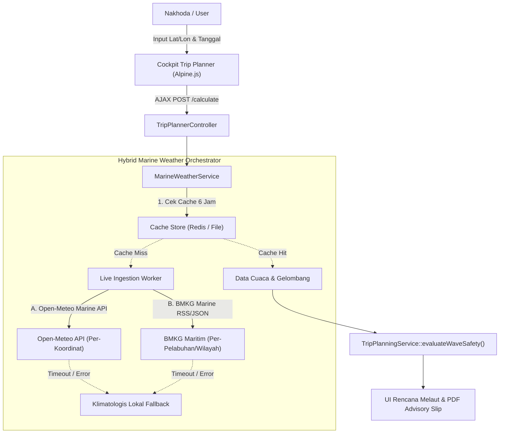

# Desain Arsitektur: Sistem Cuaca & Keselamatan Gelombang Hybrid (BMKG + Open-Meteo Marine)

## 1. Latar Belakang & Tujuan
Saat ini, SEACAST mengevaluasi tinggi gelombang di modul **Trip Planner** dan **DPI Radar** menggunakan simulasi klimatologis musiman lokal (*fallback* statistik berbasis upwelling dan jarak pantai). 

Agar rekomendasi berlayar memiliki akurasi operasional dan legalitas resmi yang kuat, sistem ditingkatkan menggunakan **Pendekatan Hybrid (Dual-Engine Marine Weather)**:
1. **Otoritas Resmi BMKG:** Menyediakan narasi resmi peringatan dini cuaca perairan pelabuhan (Stasiun Meteorologi Maritim BMKG Tanjung Perak untuk Jatim/Prigi & Cilacap untuk Jateng) sebagai rujukan sah penerbitan SPB (Surat Persetujuan Berlayar).
2. **Presisi Titik Tangkap Open-Meteo Marine:** Menyediakan data meteorologi numerik real-time (Tinggi Gelombang Signifikan / SWH, Arah Gelombang, Periode Gelombang, dan Kecepatan Angin) berbasis koordinat spesifik (Latitude/Longitude) di tengah Samudera Hindia (WPPNRI 573).
3. **Resilience & Offline Fallback:** Jika jaringan internet di pelabuhan terganggu atau server BMKG/Open-Meteo mengalami latensi, sistem secara otomatis beralih ke model klimatologis internal tanpa memicu kegagalan sistem (*zero runtime crash*).

---

## 2. Pendekatan yang Dipertimbangkan

| Pendekatan | Kelebihan | Kekurangan | Status |
|---|---|---|---|
| **1. Feed BMKG Maritim Saja** | Resmi institusi negara, teks naratif legal untuk Syahbandar | Cakupan berbasis sub-wilayah perairan besar (resolusi spasial rendah, tidak per-koordinat titik pancing) | Ditolak |
| **2. Marine API Global Saja (Open-Meteo/Copernicus)** | Sangat presisi per-koordinat (lat/lon), parameter numerik lengkap (SWH, periode, arah) | Tidak membawa stempel nama resmi stasiun BMKG dan status hukum peringatan dini lokal | Ditolak |
| **3. Hybrid (BMKG Port Advisory + Open-Meteo Waypoint)** | **Menggabungkan legalitas stasiun BMKG dengan presisi koordinat lepas pantai WPP 573, plus safety fallback lokal** | Membutuhkan layer orkestrasi service di Laravel | **DIPILIH** |

---

## 3. Komponen & Alur Data



---

## 4. Parameter & Struktur Data

### Schema Data Cuaca Terpadu:
```json
{
  "source": "HYBRID_BMKG_OPENMETEO",
  "is_live": true,
  "fetched_at": "2026-11-07T16:50:00+07:00",
  "port_forecast": {
    "station_name": "Stasiun Meteorologi Maritim Tanjung Perak / Cilacap",
    "weather_condition": "Berawan Tebal - Potensi Hujan Ringan",
    "wind_speed_knots": "10 - 20",
    "wind_direction": "Timur - Tenggara",
    "bmkg_warning": "Waspada gelombang sedang di Samudera Hindia Selatan Jawa Timur"
  },
  "offshore_waypoint": {
    "latitude": -8.7500,
    "longitude": 111.7500,
    "wave_height_m": 1.4,
    "wave_direction_deg": 185,
    "wave_period_sec": 8.2,
    "wind_speed_kmh": 22.4,
    "sea_surface_temp_c": 28.6
  },
  "safety_evaluation": {
    "status": "AMAN",
    "is_safe_to_sail": true,
    "badge_color": "emerald",
    "clearance_recommendation": "Kondisi perairan bersahabat, diizinkan berlayar untuk semua kelas tonase."
  }
}
```

---

## 5. Tampilan Antarmuka (Mockup UI & PDF)

### Mockup Kartu Cuaca di Dashboard Trip Planner:
```text
┌────────────────────────────────────────────────────────────────────────┐
│ 🌊 KESELAMATAN GELOMBANG & CUACA MARITIM (HYBRID BMKG + SATELIT)      │
├───────────────────────────────────┬────────────────────────────────────┤
│ Pangkalan: PPN Prigi (BMKG Resmi) │ Titik Sasaran: 08°45'00"S 111°45'E │
│ • Stasiun: Maritim Tanjung Perak  │ • Gelombang Signifikan: 1.4 m     │
│ • Angin: 12-18 knot (Tenggara)    │ • Periode Ombak: 8.2 detik         │
│ • Kondisi: Berawan                │ • Arah Ombak: Dari Selatan (185°)  │
├───────────────────────────────────┴────────────────────────────────────┤
│ STATUS IZIN BERLAYAR: [ AMAN MELAUT ]                                 │
│ Saran: Kondisi perairan tenang di bawah 1.5 m. Aman untuk kapal <10 GT │
│ Sumber: BMKG Maritim WPP 573 & Model ECMWF Marine (Diperbarui 14:00)  │
└────────────────────────────────────────────────────────────────────────┘
```

---

## 6. Ruang Lingkup Pengerjaan (Scope of Work)
1. **Layanan Baru (`App\Services\MarineWeatherService`):**
   - Integrasi HTTP client dengan timeout 3 detik (mencegah blocking request).
   - Driver Open-Meteo Marine API untuk koordinat sasaran.
   - Driver BMKG Maritim untuk narasi stasiun pelabuhan (Prigi & Cilacap).
   - Automatic caching 3-6 jam per wilayah/koordinat.
   - Deterministic Fallback ke formula internal jika koneksi internet terputus.
2. **Penyelarasan `TripPlanningService`:**
   - Menghubungkan input `wave_height_m` dan advisory text ke hasil query `MarineWeatherService`.
3. **Penyelarasan Tampilan UI (`trip-planner.blade.php`) & PDF (`sailing-advisory.blade.php`):**
   - Menampilkan badge sumber data `LIVE BMKG + SATELLITE` atau `OFFLINE KALIBRASI`.
   - Menampilkan kecepatan angin, arah gelombang, dan catatan stasiun meteorologi BMKG.
4. **Pengujian Otomatis (Feature & Unit Tests):**
   - Test respon live API dengan Http::fake().
   - Test toleransi timeout / network failure (graceful fallback).
   - Test konsistensi verifikasi izin berlayar di PDF slip.

