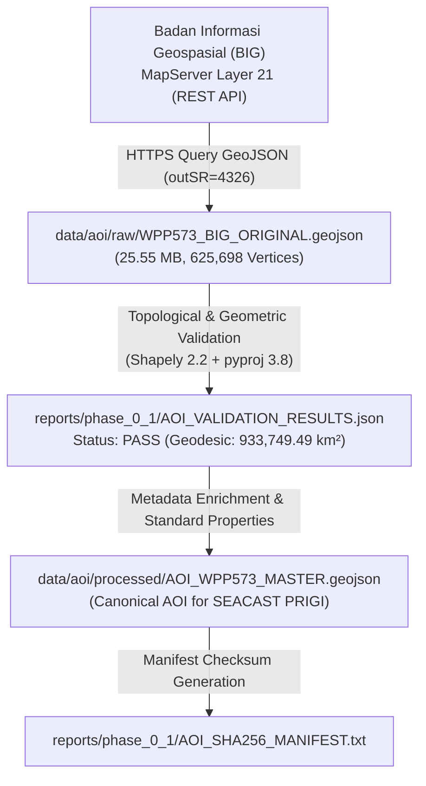

# AOI SOURCE PROVENANCE — OFFICIAL WPPNRI 573
## Sistem Intelijen Geospasial Perikanan Pelagis PPN Prigi — WPPNRI 573

- **Document ID:** `AOI-PROV-01`
- **Target Resource:** Master Wilayah Pengelolaan Perikanan Republik Indonesia (WPPNRI) 573
- **Primary Source:** Badan Informasi Geospasial (BIG) Republik Indonesia
- **Service Type:** ArcGIS REST MapServer Feature Service
- **Service Endpoint:** `https://kspservices.big.go.id/satupeta/rest/services/PUBLIK/SUMBER_DAYA_ALAM_DAN_LINGKUNGAN/MapServer/21`
- **Layer Name:** `Peta Wilayah Pengelolaan Perikanan RI`
- **Layer ID:** `21`
- **Target Query:** `where=namobj='WPP-RI 573'&outFields=*&returnGeometry=true&outSR=4326&f=geojson`
- **Acquisition Timestamp:** `2026-11-02 06:25:30 UTC`

---

## 1. Atribut Asli dari Sumber BIG (Unmodified Raw Attributes)

```json
{
  "objectid": 5,
  "namobj": "WPP-RI 573",
  "perairan": "Meliputi Perairan Samudera Hindia sebelah Selatan Jawa hingga sebelah Selatan  Nusa Tenggara, Laut Sawu dan Laut Timor",
  "ruleid_ksp": 3,
  "fcode": "BC03030120",
  "metadata": "WilayahPengelolaanPerikananRI.xls",
  "kodwpp": null,
  "remark": null,
  "srs_id": null
}
```

---

## 2. Rantai Provenance (Data Lineage)



---

## 3. Checksum SHA-256 Integritas Data

```text
4e2b16197b0d48f350a488ad0a9c076691cf757e78ae855ae117d63d0e53c669  data/aoi/raw/WPP573_BIG_ORIGINAL.geojson
fad138ee3dab333d93ac94a416bccd7b73c308313b328e8f0b4f743cd17e7545  data/aoi/processed/AOI_WPP573_MASTER.geojson
989632c024c4e23f39fe7f5ec275b051fec0532703cfe0c9be27e97cd3a9b473  data/aoi/metadata/AOI_WPP573_METADATA.json
16f74cf2b2e075aefcdb3cf02223a3b24caa0e4c593538c0ae47169225cfd127  reports/phase_0_1/AOI_VALIDATION_RESULTS.json
```
