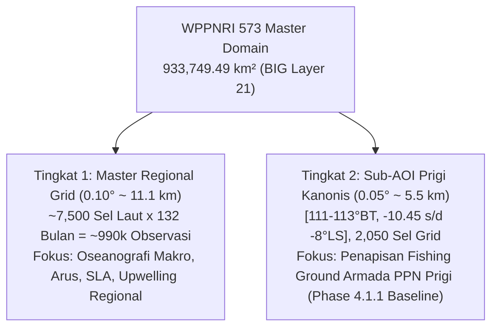

# 05 — SPATIAL ANALYSIS DESIGN & MULTI-SCALE GRID SPECIFICATION
## SEACAST PRIGI — Wilayah Pengelolaan Perikanan Negara Republik Indonesia (WPPNRI) 573

- **Document ID:** `SPAT-DES-05`
- **Target Domain:** WPPNRI 573 Master Polygon (`933,749.49 km²`)
- **Evaluation Authority:** Senior Geospatial Scientist, Physical Oceanographer, GEE Engineer
- **Governance Gate:** Gate C (Spatial & Oceanographic Methodology Approval)

---

## 1. Definisi Domain Spasial Resmi (Spatial Domain)

Pemodelan spasial SEACAST PRIGI merekonstruksi seluruh domain analisis berdasarkan poligon resmi **WPPNRI 573** hasil akuisisi dari MapServer Badan Informasi Geospasial (BIG) `Layer 21`:

* **Nama Lapisan Master:** [`AOI_WPP573_MASTER.geojson`](file:///C:/Users/ThinkPad/.gemini/antigravity/scratch/prigi-pelagis/data/aoi/processed/AOI_WPP573_MASTER.geojson) / `.shp`
* **Tipe Geometri:** `MultiPolygon` (`625,698` simpul vertikal)
* **Luas Geodesik (WGS 84):** **`933,750.90 km²`**
* **Luas Equal-Area (EPSG:6933 EASE-Grid 2.0):** **`933,749.49 km²`**
* **Bounding Envelope Koordinat Geografis:**
  * Bujur Barat: `102.577830° BT`
  * Bujur Timur: `126.499579° BT`
  * Lintang Selatan: `-13.938231° LS`
  * Lintang Utara: `-6.801796° LS`

> [!IMPORTANT]
> **Aturan Masking Ketat:** Seluruh citra raster satelit final (SST, Chl-a, Angin, Arus, SLA, Batimetri) wajib di-mask dan di-clip menggunakan poligon master WPPNRI 573 ini. Penggunaan kotak pembatas (*bounding envelope*) hanya diizinkan untuk efisiensi kueri spasial (*spatial query bounding box*) di Google Earth Engine.

---

## 2. Evaluasi Komparatif Tiga Alternatif Resolusi Grid

Sesuai instruksi Bagian 6.3, dilakukan perbandingan teknis terhadap tiga opsi resolusi grid spasial reguler di seluruh domain WPPNRI 573:

| Kriteria Evaluasi | Opsi 1: Resolusi 0.25° (~27.8 km) | Opsi 2: Resolusi 0.10° (~11.1 km) | Opsi 3: Resolusi 0.05° (~5.5 km) |
| :--- | :--- | :--- | :--- |
| **Dimensi Grid Bounding Box** | `96` kolom × `29` baris (`2,784` sel) | `239` kolom × `71` baris (`16,969` sel) | `478` kolom × `143` baris (`68,354` sel) |
| **Estimasi Sel di Dalam Poligon WPP 573** | **`~1,200` sel** laut | **`~7,500` sel** laut | **`~30,000` sel** laut |
| **Kesesuaian Resolusi Sensor Satelit** | Cocok persis dengan resolusi asli NOAA OISST v2.1 dan Altimetri SLA Copernicus (`0.25°`). | Resolusi kompromi ideal untuk ERA5-Land (`0.1°`) dan HYCOM Velocity (`0.08°`). | Resolusi asli NASA MODIS-Aqua 4km. Sangat detail untuk perairan pesisir. |
| **Beban Komputasi 132 Bulan (2015–2025)** | `~158,400` observasi (`~25 MB`). Ekspor sangat cepat, instan untuk visualisasi. | `~990,000` observasi (`~160 MB`). Stabil, sangat ideal untuk dataframe Colab. | `~3,960,000` observasi (`~650 MB`). Memerlukan chunking spasial/tahunan di GEE. |
| **Akurasi Bentuk Garis Pantai** | Garis pantai tampak bertangga kasar; teluk sempit tidak teresolusi. | Garis pantai dan teluk utama Selatan Jawa terdefinisi dengan baik. | Representasi garis pantai, pulau-pulau kecil, dan teluk sangat presisi. |

---

## 3. Keputusan Arsitektur Grid Bersarang (*Nested Grid Architecture*)

Untuk menggabungkan keunggulan komputasi regional dengan kebutuhan presisi operasional nelayan PPN Prigi, ditetapkan **Arsitektur Grid Bersarang Dua Tingkat**:

1. **Master Regional Grid WPPNRI 573 (`0.10°`, `~11.1 km`):**
   * Grid reguler tingkat makro mencakup seluruh wilayah pengelolaan perikanan 573.
   * Total sel laut: `~7,500` sel.
   * Fungsi: Pemantauan pola monsun, indeks upwelling regional, arus lintas Indonesia (ITF), anomali IOD/ENSO, dan masukan model AI skala perairan terbuka di Google Colab.
2. **Sub-AOI Prigi Kanonis (`0.05°`, `~5.5 km`):**
   * Grid reguler tingkat mikro mencakup wilayah operasional utama kapal nelayan PPN Prigi (`[111.00, 113.00]°BT × [-10.45, -8.00]°LS`).
   * Total sel: `50` baris × `41` kolom = `2,050` sel (`1,750` sel laut sejati, `300` sel daratan bertopografi positif).
   * Fungsi: Melanjutkan dan menyelaraskan habitat screening heuristic baseline Phase 4.1.1 secara langsung dengan armada kapal PPN Prigi (sekitar 443 unit kapal per 2025).

---

## 4. Perlakuan Sel Batas Wilayah (*Boundary Cell Treatment Protocol*)

Setiap sel grid yang beririsan dengan garis pantai atau batas terluar ZEE WPPNRI 573 diperlakukan secara konsisten dengan mencatat atribut topologi berikut:

* `cell_type`:
  * `INTERIOR`: Sel berada 100% di dalam poligon WPPNRI 573 (`aoi_intersection_fraction = 1.0`).
  * `BOUNDARY_CLIPPED`: Sel terpotong oleh batas WPPNRI 573 atau garis pantai (`0.0 < aoi_intersection_fraction < 1.0`).
  * `EXTERIOR`: Sel berada di luar poligon WPPNRI 573 (`aoi_intersection_fraction = 0.0`, dikeluarkan dari analisis).
* `aoi_intersection_fraction`: Fraksi luas sel yang berada di dalam WPP 573 dihitung menggunakan proyeksi equal-area (`EPSG:6933`).
* `is_ocean`: Nilai `1` untuk perairan laut (`depth_m < 0`), nilai `0` untuk daratan (`depth_m >= 0` berdasarkan ETOPO1).
* **Centroid Rule:** Koordinat bujur (`longitude`) dan lintang (`latitude`) yang dicatat pada dataset adalah koordinat titik tengah sel geometris. Jika centroid berada di laut dan fraksi perairan `>= 10%`, sel dipertahankan untuk pemodelan oseanografi dengan bobot luas terhitung.

---

## 5. Sistem Referensi Koordinat (CRS)

1. **Penyimpanan Vektor & Pertukaran Data:** `EPSG:4326` (WGS 84 Geographic 2D).
2. **Perhitungan Luas & Statistik Zonal:** `EPSG:6933` (EASE-Grid 2.0 Global Equal Area) untuk menjamin akurasi metrik luas tanpa distorsi lintang tropis.
3. **Analisis Gradien & Jarak Lokal:** `EPSG:32749` (WGS 84 / UTM Zone 49S) untuk perairan Jawa Timur–Bali–Lombok, dan formula bola metrik geodesik untuk seluruh lintang WPP 573.
