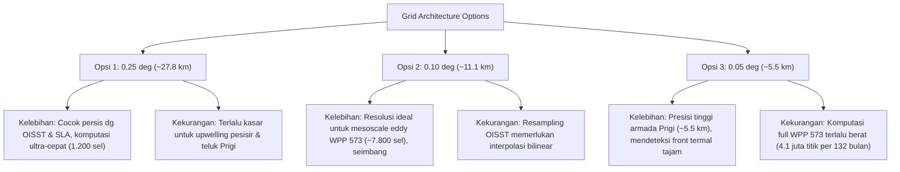

# SCIENTIFIC GRID DESIGN RECOMMENDATION & TRADE-OFF EVALUATION
**Project:** SEACAST PRIGI — WPPNRI 573  
**Phase:** 0.5 — Strategic Grid Design Recommendation  
**Recommended Architecture:** **HYBRID NESTED MULTI-SCALE GRID**  

---

## 1. EVALUASI TRADE-OFF TIGA OPSI GRID

### Analisis Ilmiah Resolusi:
1. **0.25° (Macro Regional):**
   - Sangat efisien untuk analisis klimatologi makro dan sirkulasi Arus Lintas Indonesia (ITF) serta Dipole Mode Samudera Hindia (IOD).
   - Namun, resolusi ini memotong garis pantai Prigi sejauh ~27 km, mengaburkan dinamika perairan teluk dan daerah penangkapan jarak dekat (<12 mil laut).
2. **0.10° (Optimal Regional Mesoscale):**
   - Resolusi kompromi terbaik untuk keseluruhan WPPNRI 573.
   - Mampu menangkap *mesoscale eddies* (diameter 50–150 km) di selatan Jawa dan gradien suhu permukaan laut yang memicu zona agregasi cakalang dan madidihang.
3. **0.05° (Local Precision Fleet Domain):**
   - Sangat esensial untuk memodelkan perikanan operasional PPN Prigi (Sub-AOI: 111°–113° BT, 8°–10.45° LS).
   - Memungkinkan analisis *thermal front* dan *Ekman transport* pada skala yang dapat dimanfaatkan langsung oleh nelayan lokal (one-day fishing vessels dan motor tempel / purse seine).

---

## 2. REKOMENDASI ARSITEKTUR FINAL: "HYBRID NESTED ARCHITECTURE"

Tim auditor independen merekomendasikan **Arsitektur Grid Berjenjang (Hybrid Nested Grid)**:

1. **Level 1 — WPPNRI 573 Regional Macro Grid (0,10° x 0,10°):**
   - Digunakan untuk monitoring makro seluruh WPPNRI 573.
   - Jumlah sel aktif: **8249 sel**.
   - Variabel: SST, SST Anomaly, Wind Stress Curl, Ekman Pumping, Mesoscale Geostrophic Velocity, Chl-a.
2. **Level 2 — PPN Prigi Operational High-Resolution Grid (0,05° x 0,05°):**
   - Digunakan untuk intelijen perikanan lokal armada PPN Prigi (Sub-AOI).
   - Jumlah sel aktif: **1724 sel**.
   - Variabel: Fine-scale Thermal Front Intensity, Coastal Upwelling Index, Bathymetric Slope, Local Habitat Suitability.

Dengan arsitektur *nested* ini, SEACAST PRIGI mencapai akurasi ilmiah tingkat tinggi tanpa membebani komputasi cloud.
