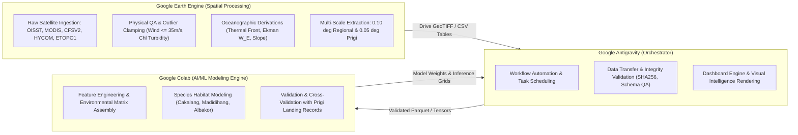

# FINAL SPATIAL ANALYSIS DESIGN & ARCHITECTURE SPECIFICATION
**Project:** SEACAST PRIGI — Sistem Intelijen Geospasial Perikanan Pelagis PPN Prigi  
**Geographic Domain:** Official WPPNRI 573 (102.58°–126.50° BT, 6.80°–13.94° LS)  
**Study Period:** 132 Bulan (Januari 2015 s.d. Desember 2025)  
**Integrated Platforms:** Google Earth Engine (Spatial Engine) | Google Colab (AI/ML Engine) | Google Antigravity (Orchestrator)  
**Version:** 2.0.0-PROD-CANDIDATE  

---

## 1. STRUKTUR ARSITEKTUR TIGA PLATFORM (CROSS-PLATFORM ARCHITECTURE)

---

## 2. PILAR DESAIN SPASIAL UTAMA (CORE DESIGN PILLARS)

### 2.1 AOI Otoritatif & Bounding Box Terverifikasi
- **Sumber:** BIG REST MapServer Layer 21 (`namobj = 'WPP-RI 573'`).
- **Bounding Box Aktual:** `[102.577830° BT, -13.938231° LS, 126.499579° BT, -6.801796° LS]`.
- **Luas Geodesik Resmi:** `933.750,90 km²` (WGS 84 Karney 2013).
- **Luas Planar Equal-Area:** `933.749,49 km²` (EPSG:6933, deviasi -0,00015%).

### 2.2 Arsitektur Grid Berjenjang (Hybrid Nested Grid)
1. **Regional Macro Grid (0,10° x 0,10° | ~11,0 km):**
   - 240 kolom x 72 baris = 17.280 sel bounding box.
   - **8.249 sel aktif** (7.381 sel murni laut + 868 sel batas pantai).
   - Menangkap dinamika sirkulasi mesoskala, pusaran arus (*eddies*), dan divergensi angin regional.
2. **Local Precision Grid PPN Prigi (0,05° x 0,05° | ~5,5 km):**
   - Sub-AOI: `[111.00°–113.00° BT, -10.45°– -8.00° LS]`.
   - 40 kolom x 49 baris = 1.960 sel bounding box.
   - **1.724 sel aktif** (1.663 sel murni laut + 61 sel batas teluk).
   - Menghadirkan presisi operasional untuk armada penangkapan PPN Prigi.

### 2.3 Sumber Data & Protokol Mutu
- **SST:** `NOAA/CDR/OISST/V2_1` (100% lengkap 132 bulan, 4.017 frame).
- **Chl-a:** `NASA/OCEANDATA/MODIS-Aqua/L3SMI` (3.879 frame, bulanan mean, fallback GCOM-C untuk 2021-07 dan 2021-11).
- **Wind:** `NOAA/CFSV2/FOR6H_HARMONIZED` (16.061 frame, wajib clamp $|u, v| \le 35\text{ m/s}$).
- **Currents:** `HYCOM/sea_water_velocity` (18.938 frame, mode ganda: 2015–2024 GEE, 2024–2025 CMEMS/klimatologi).
- **Bathymetry:** `NOAA/NGDC/ETOPO1` (1 frame statis, bedrock negatif terverifikasi).

---

## 3. PROSEDUR EKSEKUSI BERTAHAP (STAGED EXECUTION ROADMAP)

1. **Gate A Approval (AOI Final):** Persetujuan resmi peneliti terhadap geometri dan batas WPPNRI 573.
2. **Gate B Approval (Data Sources Final):** Persetujuan terhadap katalog dataset, protokol filter, dan fallback.
3. **Gate C Approval (Methodology Final):** Persetujuan terhadap formulasi matematis indikator oseanografi.
4. **Tahap Pilot (Gate D):** Eksekusi pilot 12 bulan (Tahun 2020) pada grid 0,10° dan 0,05° untuk verifikasi output sebelum batch penuh 132 bulan.
5. **Tahap Batch Penuh (Gate E):** Eksekusi 132 bulan (2015–2025) di Google Earth Engine dan integrasi ke Google Drive.
