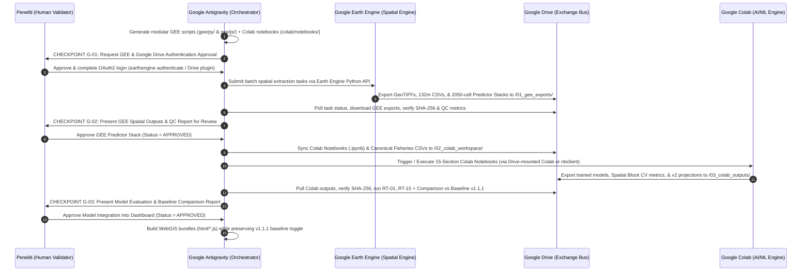

# CROSS-PLATFORM AUTOMATION ARCHITECTURE
## Sistem Intelijen Geospasial Perikanan Pelagis PPN Prigi — WPPNRI 573

- **Document ID:** `STRAT-REASSESS-04`
- **Architecture Paradigm:** **AUTOMATION-FIRST, HUMAN-VALIDATED**
- **Integrated Platforms:**
  1. **Google Antigravity (Local Windows Workspace):** Orchestrator, Code Generator, Validator, Git Manager, & Dashboard Host
  2. **Google Earth Engine (Cloud Spatial Engine):** Satellite Data Acquisition & Geospatial Processing
  3. **Google Drive / Cloud Storage (Data Exchange Bus):** Versioned Artifact & Manifest Repository
  4. **Google Colab (Cloud AI/ML Engine):** Statistical & Machine Learning Training, Spatial Block CV, & Model Export

---

## 1. Diagram Orkestrasi Lintas Platform

---

## 2. Evaluasi Tiga Mekanisme Otomatisasi (`Section 6`)

Sesuai prinsip kejujuran teknis (*never claim unverified API capabilities*), berikut adalah evaluasi terperinci atas tiga mekanisme otomatisasi beserta status ketersediaannya saat ini di workspace:

### A. Mekanisme 1 — API Integration (Rekomendasi Utama untuk GEE & Google Drive)

| Sub-Komponen | Apa yang Dapat Diotomatisasi oleh Antigravity | Persyaratan Autentikasi & Instalasi | Batasan Teknis & Risiko Kegagalan | Kebutuhan Intervensi Pengguna | Tingkat Stabilitas |
| :--- | :--- | :--- | :--- | :--- | :---: |
| **1. Earth Engine Python API (`earthengine-api`)** | - Inisialisasi proyek (`ee.Initialize(project='...')`) - Eksekusi seluruh modul spasial `gee/py/m00..m05` - Pengiriman tugas ekspor (`ee.batch.Export.table.toDrive` / `Export.image.toDrive`) - *Polling* status antrean GEE (`READY`, `RUNNING`, `COMPLETED`, `FAILED`) secara otomatis. | 1. `pip install earthengine-api` 2. Satu kali perintah `earthengine authenticate` oleh pengguna 3. Google Cloud Project ID yang terdaftar untuk Earth Engine non-komersial/penelitian. | - Kuota batas waktu komputasi *on-demand* (`5 menit`), diatasi dengan menggunakan `ee.batch.Export` (asinkron di server GEE). - Memerlukan koneksi internet stabil. | **1 kali di awal Phase 4.2:** Menyetujui instalasi paket dan menyelesaikan login OAuth2 di browser serta memberikan `GCP_PROJECT_ID`. | **SANGAT TINGGI (Metode Paling Stabil untuk GEE)** |
| **2. Google Drive Integration (Marketplace Plugin / Drive API / Google Drive for Desktop)** | - Mengunggah baseline CSV/GeoJSON dan notebook `.ipynb` ke folder Google Drive proyek - Mengunduh hasil ekspor GEE (`/01_gee_exports/`) dan output model Colab (`/03_colab_outputs/`) ke workspace lokal - Memverifikasi ukuran file dan *hash* SHA-256. | **Opsi A (Paling Mudah):** Mengaktifkan plugin resmi **Google Drive (`antigravity-plugins-official/plugin/gdrive`)** atau memasang **Google Drive for Desktop** (sinkronisasi folder lokal `G:\\My Drive\\...`). **Opsi B:** `google-api-python-client` dengan `credentials.json` OAuth2. | - Batas ukuran unggah/unduh API jika menggunakan panggilan tunggal (diatasi dengan *chunked download* atau sinkronisasi folder Drive lokal). | **1 kali di awal Phase 4.2:** Mengaktifkan plugin Google Drive atau memberikan path sinkronisasi Google Drive lokal. | **SANGAT TINGGI** |
| **3. Google Colab Execution via API / Notebook Runner** | - **Fakta Teknis Penting:** Google Colab versi gratis **tidak menyediakan REST API publik tanpa kepala (*headless REST API*)** untuk mengeksekusi notebook dari luar secara langsung tanpa sesi browser aktif. - **Alternatif Terverifikasi:**   (a) Menjalankan notebook `.ipynb` yang sama di dalam Google Colab melalui sesi browser terautentikasi (atau klik *Run All* pada notebook yang telah disinkronkan Antigravity ke Google Drive), **ATAU**   (b) Menjalankan file `.ipynb` secara otomatis menggunakan `nbclient`/`papermill` pada kernel Python yang telah dilengkapi pustaka ML (`scikit-learn`, `scipy`, `statsmodels`, `xgboost`, `shap`) dan `earthengine-api`. | Jika dijalankan di Colab Cloud: Akun Google terautentikasi di browser. Jika dijalankan via `nbclient` lokal/hybrid: Instalasi `scikit-learn scipy statsmodels xgboost shap nbformat nbclient`. | - Sesi Google Colab di browser memiliki batas waktu *idle timeout* (`~90 menit`) dan batas sesi (`~12 jam`). - CAPTCHA / verifikasi keamanan akun Google dapat memblokir *headless browser* murni. | Membuka tautan notebook di Google Colab dan menekan `Run All` (`Ctrl+F9`), atau mengizinkan sesi browser/kernel lokal menjalankan `.ipynb`. | **TINGGI (Dengan Pola Hybrid Sync + One-Click Run All)** |

---

### B. Mekanisme 2 — Browser Automation (Pendukung / Fallback Interaktif)

| Aspek Evaluasi | Penjelasan Teknis Berdasarkan Kondisi Aktual |
| :--- | :--- |
| **Apa yang Dapat Diotomatisasi** | Membuka URL GEE Code Editor (`https://code.earthengine.google.com/`) atau Google Colab (`https://colab.research.google.com/`), memuat skrip/notebook, memantau status sel yang sedang berjalan, dan memeriksa pesan galat visual. |
| **Persyaratan Autentikasi** | Sesi browser harus sudah masuk (*logged in*) ke akun Google peneliti yang memiliki akses GEE dan Google Drive. Antigravity **tidak boleh** menyimpan kata sandi atau melewati 2FA secara paksa. |
| **Batasan Teknis & Risiko Kegagalan** | 1. Google secara aktif melindungi halaman login, GEE Code Editor, dan Google Colab dengan deteksi bot/CAPTCHA dan *Shadow DOM* dinamis. 2. Pada GEE Code Editor, setiap tugas `Export.table.toDrive` tetap memunculkan dialog konfirmasi manual di tab *Tasks* kecuali dijalankan melalui **Earth Engine Python API (`ee.batch.Export`)**. 3. Koneksi WebSocket Colab dapat terputus jika tab browser tidak aktif dalam waktu lama. |
| **Rekomendasi Penggunaan** | **Gunakan Browser Automation hanya sebagai pendamping visual**, bukan sebagai jalur utama pengiriman tugas GEE. Untuk GEE, **Earth Engine Python API (`ee.batch`) jauh lebih stabil** karena tidak memerlukan klik manual pada tombol *Run Task* di UI Code Editor. |

---

### C. Mekanisme 3 — Local Workspace Automation (100% Terverifikasi & Aktif Saat Ini)

| Aspek Evaluasi | Penjelasan Teknis Berdasarkan Kondisi Aktual |
| :--- | :--- |
| **Apa yang Dapat Diotomatisasi** | 1. Pembuatan seluruh skrip GEE (`gee/js/`, `gee/py/`) dan notebook Google Colab (`colab/notebooks/*.ipynb`) secara terprogram. 2. Eksekusi skrip Python dan Node.js melalui terminal PowerShell. 3. Validasi skema JSON/CSV/GeoJSON, topologi poligon (`validate_polygon_geometries.py`), dan checksum SHA-256. 4. Kompilasi bundle WebGIS (`html/oceanographic_data.js`, `html/sdm_data.js`) dan pengujian regresi otomatis (`RT-01`..`RT-15`). |
| **Persyaratan Autentikasi** | Tidak memerlukan autentikasi eksternal (berjalan penuh di dalam workspace lokal `c:\\Users\\ThinkPad\\.gemini\\antigravity\\scratch\\prigi-pelagis`). |
| **Batasan Teknis** | Lingkungan Python `3.14.7` lokal saat ini hanya memasang `numpy`, `pandas`, dan `requests` (belum memasang `earthengine-api` atau `scikit-learn`). |
| **Tingkat Stabilitas** | **100% TERVERIFIKASI & STABIL.** |

---

## 3. Rekomendasi Arsitektur Eksekusi Paling Stabil (Recommended Hybrid Pattern)

Berdasarkan evaluasi di atas, pola integrasi paling andal, bebas rapuh (*non-fragile*), dan dapat diaudit penuh adalah:

1. **Untuk Google Earth Engine (Phase 4.2):**
   - Antigravity menghasilkan skrip ganda: `gee/py/m00..m05.py` (Earth Engine Python API) **dan** `gee/js/00..05.js` (GEE Code Editor).
   - Setelah peneliti menyelesaikan **satu kali autentikasi OAuth2** (`earthengine authenticate` + `GCP_PROJECT_ID`), Antigravity mengeksekusi `gee/py/` secara otomatis melalui terminal lokal, memantau antrean `ee.batch.Task` hingga `COMPLETED`, dan mengunduh hasilnya dari Google Drive.
2. **Untuk Pertukaran Data Google Drive (Phase 4.2 – 4.4):**
   - Menggunakan **Google Drive Plugin (`antigravity-plugins-official/plugin/gdrive`)** dan/atau folder sinkronisasi **Google Drive for Desktop** (`SEACAST_PRIGI_DATA_EXCHANGE/`) dengan verifikasi manifest `SHA-256` otomatis pada setiap titik masuk dan keluar.
3. **Untuk Google Colab AI/ML (Phase 4.3):**
   - Antigravity membangun file notebook standar `.ipynb` secara lengkap (`colab/notebooks/01..03.ipynb`) dan menyinkronkannya ke Google Drive.
   - Notebook dieksekusi di Google Colab (dengan satu klik `Run All` oleh peneliti pada sesi Colab yang terhubung ke Drive, atau melalui eksekusi terotomasi `nbclient`), yang secara otomatis menulis seluruh model, metrik *Spatial Block CV*, prediksi, dan manifest `SHA-256` kembali ke Google Drive untuk ditarik dan divalidasi oleh Antigravity.
