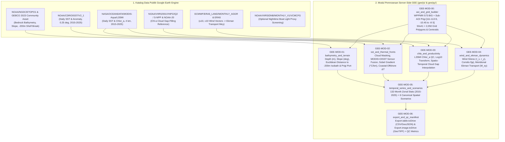

# GOOGLE EARTH ENGINE (GEE) SPATIAL MODELING ARCHITECTURE
## Sistem Intelijen Geospasial Perikanan Pelagis PPN Prigi — WPPNRI 573

- **Document ID:** `STRAT-REASSESS-02`
- **Target Execution Phase:** Phase 4.2 — Google Earth Engine Spatial Modeling
- **Engine Role:** Cloud-Native Satellite Image Acquisition, Spatio-Temporal Compositing, Oceanographic Derivative Calculation, Bathymetric Terrain Analysis, and Predictor Stack Export
- **Dual-Language Support:** Modular GEE JavaScript (for interactive inspection in GEE Code Editor) + Earth Engine Python API (`ee` package, for automated CLI execution from Antigravity)

---

## 1. Arsitektur Alur Kerja Spasial GEE (End-to-End Pipeline)

---

## 2. Evaluasi Ilmiah Katalog Data Satelit & Reanalisis di GEE

Hanya dataset yang benar-benar tersedia di katalog Google Earth Engine dan memiliki dasar ilmiah oseanografi perikanan yang digunakan:

| Parameter Oseanografi | Dataset Utama GEE (`ImageCollection` / `Image` ID) | Resolusi Spasial & Temporal Asli | Dataset Pendukung / Gap-Filling di GEE | Dasar Ilmiah & Catatan Keterbatasan |
| :--- | :--- | :--- | :--- | :--- |
| **Sea Surface Temperature (SST) & Anomali** | `NASA/OCEANDATA/MODIS-Aqua/L3SMI` (band `sst`) & `NOAA/CDR/OISST/V2_1` (band `sst`, `anom`) | MODIS: `4.63 km` harian; OISST: `0.25° (~27.8 km)` harian (`1981–sekarang`) | *Sensor fusion*: Anomali spasial resolusi tinggi MODIS digabungkan dengan dasar bebas-awan OISST v2.1 ketika tutupan awan Musim Barat tinggi. | Standar NOAA/NASA untuk dinamika kolam hangat dan *upwelling* Selatan Jawa. |
| **Chlorophyll-a (`chlor_a`)** | `NASA/OCEANDATA/MODIS-Aqua/L3SMI` (band `chlor_a`) | `4.63 km` harian (`2002–sekarang`) | Komposit median bulanan + jendela berjalan $\pm 1$ bulan terboboti jarak temporal untuk mengatasi *cloud cover* Musim Barat (DJF). | Indikator biomassa fitoplankton permukaan (bukan bukti langsung biomassa ikan). |
| **Thermal Front Intensity (`Sobel`)** | Turunan dari komposit SST (`MODIS-Aqua` / `OISST`) | Diresampling ke grid kanonis `0.05° (~5.55 km)` | Operator konvolusi `ee.Kernel.sobel()` pada sumbu $x$ dan $y$: $\|\nabla \text{SST}\| = \sqrt{(\partial_x T)^2 + (\partial_y T)^2}$ (`°C/km`). | Mengidentifikasi zona konvergensi massa air tempat agregasi mangsa pelagis. |
| **SST Contrast ($\Delta T_{\text{coast-offshore}}$)** | Turunan zonasi pesisir (`<= 25 km` dari pantai) vs lepas pantai (`> 60 km`) | Bulanan (`2015-01` s/d `2025-12`) | $\Delta T = \overline{\text{SST}}_{\text{offshore}} - \overline{\text{SST}}_{\text{coastal}}$. Nilai positif tinggi ($\ge 1.0^\circ\text{C}$) menandakan *upwelling* aktif. | Indikator termal *coastal upwelling* Selatan Jawa (menggantikan istilah ambigu "Bakun CUI"). |
| **Angin Permukaan & Transpor Ekman Meridional ($M_{ey}$)** | `ECMWF/ERA5/MONTHLY` atau `ECMWF/ERA5_LAND/MONTHLY_AGGR` / `NOAA/CFSV2/FOR6H` (komponen `u_component_of_wind_10m`, `v_component_of_wind_10m`) | `0.25°` (`~27.8 km`) bulanan / 6-jam | Tegangan angin $\tau_x = \rho_a C_d u_{10} \sqrt{u_{10}^2 + v_{10}^2}$; Transpor Ekman meridional $M_{ey} = -\frac{\tau_x}{\rho_w f}$, dengan $f = 2\Omega \sin(\phi)$ ($\phi < 0$ di Selatan Jawa). | Nilai $M_{ey} < 0$ (ke arah selatan/lepas pantai) saat Monsun Tenggara memicu divergensi pantai dan *upwelling* Ekman. |
| **Batimetri, Kemiringan Lereng (`Slope`), & Tubir Benua (`-200 m`)** | `NOAA/NGDC/ETOPO1` (band `bedrock`) dan/atau `projects/sat-io/open-datasets/gebco/gebco_2023` | ETOPO1: `1 arc-minute (~1.85 km)`; GEBCO: `15 arc-second (~450 m)` | `ee.Terrain.slope()` dengan koreksi skala meter; `fastDistanceTransform` terhadap kontur kedalaman `-200 m`. | Menentukan batas neritik (`0–200 m`), *shelf-break* (`200–1000 m`), dan palung oseanik (`> 1000 m`). |
| **Tinggi Gelombang Signifikan ($H_s$) — Catatan Kejujuran Katalog** | **Perhatian Teknis:** Band gelombang laut ERA5 (`swh`) tidak selalu tersedia pada koleksi `ERA5_LAND` standar di GEE. | Jika koleksi gelombang tidak tersedia langsung di GEE, digunakan hubungan empiris kecepatan angin 10m ERA5 ($U_{10}$) di GEE **dan/atau** akuisisi langsung Copernicus Marine / ERA5 CDS di Google Colab. | Wajib didokumentasikan secara jujur apakah $H_s$ diekstrak dari band gelombang penuh atau parameterisasi kecepatan angin permukaan ERA5. |

---

## 3. Rancangan Modular Skrip Google Earth Engine (`gee/`)

Seluruh skrip GEE dirancang secara modular di dalam folder workspace `gee/js/` (untuk GEE Code Editor) dan `gee/py/` (untuk eksekusi otomatis melalui Earth Engine Python API):

### Modul 0 — `gee/js/00_aoi_and_grid_builder.js` (`gee/py/m00_aoi_and_grid_builder.py`)
- **Tujuan Pemrosesan:** Membangun geometri kanonis Sub-AOI Prigi (`[111.00, 113.00]° BT × [-10.45, -8.00]° LS`), memotong poligon terklip `50 × 41 = 2.050` sel (`0.05°`), menghitung luas *equal-area* (`ee.Geometry.area()`), serta memuat batas daratan/laut dan poligon resmi WPPNRI 573.
- **Sumber Data:** `USDOS/LSIB_SIMPLE/2017` / `NOAA/NGDC/ETOPO1` (`bedrock < 0` untuk masker laut) + Asset `wppnri_573_big`.
- **Rentang Waktu:** Statis (Geometri referensi).
- **AOI & Parameter:** `WEST = 111.00`, `EAST = 113.00`, `SOUTH = -10.45`, `NORTH = -8.00`, `STEP_DEG = 0.05`, `HARBOR_LON = 111.7314`, `HARBOR_LAT = -8.2818`.
- **Validasi Output:** Jumlah fitur tepat `2.050` sel; `0` sel memiliki koordinat di luar `bbox`; luas total sama dengan `~59.550,43 km²`.
- **Mekanisme Ekspor:** `Export.table.toAsset` & `Export.table.toDrive` (`prigi_canonical_grid_2050_v2.geojson`).

### Modul 1 — `gee/js/01_bathymetry_and_terrain.js` (`gee/py/m01_bathymetry_and_terrain.py`)
- **Tujuan Pemrosesan:** Mengekstrak kedalaman laut (`depth_m`), kemiringan lereng dasar laut (`slope_deg`), jarak ke garis kontur tubir benua `-200 m` (`dist_to_200m_isobath_km`), jarak ke Pelabuhan PPN Prigi (`dist_harbor_nm`), serta mengekstrak kandidat poligon penapisan batimetri hiu (`-1000 m <= depth_m <= -200 m`).
- **Sumber Data:** `NOAA/NGDC/ETOPO1` (`bedrock`) dan/atau `projects/sat-io/open-datasets/gebco/gebco_2023`.
- **Metode Preprocessing:** Reduksi rata-rata (`ee.Reducer.mean()`) per sel poligon `0.05°`; perhitungan gradien topografi dalam proyeksi metrik (`EPSG:32749` UTM Zone 49S); ekstraksi garis kontur `-200 m` dan transformasi jarak Euclidean.
- **Validasi Output:** Pengecekan nilai `depth_m` minimum/maksimum (`-4.500 m` s/d `0 m`), pemeriksaan nilai `null = 0`.
- **Mekanisme Ekspor:** `Export.table.toDrive` (`gee_bathymetry_terrain_2050_v2.csv`) dan `Export.image.toDrive` (`gee_bathymetry_stack_sub_aoi_v2.tif`).

### Modul 2 — `gee/js/02_sst_and_thermal_fronts.js` (`gee/py/m02_sst_and_thermal_fronts.py`)
- **Tujuan Pemrosesan:** Menghasilkan komposit bulanan SST (`2015-01` s/d `2025-12`, `132` bulan), anomali SST (`sst_anom`), kontras suhu pesisir-lepas pantai ($\Delta T_{\text{coast-offshore}}$), dan intensitas front termal Sobel (`thermal_front_sobel_c_km`).
- **Sumber Data:** `NASA/OCEANDATA/MODIS-Aqua/L3SMI` (`sst`) dan `NOAA/CDR/OISST/V2_1` (`sst`, `anom`).
- **Rentang Waktu:** `2015-01-01` s/d `2025-12-31` (`132` bulan).
- **Metode Preprocessing:**
  1. Konversi skala `OISST` (`× 0.01 °C`).
  2. *Cloud-gap fusion*: menggunakan rata-rata bulanan `MODIS-Aqua` pada piksel valid, dan mengisi piksel berawan menggunakan `OISST v2.1` yang telah dikoreksi bias lokalnya pada bulan tersebut.
  3. Penerapan kernel `ee.Kernel.sobel()` pada citra komposit SST yang telah dihaluskan dengan filter Gaussian `3×3` untuk mereduksi derau tepi awan.
- **Validasi Output:** Rentang fisik SST `18.0 °C – 33.0 °C`; proporsi piksel valid (`valid_pixel_fraction`) dicatat untuk setiap bulan (`132` baris QC).
- **Mekanisme Ekspor:** `Export.table.toDrive` (`gee_monthly_sst_fronts_132m_v2.csv`) & `Export.image.toDrive` (GeoTIFF multi-band).

### Modul 3 — `gee/js/03_chla_and_productivity.js` (`gee/py/m03_chla_and_productivity.py`)
- **Tujuan Pemrosesan:** Mengekstrak konsentrasi Klorofil-a permukaan (`chlor_a_mg_m3`) dan transformasi logaritmik (`log10_chla`) untuk `132` bulan dan `6` skenario spasial.
- **Sumber Data:** `NASA/OCEANDATA/MODIS-Aqua/L3SMI` (`chlor_a`).
- **Metode Preprocessing:** Filter nilai ekstrem non-fisik (`0.01 <= chlor_a <= 20.0 mg/m³`); reduksi median bulanan (lebih tahan terhadap *outlier* kilauan matahari/*sunglint* dibanding mean); interpolasi klimatologi bulanan terboboti jika cakupan piksel bebas-awan pada puncak Musim Barat `< 30%`, disertai bendera `qc_gap_filled_flag`.
- **Validasi Output:** Pencatatan `valid_pixel_count`, `valid_pixel_fraction`, dan `gap_fill_percentage` per bulan.
- **Mekanisme Ekspor:** `Export.table.toDrive` (`gee_monthly_chla_132m_v2.csv`).

### Modul 4 — `gee/js/04_wind_and_ekman_dynamics.js` (`gee/py/m04_wind_and_ekman_dynamics.py`)
- **Tujuan Pemrosesan:** Menghitung kecepatan angin permukaan (`wind_speed_10m`), tegangan angin zonal/meridional ($\tau_x, \tau_y$), dan Transpor Ekman Meridional ($M_{ey}$, `m²/s`) sepanjang `132` bulan.
- **Sumber Data:** `ECMWF/ERA5_LAND/MONTHLY_AGGR` / `ECMWF/ERA5/MONTHLY` / `NOAA/CFSV2/FOR6H`.
- **Metode Preprocessing:** Perhitungan $\tau_x = \rho_a C_d u_{10} |U_{10}|$ ($\rho_a = 1.22\text{ kg/m}^3, C_d = 1.3 \times 10^{-3}$) dan $M_{ey} = -\tau_x / (\rho_w f)$ ($\rho_w = 1025\text{ kg/m}^3, f = 2\Omega \sin\phi$).
- **Validasi Output:** Pemeriksaan tanda fisik ($M_{ey} < 0$ pada puncak Monsun Tenggara JJA).
- **Mekanisme Ekspor:** `Export.table.toDrive` (`gee_monthly_wind_ekman_132m_v2.csv`).

### Modul 5 — `gee/js/05_scenario_predictor_stacks.js` (`gee/py/m05_scenario_predictor_stacks.py`)
- **Tujuan Pemrosesan:** Menggabungkan seluruh prediktor statis (Modul 1) dan dinamis (Modul 2–4) pada `2.050` sel Sub-AOI Prigi untuk 6 skenario kanonis:
  1. `east_monsoon_jja` (Klimatologi JJA 2015–2025)
  2. `west_monsoon_djf` (Klimatologi DJF 2015–2025)
  3. `transition_1_mam` (Klimatologi MAM 2015–2025)
  4. `transition_2_son` (Klimatologi SON 2015–2025)
  5. `super_positive_iod_2019` (Komposit Puncak Upwelling Ekstrem Jul–Okt 2019)
  6. `negative_iod_2016` (Komposit Anomali Hangat / La Niña Jul–Okt 2016)
- **Mekanisme Ekspor:**
  - Tabel Fitur ML untuk Google Colab: `gee_predictor_stack_6scenarios_2050cells_v2.csv` (`12.300` baris = `6 × 2.050` sel)
  - Tabel Time-Series Bulanan (`132` bulan): `gee_ocean_monthly_132m_v2.csv`
  - GeoTIFF Multi-Band per skenario: `gee_raster_stack_<scenario>_v2.tif`.

---

## 4. Evaluasi GEE JavaScript Code Editor vs. Earth Engine Python API

| Kriteria | GEE JavaScript (Code Editor) | Earth Engine Python API (`ee` di Antigravity / Colab) | Rekomendasi Arsitektur Hibrida |
| :--- | :--- | :--- | :--- |
| **Visualisasi Interaktif Cepat** | Sangat unggul (`Map.addLayer` instan di browser) | Memerlukan `geemap` / ekspor tile | Gunakan skrip **JavaScript** untuk inspeksi visual cepat oleh peneliti di GEE Code Editor. |
| **Otomatisasi & Orkestrasi Lintas Platform** | Manual (klik tombol *Run* dan *Export* di tab Tasks) | **100% Otomatis** (`ee.batch.Export.table.toDrive(...).start()` dan *polling* status `task.status()`) | Gunakan **Earth Engine Python API** sebagai mesin eksekusi utama yang dipanggil oleh Antigravity atau langsung dari Google Colab! |
| **Reproduksibilitas & Version Control** | Sulit diintegrasikan langsung dengan Git lokal | File `.py` lokal di bawah Git dengan logging JSON dan SHA-256 otomatis | Seluruh logika algoritma disinkronkan antara `gee/py/` (otomatis) dan `gee/js/` (inspeksi). |
