# REVISED PROJECT ROADMAP (CROSS-PLATFORM SCIENTIFIC WORKFLOW)
## Sistem Intelijen Geospasial Perikanan Pelagis PPN Prigi — WPPNRI 573

- **Document ID:** `STRAT-REASSESS-06`
- **Roadmap Architecture:** Sequential Gated Execution (`Phase 4.1.1 → Phase 4.2 → Phase 4.3 → Phase 4.4 → Phase 4.5 → Phase 4.6`)
- **Governance Rule:** Tidak ada phase yang boleh dimulai sebelum Human Validation Gate pada phase pendahulunya berstatus `APPROVED` oleh peneliti.

---

## 1. Peta Jalan Pengembangan Terintegrasi

```mermaid
flowchart LR
    P411["Phase 4.1.1<br/>Independent Validation &<br/>Baseline Freeze (v1.1.1)<br/>[COMPLETED]"] --> G0["Gate G-00<br/>Strategic Reassessment<br/>Approval"]
    G0 --> P42["Phase 4.2<br/>Google Earth Engine<br/>Spatial Modeling (v2.0)"]
    P42 --> G1["Gate G-01<br/>GEE Predictor Stack &<br/>QC Approval"]
    G1 --> P43["Phase 4.3<br/>Google Colab<br/>AI/ML Modeling (v2.0)"]
    P43 --> G2["Gate G-02<br/>Colab Model & Spatial<br/>CV Approval"]
    G2 --> P44["Phase 4.4<br/>Cross-Platform Data &<br/>Artifact Integration"]
    P44 --> G3["Gate G-03<br/>v1.1.1 vs v2.0<br/>Integration Approval"]
    G3 --> P45["Phase 4.5<br/>DOM-DSS Geospatial<br/>Intelligence Dashboard"]
    P45 --> G4["Gate G-04<br/>UI & Scientific Guardrail<br/>Approval"]
    G4 --> P46["Phase 4.6<br/>System Testing & Final<br/>Scientific Evaluation"]
```

---

## 2. Spesifikasi Teknis Setiap Phase (Inputs, Processes, Outputs, Acceptance Criteria)

### Phase 4.1.1 — Independent Validation and Baseline Freeze *(Status: COMPLETED — READY FOR FREEZE APPROVAL)*
- **Input:** Seluruh artefak Phase 1–3 dan Phase 4.1, buku kerja Excel asli PPN Prigi (`Sheets 1–5`), poligon resmi BIG WPPNRI 573.
- **Proses:** Rekonsiliasi `R-01` s/d `R-07`, pengujian regresi otomatis `RT-01` s/d `RT-15`, pembuatan manifest baseline [`backups/phase_4_1_1_baseline_manifest.json`](file:///c:/Users/ThinkPad/.gemini/antigravity/scratch/prigi-pelagis/backups/phase_4_1_1_baseline_manifest.json), serta *Strategic Reassessment* lintas platform.
- **Output:** 10 laporan di `reports/phase_4_1_1/`, `backups/phase_4_1_1_baseline_manifest.json`, dan 8 dokumen arsitektur di `reports/strategic_reassessment/`.
- **Acceptance Criteria:** `15/15 PASS` pada `RT-01`..`RT-15`; `0` konflik bobot, armada, taksonomi, geometri AOI, maupun manifest backup; baseline `v1.1.1` dibekukan (*frozen*) sebagai acuan pembanding.

---

### Phase 4.2 — Google Earth Engine Spatial Modeling *(Status: NOT STARTED — Awaiting Gate G-00 Approval & GEE Auth)*
- **Input:**
  - Poligon resmi [`data/boundaries/wppnri_573_big.geojson`](file:///c:/Users/ThinkPad/.gemini/antigravity/scratch/prigi-pelagis/data/boundaries/wppnri_573_big.geojson) & konfigurasi Sub-AOI Prigi `[111.00, 113.00]° BT × [-10.45, -8.00]° LS` (`2.050` sel).
  - Kredensial OAuth2 Google Earth Engine (`earthengine authenticate`) & `GCP_PROJECT_ID` peneliti.
- **Proses:**
  1. Pengembangan skrip modular `gee/py/m00..m05.py` dan `gee/js/00..05.js`.
  2. Ekstraksi batimetri (`ETOPO1`/`GEBCO`), kemiringan lereng, dan jarak ke kontur `-200 m` di GEE (`Modul 0–1`).
  3. Komposit satelit bulanan (`2015-01` s/d `2025-12`, `132` bulan) untuk SST (`MODIS-Aqua` + `OISST v2.1`), gradien front termal Sobel, kontras suhu $\Delta T$, Klorofil-a (`MODIS-Aqua`), dan Transpor Ekman Meridional $M_{ey}$ (`ERA5`) di GEE (`Modul 2–4`).
  4. Pembentukan 6 skenario spasial (`2.050` sel per skenario) dan ekspor ke Google Drive (`Modul 5`).
- **Output:**
  - `data/gee_v2/monthly_132m/gee_ocean_monthly_prigi_132m_v2_0.csv`
  - `data/gee_v2/seasonal_scenarios/gee_predictor_stack_6scenarios_2050cells_v2_0.csv`
  - `data/gee_v2/raw_rasters/*.tif`
  - `data/gee_v2/gee_export_manifest_v2.json` + Laporan Komparasi Kualitas Data GEE v2.0 vs Baseline Lokal v1.1.1.
- **Acceptance Criteria:**
  - Seluruh tugas GEE berstatus `COMPLETED` dengan ID tugas GEE tercatat di manifest.
  - `132` bulan dan `6 × 2.050 = 12.300` baris sel skenario bebas nilai `NaN` di area laut.
  - Seluruh piksel/poligon berada ketat di dalam `[111.00, 113.00]° BT × [-10.45, -8.00]° LS`.

---

### Phase 4.3 — Google Colab AI/ML Modeling *(Status: NOT STARTED — Awaiting Gate G-01 Approval)*
- **Input:**
  - Dataset prediktor GEE `v2.0` dari Phase 4.2 (`gee_ocean_monthly_prigi_132m_v2_0.csv` & `gee_predictor_stack_6scenarios_2050cells_v2_0.csv`).
  - Data pendaratan & upaya tangkap kanonis PPN Prigi (`master_prigi_all_inclusive.csv`, `prigi_fleet_by_gt_2015_2025.csv`).
- **Proses:**
  1. Penyusunan 3 notebook 15-bagian di `colab/notebooks/` (`01_GEE_Data_Ingestion_and_EDA.ipynb`, `02_Temporal_Fisheries_Catch_and_CPUE_ML.ipynb`, `03_Spatial_RHSI_MaxEnt_RF_GLM_and_BlockCV.ipynb`).
  2. Eksekusi **Track A (Temporal Empiris):** Pelatihan model prediksi tangkapan/CPUE bulanan dengan *Rolling-Origin TimeSeriesSplit* (`2015–2022` train, `2023–2025` test).
  3. Eksekusi **Track B & Track C (Spasial):** Pelatihan kode nyata `MaxEnt/MaxNet`, `Random Forest`, `GLM/GAM`, dan `XGBoost` dengan **5-Fold Spatial Block Cross-Validation**, perhitungan *Permutation Importance* & SHAP, kalibrasi bobot ensemble, dan kuantifikasi ketidakpastian $\sigma_w$.
  4. Deklarasi eksplisit atas sirkularitas pada label proksi vs data independen.
- **Output:**
  - Artefak model terlatih di `models/colab_v2/`
  - Matriks evaluasi *Spatial Block CV* & *Temporal CV* (`colab_sdm_spatial_block_cv_matrix_v2_0.csv`)
  - Proyeksi spasial `outputs/colab_v2/hsi/colab_hsi_projections_all_scenarios_v2_0.json`
  - Manifest reproduksibilitas `colab/colab_execution_manifest_v2.json`.
- **Acceptance Criteria:**
  - Seluruh sel pada ketiga notebook `.ipynb` telah dieksekusi sampai selesai (`execution_count` berurutan, `0` *unhandled exceptions*).
  - `ml_training_executed_in_code = true` dan `spatial_cv_executed_in_code = true` terbukti dari artefak model dan log *5-Fold Spatial Block CV*.
  - Laporan komparasi kuantitatif antara **Baseline Heuristik v1.1.1** dan **Colab Trained Models v2.0** tersedia.

---

### Phase 4.4 — Cross-Platform Integration *(Status: NOT STARTED — Awaiting Gate G-02 Approval)*
- **Input:** Output tervalidasi dari Phase 4.2 (`data/gee_v2/`) dan Phase 4.3 (`models/colab_v2/`, `outputs/colab_v2/`), serta Baseline Phase 4.1.1 (`v1.1.1`).
- **Proses:**
  1. Sinkronisasi dan verifikasi checksum `SHA-256` seluruh artefak dari Google Drive ke workspace lokal Antigravity.
  2. Pembuatan poligon zonasi fungsional & penapisan batimetri hiu `v2.0` (`outputs/colab_v2/zones/*.geojson`) dengan pemotongan geometri ketat terhadap batas Sub-AOI Prigi dan penyematan 8 field CITES (`NEEDS_VERIFICATION`).
  3. Pembuatan skrip komparasi otomatis `v1.1.1` vs `v2.0` (`outputs/colab_v2/comparison_v1_vs_v2.json`).
- **Output:** Kontrak data terpadu (`v1.1.1` + `v2.0`) dan bundle JavaScript yang siap dikonsumsi oleh aplikasi WebGIS dan Streamlit.
- **Acceptance Criteria:** Seluruh tes geometri dan integritas data lulus 100% tanpa merusak satu pun berkas baseline `v1.1.1`.

---

### Phase 4.5 — Geospatial Intelligence Dashboard & DOM-DSS Modules *(Status: NOT STARTED — Awaiting Gate G-03 Approval)*
- **Input:** Kontrak data terintegrasi `v1.1.1` & `v2.0` dari Phase 4.4.
- **Proses:**
  1. Pengembangan empat modul pendukung keputusan akademik DOM-DSS pada [`html/index.html`](file:///c:/Users/ThinkPad/.gemini/antigravity/scratch/prigi-pelagis/html/index.html) (dengan tetap mempertahankan desain UI, tema warna, dan struktur tab yang sudah ada):
     - **Modul A:** *Dynamic Ocean Monitoring* (menampilkan deret waktu dan komposit satelit GEE `v2.0` beserta status kualitas piksel).
     - **Modul B:** *Pelagic Fishing Ground Advisory Screening* (menampilkan $\overline{\text{RHSI}}_w$, $\sigma_w$, dan skor advisory dengan pemilih versi `v1.1.1 Heuristic` vs `v2.0 GEE+Colab ML`).
     - **Modul C:** *Maritime Risk Screening Indicator* (klasifikasi kondisi gelombang $H_s$ dan angin permukaan per kelas GT kapal `<10 GT`, `10–20 GT`, `20–30 GT`, `>30 GT` sebagai informasi pendukung keselamatan akademik, **tanpa** klaim jaminan `"AMAN"` atau larangan melaut otomatis).
     - **Modul D:** *Voluntary Shark Bycatch Bathymetric Screening* (`123` poligon kandidat lereng benua dengan 8 atribut CITES dan panduan mitigasi sukarela).
- **Output:** Aplikasi WebGIS `html/index.html` dan bundle `html/*.js` yang telah diperbarui.
- **Acceptance Criteria:** Bebas galat sintaks JS/HTML, seluruh pagar pembatas ilmiah (*scientific guardrails*) tampil jelas di antarmuka pengguna.

---

### Phase 4.6 — System Testing and Scientific Evaluation *(Status: NOT STARTED — Awaiting Gate G-04 Approval)*
- **Input:** Seluruh pipeline GEE (`gee/`), notebook Colab (`colab/`), dataset (`data/`), model (`models/`), output (`outputs/`), dan dashboard (`html/`).
- **Proses:** Eksekusi rangkaian pengujian regresi menyeluruh (`RT-01`..`RT-25`), audit jejak provenance dari piksel satelit GEE hingga elemen DOM di dashboard, serta penyusunan laporan evaluasi ilmiah akhir.
- **Output:** `FINAL_SYSTEM_AND_SCIENTIFIC_EVALUATION_REPORT.md` & `FINAL_PROJECT_READINESS_GATE.json`.
- **Acceptance Criteria:** `100% PASS` pada seluruh tes regresi; keterlacakan (*traceability*) end-to-end terverifikasi penuh.
